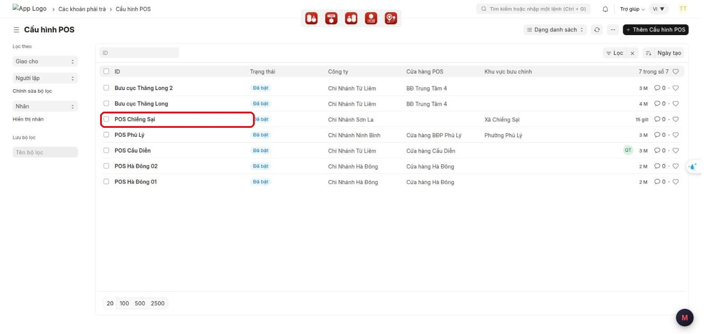
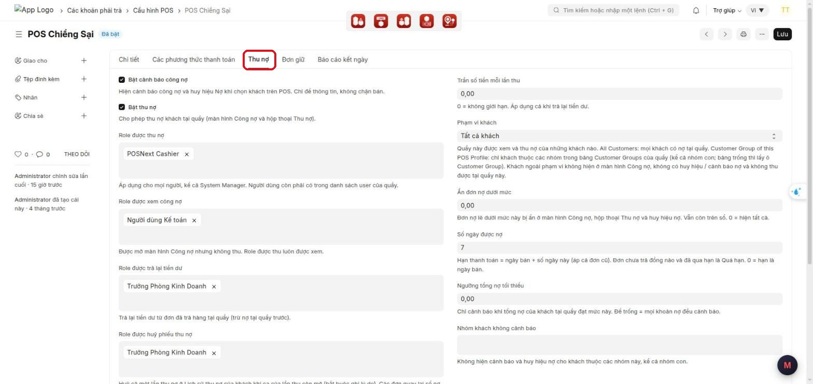
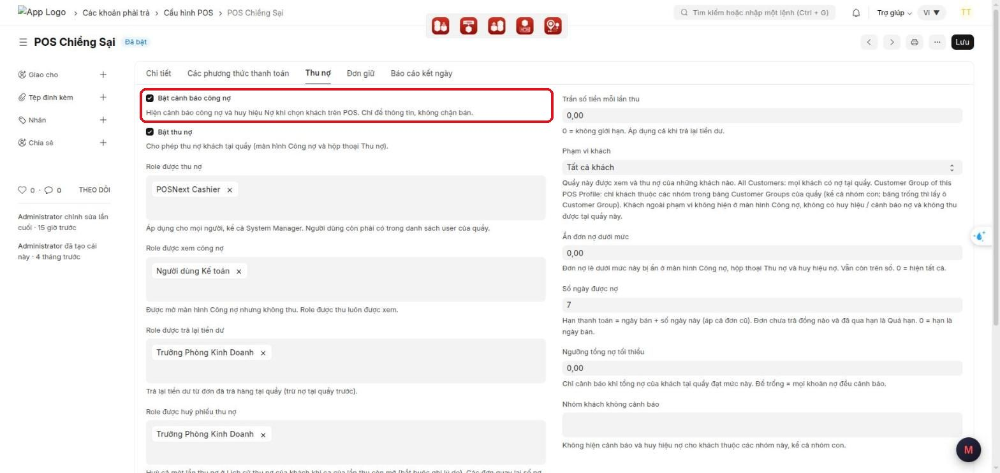
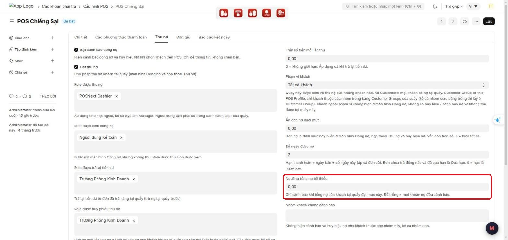
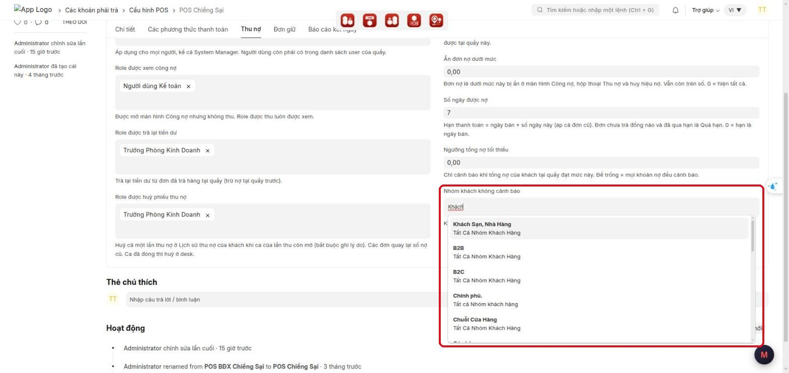
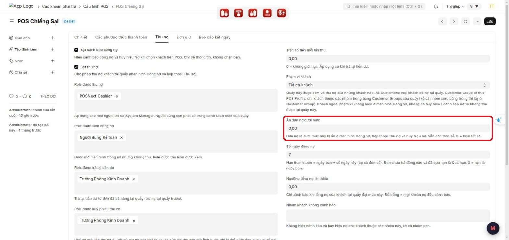
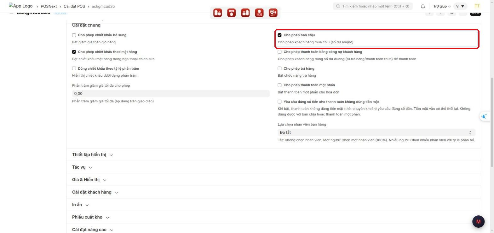
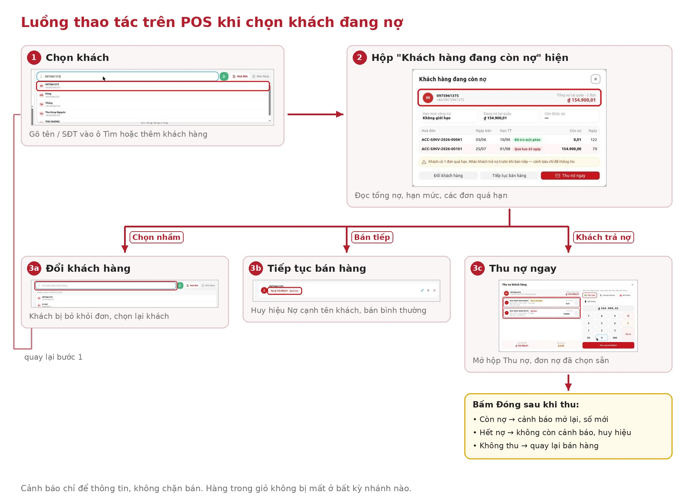
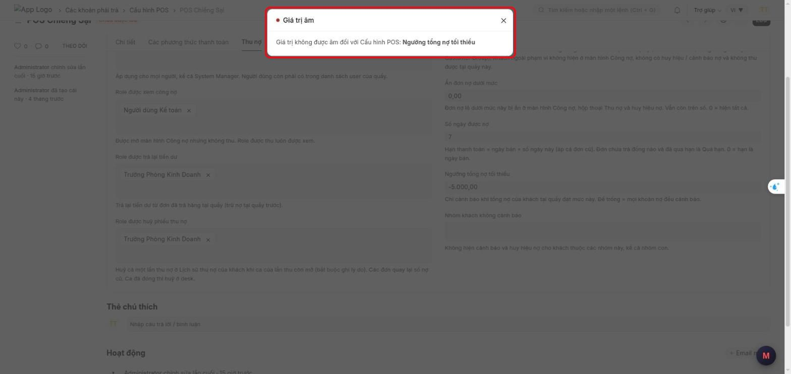

# Hướng dẫn cấu hình: Cảnh báo công nợ khi chọn khách trên POS

> **Phạm vi:** App lõi `pos_next` (POS Next), dùng chung cho mọi khách MBWNext
> **Đối tượng:** Quản trị hệ thống, tư vấn triển khai
> **Cập nhật:** 2026-10-03
> **Mục đích:** Bật cảnh báo công nợ cho từng quầy POS; đặt ngưỡng nợ, nhóm khách không cảnh báo, hạn mức, bán chịu; kiểm lại trước khi giao cho thu ngân.

Cách thu ngân dùng tính năng: xem
[canh-bao-cong-no-khi-chon-khach-van-hanh.md](canh-bao-cong-no-khi-chon-khach-van-hanh.md).
Ảnh chụp trên Desk thật (site pos.next, Cấu hình POS "POS Chiềng Sại"), giao diện tiếng Việt.

---

## Mục lục

1. [Tính năng này dùng để làm gì](#1-tính-năng-này-dùng-để-làm-gì)
2. [Tổng hợp các ô cấu hình](#2-tổng-hợp-các-ô-cấu-hình)
3. [Chuẩn bị trước khi dùng](#3-chuẩn-bị-trước-khi-dùng)
4. [Các bước cấu hình](#4-các-bước-cấu-hình)
5. [Cấu hình mẫu theo kiểu cửa hàng](#5-cấu-hình-mẫu-theo-kiểu-cửa-hàng)
6. [Ai thấy gì](#6-ai-thấy-gì)
7. [Kiểm tra kết quả](#7-kiểm-tra-kết-quả)
8. [Thông báo lỗi thường gặp](#8-thông-báo-lỗi-thường-gặp)
9. [Câu hỏi thường gặp](#9-câu-hỏi-thường-gặp)
10. [Triển khai cho site mới](#10-triển-khai-cho-site-mới)

---

## 1. Tính năng này dùng để làm gì

Khi thu ngân chọn khách lúc bán hàng, POS hiện cảnh báo nếu khách còn nợ **tại quầy đó**. Cảnh báo có
danh sách đơn nợ, hạn thanh toán, hạn mức công nợ, và nút thu nợ ngay. Cảnh báo chỉ để thông tin,
không chặn bán.

Mỗi quầy (mỗi **Cấu hình POS** / POS Profile) cấu hình riêng:

- quầy nào có cảnh báo;
- cảnh báo từ mức nợ nào;
- nhóm khách nào không cảnh báo.

Việc quầy có cho bán chịu hay không nằm ở **Cài đặt POS** của quầy. Cảnh báo chỉ nhắc lại cấu hình đó cho thu ngân.

**Ví dụ tình huống:** Cửa hàng bán lẻ muốn thu ngân biết khách còn nợ. Khách bán buôn ghi nợ thường
xuyên thì không cần nhắc mỗi lần. Quản trị bật cảnh báo cho quầy và thêm nhóm "Khách buôn" vào
**Nhóm khách không cảnh báo**.

---

## 2. Tổng hợp các ô cấu hình

Các ô của chức năng này (đánh dấu ★) nằm trong tab **Thu nợ** của **Cấu hình POS**, cùng các ô của chức
năng Thu nợ. Các ô của chức năng Thu nợ cũng ảnh hưởng tới cảnh báo.

| Ô (tiếng Việt) | Tiếng Anh | Kiểu | Mặc định | Ảnh hưởng tới cảnh báo |
|---|---|---|---|---|
| ★ **Bật cảnh báo công nợ** | Enable Debt Warning | Tick | Tắt | Bật/tắt cảnh báo và huy hiệu Nợ khi chọn khách |
| ★ **Ngưỡng tổng nợ tối thiểu** | Debt Warning Minimum Amount | Số tiền | Trống (= 0) | Chỉ cảnh báo khi **tổng** nợ tại quầy ≥ số này. Không nhận số âm |
| ★ **Nhóm khách không cảnh báo** | Customer Groups Without Debt Warning | Chọn nhiều nhóm | Trống | Khách thuộc nhóm này và các nhóm con: không cảnh báo, không huy hiệu |
| **Bật thu nợ** | Enable Debt Collection | Tick | Tắt | Có nút **Thu nợ ngay** hay không |
| **Role được thu nợ** | Roles Allowed to Collect Debt | Chọn nhiều role | Trống | Người có role này mới thấy nút **Thu nợ ngay** |
| **Phạm vi khách** | Customer Scope | Chọn | All Customers | Khách ngoài phạm vi của quầy không có cảnh báo |
| **Ẩn đơn nợ dưới mức** | Hide Invoices with Debt Below | Số tiền | Trống (= 0) | Đơn còn nợ dưới mức này không tính vào cảnh báo |
| **Số ngày được nợ** | Credit Days | Số ngày | Trống (= 0) | Hạn TT = ngày bán + số ngày này; quyết định đơn nào **Quá hạn** |

Ngoài Cấu hình POS:

| Ô | Ở đâu | Ảnh hưởng |
|---|---|---|
| **Cho phép bán chịu** | Cài đặt POS của quầy | Có ghi nợ đơn mới không; dòng ghi chú trên cảnh báo |
| **Cho phép thanh toán một phần** | Cài đặt POS của quầy | Kết hợp với ô trên (Bước 7) |
| **Hạn mức tín dụng** | Hồ sơ Khách hàng | Khối hạn mức trên cảnh báo |
| Danh sách người dùng | Cấu hình POS, tab **Chi tiết** | Ai được dùng quầy, và xem được cảnh báo |

---

## 3. Chuẩn bị trước khi dùng

- Quyền cần có: được sửa **Cấu hình POS**, **Cài đặt POS** và **Khách hàng** (thường là System Manager hoặc quản trị).
- Đã có sẵn các **Nhóm khách hàng** cần loại trừ (nếu dùng).
- Biết quầy có cho bán chịu không, và cho nợ bao nhiêu ngày. Hỏi kế toán hoặc chủ cửa hàng trước khi cấu hình.

---

## 4. Các bước cấu hình

### Bước 1 — Mở Cấu hình POS của quầy

1. Trên Desk, gõ **Cấu hình POS** vào ô tìm kiếm phía trên, chọn danh sách **Cấu hình POS**
   (đường dẫn hiện ở đầu trang: **Các khoản phải trả > Cấu hình POS**).
2. Bấm vào tên quầy cần cấu hình.

### Bước 2 — Kiểm danh sách người dùng của quầy

1. Ở tab **Chi tiết**, kéo tới bảng người dùng của quầy.
2. Mọi thu ngân bán ở quầy phải có một dòng trong bảng. Thiếu thì bấm **Thêm hàng**, chọn tài khoản.

Người không nằm trong bảng không dùng được quầy và không xem được công nợ của quầy, kể cả
Administrator. Ngược lại, **mọi** người trong bảng đều thấy cảnh báo, không phụ thuộc role xem công nợ.

### Bước 3 — Mở tab "Thu nợ" và bật cảnh báo

1. Bấm tab **Thu nợ**.
2. Tick **Bật cảnh báo công nợ** (ô đầu tiên của tab).

- Tick: thu ngân thấy cảnh báo và huy hiệu **Nợ** khi chọn khách đang nợ. Hai ô ở bước 4 và 5 hiện ra.
- Bỏ tick: không có cảnh báo; hai ô ở bước 4 và 5 bị ẩn. Huy hiệu Nợ vẫn hiện nếu quầy bật thu nợ, và
  bấm vào sẽ mở thẳng hộp thoại Thu nợ.

### Bước 4 — Đặt ngưỡng tổng nợ tối thiểu (tuỳ chọn)

Ô **Ngưỡng tổng nợ tối thiểu** nằm cuối cột phải, dưới **Số ngày được nợ**.

| Giá trị | Kết quả |
|---|---|
| Để trống hoặc 0 | Mọi khoản nợ đều cảnh báo |
| Một số tiền, ví dụ 50.000 | Chỉ cảnh báo khi **tổng nợ tại quầy** của khách **từ** 50.000 trở lên. Bằng đúng 50.000 vẫn cảnh báo |

**Ví dụ:** ngưỡng 50.000. Khách A nợ 3 đơn 20.000 + 20.000 + 15.000 = 55.000 → **có** cảnh báo (so tổng,
không so từng đơn). Khách B nợ 1 đơn 30.000 → không cảnh báo.

### Bước 5 — Chọn nhóm khách không cảnh báo (tuỳ chọn)

1. Bấm vào ô **Nhóm khách không cảnh báo**.
2. Gõ vài chữ tên nhóm, **bấm chọn** nhóm trong danh sách gợi ý. Lặp lại để chọn thêm nhóm.
3. Bỏ một nhóm: bấm dấu × trên nhãn nhóm.

- Khách thuộc các nhóm này **và các nhóm con** của chúng: không cảnh báo, không có huy hiệu Nợ, và
  không bị tải sẵn xuống máy POS.
- Chỉ chọn nhóm trong danh sách gợi ý. Gõ tên nhóm không có thật sẽ bị báo lỗi khi lưu (mục 8).

### Bước 6 — Rà các ô của chức năng Thu nợ có ảnh hưởng

Cùng tab **Thu nợ**, kiểm các ô sau:

| Ô | Nên đặt | Vì sao |
|---|---|---|
| **Số ngày được nợ** | Đúng số ngày cửa hàng cho khách nợ, ví dụ 7 | Quyết định Hạn TT và đơn nào bị **Quá hạn**. Để 0 thì mọi đơn chưa trả đều quá hạn từ ngày hôm sau |
| **Ẩn đơn nợ dưới mức** | 1.000 | Bỏ các đơn chỉ còn lệch vài chục đồng do làm tròn |
| **Bật thu nợ** + **Role được thu nợ** | Bật, chọn role của thu ngân được thu | Có nút **Thu nợ ngay** trên cảnh báo |
| **Phạm vi khách** | All Customers, trừ khi quầy chỉ phục vụ một số nhóm | Khách ngoài phạm vi không có cảnh báo |

> ⚠️ **Nên đặt "Ẩn đơn nợ dưới mức"** khi bật cảnh báo. Hoá đơn POS thường còn lệch vài chục đồng do làm
> tròn. Để 0 thì những khách này cũng bị cảnh báo; ở site thử, 5 trên 8 khách nợ là do làm tròn.
> Đặt 1.000 thì đơn còn nợ dưới 1.000 không vào cảnh báo, huy hiệu và màn hình Công nợ (vẫn còn trên sổ).
>
> 

### Bước 7 — Cho phép bán chịu hay không (trong Cài đặt POS)

1. Mở danh sách **Cài đặt POS**, chọn bản ghi của quầy (cột Cấu hình POS = tên quầy).
2. Ở mục **Cài đặt chung**, tick hoặc bỏ tick **Cho phép bán chịu** và **Cho phép thanh toán một phần**.
3. Bấm **Lưu**.

Hai ô kết hợp như sau:

| Cho phép bán chịu | Cho phép thanh toán một phần | Đơn mới ở quầy | Dòng thêm trên cảnh báo |
|---|---|---|---|
| ✓ | (bất kỳ) | Được ghi nợ toàn bộ hoặc một phần | Không có |
| ✗ | ✓ | Khách phải trả trước ít nhất một phần, phần còn lại ghi nợ | "Quầy này không cho ghi nợ toàn bộ: đơn mới khách phải trả trước ít nhất một phần." |
| ✗ | ✗ | Phải thanh toán đủ | "Quầy này không bán chịu: đơn mới phải thanh toán đủ." |

Quầy chưa có bản ghi Cài đặt POS thì không bị chặn. Cảnh báo công nợ chỉ để thông tin trong mọi trường hợp.

### Bước 8 — Khai hạn mức công nợ cho khách (tuỳ chọn)

Chỉ cần khi muốn cảnh báo hiện hạn mức và báo "vượt hạn mức".

1. Mở hồ sơ **Khách hàng** cần khai.
2. Tìm mục **Các hạn mức tín dụng và điều khoản thanh toán**, bảng **Hạn mức tín dụng**.
3. Bấm **Thêm hàng**: chọn **Công ty** = công ty của quầy, nhập số **Hạn mức tín dụng**.
4. Bấm **Lưu**.

- Hạn mức khai cho công ty khác thì quầy coi như khách **không giới hạn**.
- Cảnh báo so hạn mức với nợ **tại quầy**. Khi lưu hoá đơn, ERPNext vẫn tự kiểm hạn mức theo nợ toàn
  công ty như trước.

### Bước 9 — Lưu và cập nhật trên POS

1. Bấm **Lưu** (hoặc Ctrl+S) trên Cấu hình POS.
2. Trên máy POS đang mở: bấm biểu tượng đồng bộ trên thanh đầu POS, hoặc tải lại trang, để nhận cấu hình mới.

---

## 5. Cấu hình mẫu theo kiểu cửa hàng

| Kiểu cửa hàng | Bật cảnh báo | Ngưỡng | Nhóm không cảnh báo | Ẩn đơn nợ dưới | Số ngày được nợ | Bán chịu / Trả một phần |
|---|---|---|---|---|---|---|
| Bán lẻ, ít khi cho nợ | ✓ | 0 | (trống) | 1.000 | 0–3 | ✗ / ✓ |
| Bán lẻ có khách quen ghi sổ | ✓ | 50.000 | (trống) | 1.000 | 7 | ✓ / ✓ |
| Hỗn hợp lẻ + buôn | ✓ | 0 | Khách buôn | 1.000 | 7 | ✓ / ✓ |
| Chỉ bán thu tiền ngay | Không cần | — | — | — | — | ✗ / ✗ |

Đây là gợi ý. Con số thật hỏi chủ cửa hàng hoặc kế toán.

---

## 6. Ai thấy gì

| Người dùng | Thấy cảnh báo | Có nút **Thu nợ ngay** |
|---|---|---|
| Trong danh sách người dùng của quầy, có role thu nợ | Có | Có (khi có mạng) |
| Trong danh sách người dùng của quầy, không có role thu nợ | Có | Không, có dòng "Bạn chỉ xem được công nợ…" |
| Không có trong danh sách người dùng của quầy (kể cả Administrator) | Không | Không |

Dữ liệu nợ tải sẵn trên máy POS (để cảnh báo khi mất mạng):

- Gồm tên, số điện thoại, số nợ, mã đơn của khách đang nợ tại quầy. Không gồm khách thuộc nhóm loại trừ
  hoặc dưới ngưỡng.
- Tải lúc mở ca, và tự cập nhật lại khi có mạng (tối đa 10 phút một lần).
- Bị xoá khi thu ngân **đóng ca** (xoá dữ liệu của quầy) hoặc **đăng xuất** (xoá hết). Tài khoản khác đăng
  nhập trên cùng máy không dùng được dữ liệu của người trước.

---

## 7. Kiểm tra kết quả

Sau khi cấu hình, làm thử trên POS. Thu ngân sẽ thao tác theo luồng sau (chi tiết trong tài liệu vận hành):

Các bước kiểm:

1. Mở POS ở quầy vừa cấu hình, mở ca.
2. Chọn một khách đang nợ ở quầy (không thuộc nhóm loại trừ, tổng nợ ≥ ngưỡng) → hộp thoại
   **Khách hàng đang còn nợ** bật lên, đúng tổng nợ.
3. Chọn một khách thuộc nhóm vừa loại trừ → không có hộp thoại, không có huy hiệu.
4. Chọn một khách nợ dưới ngưỡng → không có hộp thoại.
5. Đăng nhập tài khoản không có quyền thu nợ → hộp thoại có dòng "Bạn chỉ xem được công nợ…", không có
   nút **Thu nợ ngay**.
6. Nếu đã tắt bán chịu: hộp thoại có dòng "Quầy này không bán chịu…" hoặc "Quầy này không cho ghi nợ toàn bộ…".

**Checklist giao cho thu ngân:**

- [ ] Đã tick **Bật cảnh báo công nợ**
- [ ] Đã đặt **Số ngày được nợ** đúng chính sách cửa hàng
- [ ] Đã đặt **Ẩn đơn nợ dưới mức** (gợi ý 1.000)
- [ ] Đã chọn nhóm khách không cảnh báo (nếu có)
- [ ] Đã kiểm **Cho phép bán chịu / Cho phép thanh toán một phần** trong Cài đặt POS
- [ ] Mọi thu ngân có trong danh sách người dùng của quầy; người được thu có role thu nợ
- [ ] Đã thử đủ 6 bước kiểm tra ở trên

---

## 8. Thông báo lỗi thường gặp

Ví dụ thông báo khi nhập số âm vào ô ngưỡng (cấu hình không được lưu):

| Thông báo | Nguyên nhân | Cách xử lý |
|---|---|---|
| *Giá trị không được âm đối với Cấu hình POS: Ngưỡng tổng nợ tối thiểu* (tiếng Anh: *Value cannot be negative for POS Profile: Debt Warning Minimum Amount*) | Nhập số âm vào ô ngưỡng | Đóng thông báo, nhập 0 hoặc số dương vào **Ngưỡng tổng nợ tối thiểu**, bấm **Lưu** |
| *Không thể tìm thấy Hàng #1: Nhóm khách hàng: …* | Gõ tên nhóm vào **Nhóm khách không cảnh báo** mà không chọn từ danh sách gợi ý, hoặc nhóm không tồn tại | Bấm dấu × trên nhãn nhóm sai, gõ lại và **bấm chọn** nhóm trong danh sách gợi ý, rồi **Lưu** |
| Thu ngân báo không thấy cảnh báo dù khách đang nợ | Quầy chưa tick **Bật cảnh báo công nợ**; khách thuộc nhóm loại trừ; tổng nợ dưới ngưỡng; đơn nợ dưới **Ẩn đơn nợ dưới mức**; khách ngoài **Phạm vi khách**; nợ nằm ở quầy/công ty khác; hoặc POS chưa nhận cấu hình mới | Kiểm lại bước 3–6, bấm **Lưu**; trên POS bấm đồng bộ hoặc tải lại trang |
| Thu ngân báo khách nào cũng có đơn **Quá hạn** | **Số ngày được nợ** đang để 0 | Đặt đúng số ngày cửa hàng cho nợ (bước 6), **Lưu** |
| Thu ngân báo nhiều khách bị cảnh báo vì vài chục đồng | Chưa đặt **Ẩn đơn nợ dưới mức** | Đặt 1.000 (bước 6), **Lưu** |
| Thu ngân không có nút **Thu nợ ngay** | Quầy chưa **Bật thu nợ**, hoặc tài khoản không có role trong **Role được thu nợ** | Bật thu nợ, thêm role cho người được thu, **Lưu** |
| Thu ngân không vào được POS của quầy / không thấy công nợ | Tài khoản không nằm trong danh sách người dùng của Cấu hình POS | Mở tab **Chi tiết** của Cấu hình POS, thêm tài khoản vào danh sách người dùng, **Lưu** |
| *Quầy … không cho bán chịu. Hoá đơn phải thanh toán đủ (còn thiếu …).* (thu ngân gặp lúc thanh toán) | Quầy tắt **Cho phép bán chịu** và **Cho phép thanh toán một phần** | Đúng chính sách thì hướng dẫn thu ngân thu đủ. Muốn cho nợ thì bật lại ở Cài đặt POS (bước 7) |
| *Quầy … không cho bán chịu. Khách phải trả trước ít nhất một phần hoá đơn (còn thiếu …).* | Quầy chỉ bật **Cho phép thanh toán một phần**, khách trả 0 | Như trên |

---

## 9. Câu hỏi thường gặp

**Hỏi:** Ngưỡng tổng nợ khác gì với "Ẩn đơn nợ dưới mức"?
**Đáp:** **Ẩn đơn nợ dưới mức** bỏ từng **đơn** nợ lẻ ra khỏi danh sách (áp cho cả màn hình Công nợ,
Thu nợ và cảnh báo). **Ngưỡng tổng nợ tối thiểu** chỉ quyết định có hiện cảnh báo hay không, dựa trên
**tổng** nợ còn lại của khách.

**Hỏi:** Hạn mức công nợ lấy ở đâu?
**Đáp:** Từ **Hạn mức tín dụng** của khách theo công ty của quầy, so với số nợ **tại quầy**.

**Hỏi:** Chọn nhóm cha thì nhóm con có bị loại trừ không?
**Đáp:** Có. Ví dụ chọn "Individual" thì khách thuộc nhóm con "HAMPER" cũng không có cảnh báo.

**Hỏi:** Thu ngân không có role "xem công nợ" có thấy cảnh báo không?
**Đáp:** Có. Mọi người trong danh sách người dùng của quầy đều thấy cảnh báo; role chỉ quyết định có thu được hay không.

**Hỏi:** Mất mạng thì sao?
**Đáp:** Lúc mở ca (khi có mạng), POS tải sẵn công nợ của các khách đang nợ tại quầy. Mất mạng vẫn
cảnh báo bằng số liệu đó, kèm giờ cập nhật; không thu nợ được cho tới khi có mạng. Xem mục 6.

**Hỏi:** Khách vừa có đơn còn nợ, vừa có tiền dư (trả thừa, trả hàng) thì có cảnh báo không?
**Đáp:** Có. Cảnh báo tính theo từng hoá đơn còn nợ tại quầy, không trừ tiền dư của khách.

**Hỏi:** Quầy đã bị vô hiệu hoá thì sao?
**Đáp:** Quầy đã vô hiệu thì coi như tắt cảnh báo, dù ô **Bật cảnh báo công nợ** còn tick.

**Hỏi:** Quầy có rất nhiều khách nợ thì mở ca có chậm không?
**Đáp:** POS chỉ tải sẵn tối đa 1.000 khách nợ nhiều nhất (đã bỏ nhóm loại trừ và khách dưới ngưỡng).
Khách ngoài danh sách vẫn được cảnh báo bình thường khi có mạng.

---

## 10. Triển khai cho site mới

1. Cập nhật app `pos_next` trên site.
2. Chạy `bench --site <site> migrate` để tạo các ô cấu hình. Chưa migrate thì POS vẫn bán bình thường
   nhưng không có cảnh báo.
3. Build lại giao diện POS (`yarn build` trong `apps/pos_next/POS`) và khởi động lại bench.
4. Trên từng máy POS: xoá Service Worker và dữ liệu trang (DevTools → Application → Clear site data), tải lại `/pos`.
5. Cấu hình từng quầy theo mục 4, kiểm theo mục 7.
