# Hướng dẫn sử dụng: Cảnh báo công nợ khi chọn khách trên POS

> **Phạm vi:** App lõi `pos_next` (POS Next), dùng chung cho mọi khách MBWNext
> **Đối tượng:** Thu ngân, nhân viên bán hàng tại quầy
> **Cập nhật:** 2026-10-03
> **Mục đích:** Biết khách đang nợ bao nhiêu ngay lúc chọn khách, đọc đúng từng con số trên cảnh báo, rồi nhắc khách trả nợ, thu nợ ngay hoặc bán tiếp.

Ảnh trong tài liệu chụp trên POS thật (quầy POS Chiềng Sại), giao diện tiếng Việt.
Việc cấu hình quầy (bật cảnh báo, ngưỡng nợ, nhóm khách không cảnh báo, bán chịu) do quản trị làm, xem
[canh-bao-cong-no-khi-chon-khach-cau-hinh.md](canh-bao-cong-no-khi-chon-khach-cau-hinh.md).

---

## Mục lục

1. [Tính năng này dùng để làm gì](#1-tính-năng-này-dùng-để-làm-gì)
2. [Các từ trên màn hình](#2-các-từ-trên-màn-hình)
3. [Thao tác trên POS — nhìn tổng quan](#3-thao-tác-trên-pos--nhìn-tổng-quan)
4. [Chuẩn bị trước khi dùng](#4-chuẩn-bị-trước-khi-dùng)
5. [Các bước thực hiện](#5-các-bước-thực-hiện)
6. [Tình huống mẫu từ đầu đến cuối](#6-tình-huống-mẫu-từ-đầu-đến-cuối)
7. [Kiểm tra kết quả](#7-kiểm-tra-kết-quả)
8. [Thông báo và tình huống thường gặp](#8-thông-báo-và-tình-huống-thường-gặp)
9. [Câu hỏi thường gặp](#9-câu-hỏi-thường-gặp)
10. [Tóm tắt thao tác nhanh](#10-tóm-tắt-thao-tác-nhanh)

---

## 1. Tính năng này dùng để làm gì

Khi thu ngân chọn khách cho đơn đang bán, nếu khách còn nợ ở quầy thì POS tự hiện hộp thoại
**Khách hàng đang còn nợ**. Hộp thoại cho biết tổng nợ, từng đơn còn nợ, đơn nào quá hạn, khách đã vượt
hạn mức chưa. Thu ngân dựa vào đó để nhắc khách trả nợ, thu nợ ngay, hoặc vẫn bán bình thường.

Cảnh báo **chỉ để thông tin**:

- Không đổi giá, không chặn thanh toán.
- Không làm thay đổi công nợ của đơn đang bán.
- Đơn mới có được ghi nợ hay không là do cấu hình bán chịu của quầy (xem Bước 10).

**Ví dụ tình huống:** Khách 0975961375 ra quầy mua thêm hàng. Thu ngân chọn khách, POS báo khách còn nợ
154.900,01 ở 2 đơn, trong đó 1 đơn đã quá hạn. Thu ngân nhắc khách. Khách đồng ý trả luôn nên thu ngân
bấm **Thu nợ ngay**, thu xong rồi bán tiếp đơn mới.

---

## 2. Các từ trên màn hình

| Từ trên màn hình | Nghĩa |
|---|---|
| **Tổng nợ tại quầy** | Tổng số tiền khách còn nợ ở các hoá đơn bán **tại chính quầy này**, cùng công ty. Nợ ở cửa hàng khác không tính |
| **Hạn TT** (hạn thanh toán) | Ngày khách phải trả xong đơn = ngày bán + **số ngày được nợ** của quầy. Ví dụ quầy cho nợ 7 ngày, đơn bán 25/07 thì Hạn TT là 01/08 |
| **Quá hạn N ngày** | Đơn **chưa trả đồng nào** và hôm nay đã qua Hạn TT N ngày |
| **Đã trả một phần** | Đơn khách đã trả một ít, còn nợ phần còn lại. Đơn này **không** bị tính là quá hạn |
| **Hạn mức công nợ** | Số nợ tối đa quản lý cho phép khách nợ (khai trong hồ sơ khách). Chưa khai thì là **Không giới hạn** |
| **Còn được nợ** | Hạn mức công nợ trừ số đang nợ tại quầy |
| Huy hiệu **Nợ** | Nhãn nhỏ cạnh tên khách trên giỏ hàng, nhắc khách này đang nợ |

---

## 3. Thao tác trên POS — nhìn tổng quan

### Các vùng trên màn hình bán hàng

Màn hình bán hàng sau khi đã chọn một khách đang nợ. Các số trong ảnh ứng với bảng bên dưới.

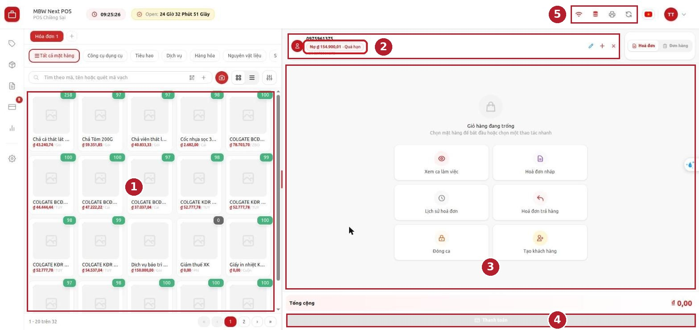

| Số | Vùng | Dùng để làm gì với cảnh báo công nợ |
|---|---|---|
| 1 | **Danh sách hàng** | Chọn hàng thêm vào giỏ. Cảnh báo không ảnh hưởng vùng này |
| 2 | **Ô khách hàng** trên giỏ | Chưa có khách: ô **Tìm hoặc thêm khách hàng...** để chọn khách. Đã có khách: tên khách kèm huy hiệu **Nợ** |
| 3 | **Giỏ hàng** | Hàng của đơn đang bán. Hàng vẫn giữ nguyên khi đổi khách hoặc thu nợ |
| 4 | Nút **Thanh toán** | Thanh toán đơn mới; quầy hạn chế bán chịu thì kiểm số tiền ở bước này |
| 5 | **Biểu tượng mạng và đồng bộ** | Biết đang có mạng hay không; bấm đồng bộ để nhận cấu hình mới |

### Luồng thao tác

Sơ đồ dưới tóm tắt toàn bộ thao tác, từ lúc chọn khách tới khi bán tiếp hoặc thu nợ xong. Chi tiết từng
bước ở mục 5.

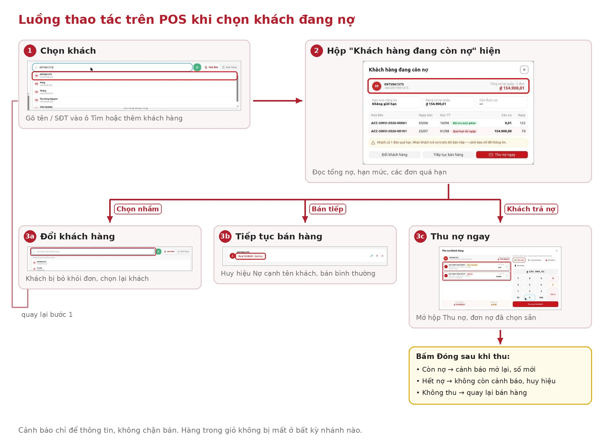

| Bước | Thu ngân làm | POS hiện |
|---|---|---|
| 1 | Gõ tên / SĐT vào ô tìm khách, bấm chọn khách | Hộp **Khách hàng đang còn nợ** (nếu khách nợ) |
| 2 | Đọc tổng nợ, hạn mức, các đơn nợ, dòng ghi chú | — |
| 3a | Bấm **Đổi khách hàng** | Khách bị bỏ khỏi đơn, con trỏ ở ô tìm khách |
| 3b | Bấm **Tiếp tục bán hàng** | Huy hiệu **Nợ** cạnh tên khách |
| 3c | Bấm **Thu nợ ngay** → thu → **Đóng** | Hộp **Thu nợ khách hàng**; sau khi đóng, cảnh báo cập nhật số mới |

---

## 4. Chuẩn bị trước khi dùng

Trước ca bán, kiểm đủ các điểm sau:

- [ ] Đã đăng nhập POS và **mở ca** ở quầy đã được quản trị bật cảnh báo công nợ.
- [ ] Tài khoản nằm trong danh sách người dùng của quầy. Nếu không, POS không cho vào quầy.
- [ ] Muốn thu nợ ngay từ cảnh báo thì tài khoản phải có quyền thu nợ tại quầy. Không có quyền thì chỉ xem được.
- [ ] Mở ca khi **có mạng**: lúc đó POS tải sẵn công nợ của khách, để khi mất mạng vẫn cảnh báo được.

---

## 5. Các bước thực hiện

### Bước 1 — Chọn khách cho đơn đang bán

1. Ở màn hình bán hàng, bấm vào ô **Tìm hoặc thêm khách hàng...** phía trên giỏ hàng.
2. Gõ tên hoặc số điện thoại của khách (gõ vài số cuối cũng được).
3. Bấm vào đúng khách trong danh sách gợi ý hiện ngay dưới ô tìm khách.

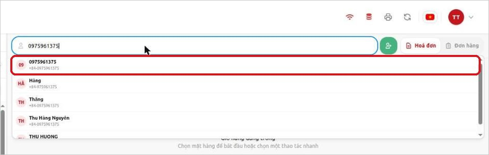

**Kết quả:**

- Khách **đang nợ**: hộp thoại **Khách hàng đang còn nợ** bật lên sau khoảng một giây. Trong lúc chờ,
  thu ngân vẫn thêm hàng vào giỏ bình thường.
- Khách **không** có cảnh báo: POS chọn khách như bình thường, không có hộp thoại.

Những khách sau **không** có cảnh báo:

| Khách | Lý do |
|---|---|
| Khách lẻ mặc định của quầy | Không theo dõi nợ khách lẻ |
| Khách không còn đơn nợ nào ở quầy | Không có gì để báo |
| Khách chỉ nợ ở cửa hàng hoặc công ty khác | Cảnh báo chỉ tính nợ tại quầy đang bán |
| Khách thuộc nhóm quản trị đã loại trừ | Ví dụ khách buôn hay ghi nợ, quản trị không muốn nhắc mỗi lần |
| Tổng nợ nhỏ hơn ngưỡng quầy đặt | Ví dụ quầy chỉ cảnh báo từ 50.000 trở lên |

### Bước 2 — Đọc phần đầu hộp thoại

Phần đầu cho biết **tên khách**, **số điện thoại**, dòng **Tổng nợ tại quầy · N đơn** và số tiền
tổng nợ in to.

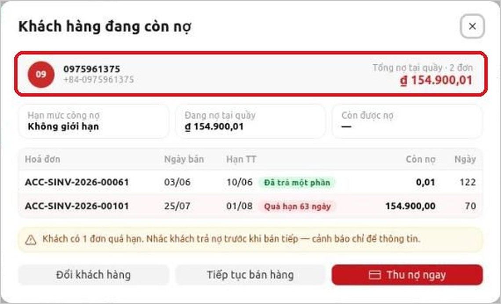

> Kiểm tên và số điện thoại trước tiên. Nếu chọn nhầm khách, bấm **Đổi khách hàng** ngay (Bước 6).

### Bước 3 — Đọc khối hạn mức

| Ô | Ý nghĩa | Ví dụ |
|---|---|---|
| **Hạn mức công nợ** | Hạn mức khai cho khách ở công ty của quầy | 200.000 |
| **Đang nợ tại quầy** | Tổng nợ của khách ở chính quầy này | 154.900 |
| **Còn được nợ** | Hạn mức trừ số đang nợ | 45.100 |

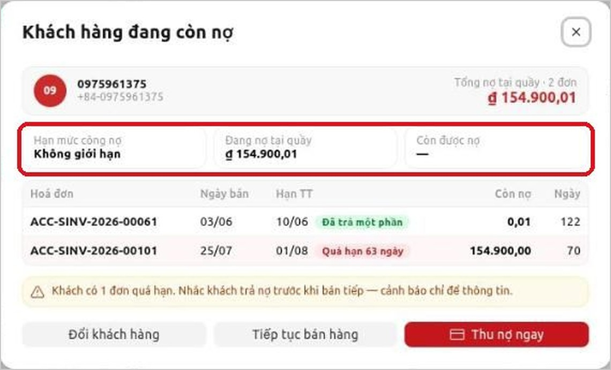

- Khách chưa được khai hạn mức: ô **Hạn mức công nợ** hiện **Không giới hạn**, ô **Còn được nợ** hiện "—".
- Khách nợ **vượt** hạn mức: **Còn được nợ** là 0, thanh tiến độ chuyển đỏ, ghi chú vàng có thêm chữ
  "đã vượt hạn mức". Nợ **bằng đúng** hạn mức thì chưa tính là vượt.

### Bước 4 — Đọc bảng đơn nợ

Bảng liệt kê từng hoá đơn còn nợ, **đơn cũ ở trên, đơn mới ở dưới**.

| Cột | Ý nghĩa |
|---|---|
| **Hoá đơn** | Mã hoá đơn còn nợ, ví dụ ACC-SINV-2026-00101 |
| **Ngày bán** | Ngày lập hoá đơn, dạng ngày/tháng. Đơn của năm khác có thêm năm, ví dụ 05/12/25 |
| **Hạn TT** | Hạn thanh toán của đơn |
| **Còn nợ** | Số tiền khách còn nợ ở đơn này |
| **Ngày** | Số ngày tính từ ngày bán tới hôm nay |

Cách nhận biết từng loại đơn:

- Đơn **quá hạn**: dòng nền đỏ, nhãn đỏ **Quá hạn N ngày**.
- Đơn **đã trả một phần**: nhãn xanh **Đã trả một phần**.
- Đơn còn trong hạn: không có nhãn.

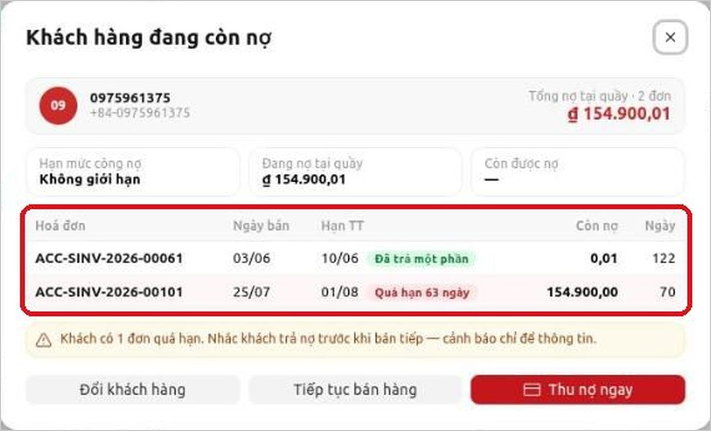

**Ví dụ đọc một dòng:** đơn ACC-SINV-2026-00101, Ngày bán 25/07, Hạn TT 01/08, Còn nợ 154.900, nhãn
**Quá hạn 63 ngày**. Nghĩa là khách mua ngày 25/07, phải trả xong trước 01/08, tới hôm nay (03/10) vẫn
chưa trả đồng nào, đã trễ 63 ngày.

### Bước 5 — Đọc dòng ghi chú

Dưới bảng có thể có các dòng ghi chú sau:

| Dòng ghi chú | Khi nào hiện |
|---|---|
| *Khách có N đơn quá hạn. Nhắc khách trả nợ trước khi bán tiếp — cảnh báo chỉ để thông tin.* | Có đơn quá hạn |
| *Khách đã vượt hạn mức công nợ. Nhắc khách trả nợ trước khi bán tiếp — cảnh báo chỉ để thông tin.* | Vượt hạn mức, không có đơn quá hạn |
| *Khách có N đơn quá hạn và đã vượt hạn mức. Nhắc khách…* | Có cả hai |
| *Quầy này không bán chịu: đơn mới phải thanh toán đủ.* | Quầy không cho ghi nợ đơn mới |
| *Quầy này không cho ghi nợ toàn bộ: đơn mới khách phải trả trước ít nhất một phần.* | Quầy chỉ cho ghi nợ một phần |
| *Bạn chỉ xem được công nợ. Thu nợ cần quyền thu nợ tại quầy này — nhờ quản lý hoặc thu ngân được cấp quyền.* | Tài khoản không có quyền thu nợ |

Gặp hai dòng "Quầy này không…", hãy báo trước cho khách là đơn mới phải trả đủ, hoặc phải trả trước
một phần.

### Bước 6 — Chọn một trong ba nút

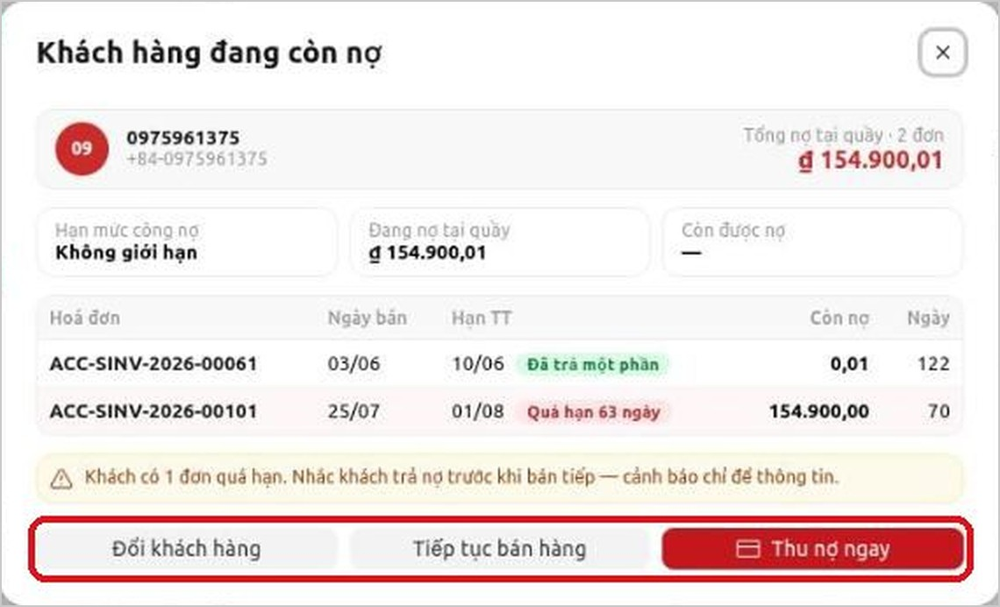

| Nút | Khi nào bấm | Kết quả |
|---|---|---|
| **Đổi khách hàng** | Chọn nhầm khách | Hộp thoại đóng, khách bị bỏ khỏi đơn, con trỏ nằm sẵn trong ô tìm khách |
| **Tiếp tục bán hàng** | Vẫn bán cho khách này | Hộp thoại đóng, khách giữ trên đơn, bán bình thường |
| **Thu nợ ngay** | Khách muốn trả nợ luôn | Mở hộp thoại **Thu nợ khách hàng** (Bước 8) |

Hàng hoá đã có trong giỏ **không bị mất** khi bấm bất kỳ nút nào.

Sau khi bấm **Đổi khách hàng**, ô tìm khách trống, sẵn sàng để gõ khách khác:

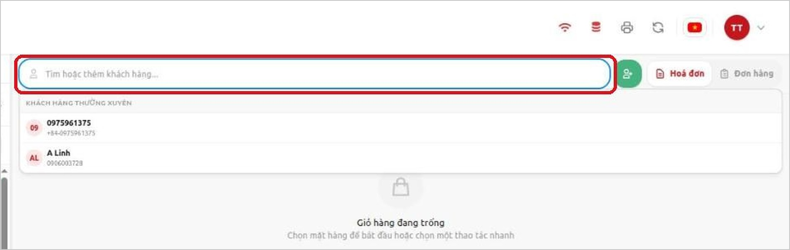

### Bước 7 — Xem lại công nợ bằng huy hiệu "Nợ"

Sau khi bấm **Tiếp tục bán hàng**, cạnh tên khách trên giỏ hàng có huy hiệu **Nợ <số tiền>**.

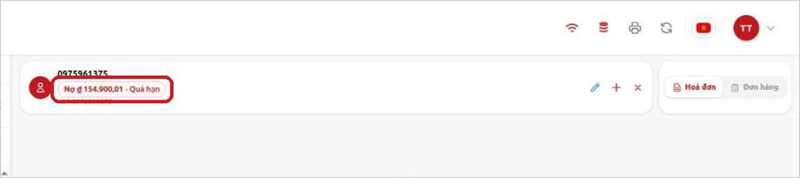

| Màu huy hiệu | Ý nghĩa |
|---|---|
| Đỏ, có chữ **Quá hạn** | Khách có đơn quá hạn hoặc đã vượt hạn mức |
| Vàng | Khách có nợ, chưa có đơn quá hạn |
| Xám, kèm giờ | Đang mất mạng, số liệu lấy từ lần cập nhật gần nhất |

1. Bấm vào huy hiệu để mở lại hộp thoại công nợ. Nên làm việc này trước khi thanh toán để nhắc khách lần nữa.
2. Huy hiệu tự mất khi khách hết nợ hoặc khi bỏ khách khỏi đơn.

### Bước 8 — Thu nợ ngay từ cảnh báo

1. Trong hộp thoại cảnh báo, bấm **Thu nợ ngay**.
2. Hộp thoại **Thu nợ khách hàng** mở ra, mọi đơn nợ của khách đã được tick sẵn, số tiền thu bằng tổng nợ.
3. Muốn thu một phần: bỏ tick các đơn không thu, hoặc sửa số tiền.
4. Chọn hình thức thanh toán (tiền mặt, chuyển khoản…), bấm nút **Thu nợ …**.
5. Xem màn kết quả "Đã thu …", rồi bấm **Đóng**.

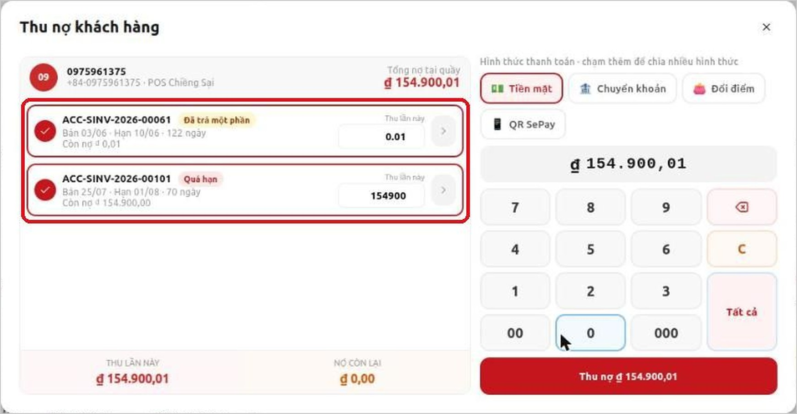

**Kết quả sau khi bấm Đóng:**

| Trường hợp | POS làm gì |
|---|---|
| Khách **còn nợ** (thu một phần) | Cảnh báo mở lại với danh sách và tổng nợ mới; huy hiệu cập nhật số mới |
| Khách **hết nợ** (thu hết) | Cảnh báo không hiện nữa, huy hiệu Nợ biến mất |
| Đóng hộp thoại Thu nợ **mà không thu** | Quay lại bán hàng, cảnh báo không tự mở lại |

Chi tiết cách thu nợ (hình thức thanh toán, in phiếu thu, huỷ lần thu) xem hướng dẫn của chức năng **Thu nợ**.

Tài khoản chỉ có quyền xem thì **không** có nút **Thu nợ ngay**. Hộp thoại có dòng xám
**Bạn chỉ xem được công nợ…** và chỉ còn hai nút **Đổi khách hàng**, **Tiếp tục bán hàng**.

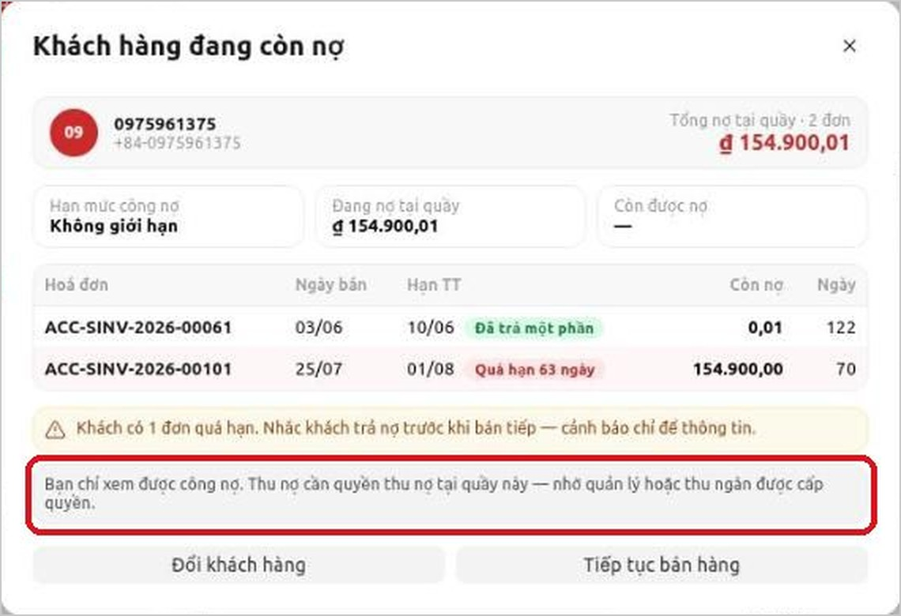

### Bước 9 — Khi mất mạng

Khi mất mạng, POS vẫn cảnh báo bằng công nợ đã tải lúc mở ca hoặc lần có mạng gần nhất. Hộp thoại có
dải xám **Đang mất mạng · Công nợ cập nhật lúc HH:mm dd/MM — có thể đã thay đổi**.

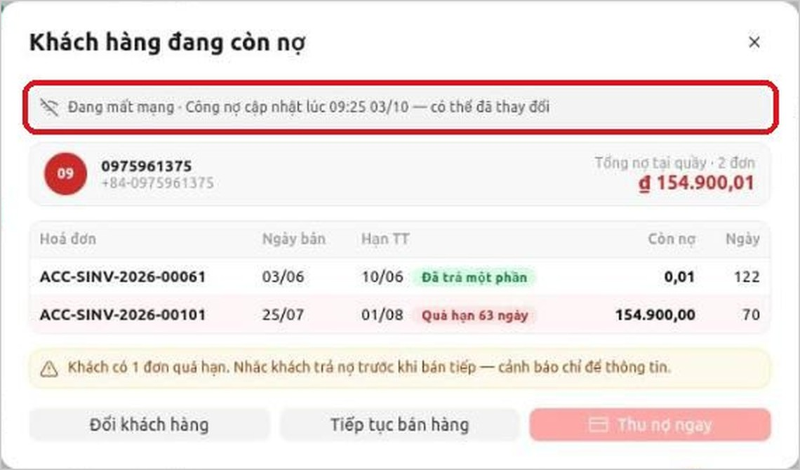

- Không hiện khối hạn mức, vì hạn mức có thể đã đổi.
- Nút **Thu nợ ngay** bị mờ. Rê chuột vào nút hiện *Cần kết nối mạng để thu nợ*.
- Khách chưa có trong dữ liệu tải sẵn thì không có cảnh báo, POS vẫn bán bình thường.
- Có mạng lại, POS tự cập nhật công nợ.

### Bước 10 — Thanh toán đơn mới khi quầy hạn chế bán chịu

Cảnh báo không chặn bán. Nhưng lúc **thanh toán**, POS kiểm cấu hình bán chịu của quầy:

| Cấu hình quầy | Khi thanh toán |
|---|---|
| Cho bán chịu | Khách trả bao nhiêu cũng được, phần thiếu ghi nợ |
| Chỉ cho trả một phần | Khách phải trả **ít nhất một phần**. Trả 0 đồng thì không hoàn tất được đơn |
| Không cho bán chịu | Khách phải trả **đủ** tiền đơn |

Nếu thu thiếu, POS báo một trong hai thông báo sau. Nhập thêm tiền cho đủ rồi bấm thanh toán lại:

- *Quầy <tên quầy> không cho bán chịu. Hoá đơn phải thanh toán đủ (còn thiếu <số tiền>).*
- *Quầy <tên quầy> không cho bán chịu. Khách phải trả trước ít nhất một phần hoá đơn (còn thiếu <số tiền>).*

---

## 6. Tình huống mẫu từ đầu đến cuối

### Tình huống A — Khách nợ quá hạn, đồng ý trả hết rồi mua tiếp

1. Chọn khách → cảnh báo hiện, có đơn **Quá hạn**.
2. Nhắc khách: "Anh/chị còn nợ 154.900 từ đơn ngày 25/07, đã quá hạn."
3. Khách đồng ý trả. Bấm **Thu nợ ngay** → giữ nguyên các đơn đã tick → chọn **Tiền mặt** → bấm **Thu nợ …**.
4. Bấm **Đóng** ở màn kết quả. Cảnh báo không hiện lại, huy hiệu Nợ biến mất.
5. Thêm hàng, thanh toán đơn mới như bình thường.

### Tình huống B — Khách chỉ trả một phần nợ cũ

1. Chọn khách → bấm **Thu nợ ngay**.
2. Sửa số tiền thu thành số khách đưa, ví dụ 100.000 → bấm **Thu nợ …** → **Đóng**.
3. Cảnh báo mở lại với tổng nợ mới (54.900). Bấm **Tiếp tục bán hàng** để bán tiếp.

### Tình huống C — Khách chưa trả nợ, vẫn mua

1. Chọn khách → cảnh báo hiện → nhắc khách.
2. Khách hẹn hôm khác trả. Bấm **Tiếp tục bán hàng**.
3. Bán bình thường. Nếu cảnh báo có dòng "Quầy này không bán chịu…", thu đủ tiền đơn mới.

### Tình huống D — Chọn nhầm khách trùng tên

1. Phần đầu cảnh báo hiện số điện thoại không khớp với khách đang đứng trước quầy.
2. Bấm **Đổi khách hàng** → gõ lại số điện thoại đúng → chọn đúng khách.

### Tình huống E — Thu ngân không có quyền thu nợ

1. Chọn khách → cảnh báo hiện, có dòng "Bạn chỉ xem được công nợ…", không có nút **Thu nợ ngay**.
2. Khách muốn trả nợ: bấm **Tiếp tục bán hàng**, nhờ quản lý hoặc thu ngân có quyền thu nợ cho khách.

### Tình huống F — Đang mất mạng

1. Chọn khách → cảnh báo hiện với dải xám "Đang mất mạng…".
2. Nhắc khách theo số liệu, lưu ý giờ cập nhật. Không thu nợ được lúc này.
3. Có mạng lại: bấm huy hiệu **Nợ** → **Thu nợ ngay** nếu khách vẫn muốn trả.

---

## 7. Kiểm tra kết quả

| Việc vừa làm | Thấy gì là đúng |
|---|---|
| Chọn khách đang nợ | Hộp thoại **Khách hàng đang còn nợ** hiện đúng tổng nợ và số đơn |
| Bấm **Tiếp tục bán hàng** | Huy hiệu **Nợ …** xuất hiện cạnh tên khách trên giỏ |
| Thu một phần, bấm **Đóng** | Cảnh báo mở lại, tổng nợ đã giảm đúng số vừa thu |
| Thu hết, bấm **Đóng** | Không còn cảnh báo, không còn huy hiệu |
| Bấm **Đổi khách hàng** | Khách bị bỏ khỏi đơn, hàng trong giỏ vẫn còn |

---

## 8. Thông báo và tình huống thường gặp

| Thông báo / hiện tượng | Nguyên nhân | Cách xử lý |
|---|---|---|
| *Bạn chỉ xem được công nợ. Thu nợ cần quyền thu nợ tại quầy này — nhờ quản lý hoặc thu ngân được cấp quyền.* (không có nút **Thu nợ ngay**) | Tài khoản không có quyền thu nợ ở quầy | Bấm **Tiếp tục bán hàng**, nhờ quản lý hoặc thu ngân có quyền thu nợ cho khách |
| Nút **Thu nợ ngay** bị mờ, rê chuột hiện *Cần kết nối mạng để thu nợ* | Đang mất mạng | Bấm **Tiếp tục bán hàng**. Có mạng lại thì bấm huy hiệu **Nợ** rồi **Thu nợ ngay** |
| *Đang mất mạng · Công nợ cập nhật lúc … — có thể đã thay đổi* | Đang mất mạng, số liệu lấy từ lần tải gần nhất | Đọc số liệu kèm giờ cập nhật. Không cần xử lý |
| *Quầy này không bán chịu: đơn mới phải thanh toán đủ.* | Quầy không cho ghi nợ đơn mới | Bán tiếp, báo khách phải trả đủ tiền đơn mới |
| *Quầy này không cho ghi nợ toàn bộ: đơn mới khách phải trả trước ít nhất một phần.* | Quầy chỉ cho ghi nợ một phần | Bán tiếp, khách phải trả trước một phần |
| *Quầy … không cho bán chịu. Hoá đơn phải thanh toán đủ (còn thiếu …).* (lúc thanh toán) | Thu thiếu tiền ở quầy không cho bán chịu | Nhập đủ số tiền còn thiếu, bấm thanh toán lại |
| *Quầy … không cho bán chịu. Khách phải trả trước ít nhất một phần hoá đơn (còn thiếu …).* (lúc thanh toán) | Khách trả 0 đồng ở quầy chỉ cho ghi nợ một phần | Thu trước ít nhất một phần, bấm thanh toán lại |
| Khách đang nợ nhưng **không** có cảnh báo | Quầy tắt cảnh báo, khách thuộc nhóm không cảnh báo, tổng nợ dưới ngưỡng, hoặc khách chỉ nợ ở quầy/công ty khác | Không cần xử lý. Cần xem công nợ thì vào màn hình **Công nợ** (nếu có quyền) |
| Mở lại đơn nháp có khách đang nợ: chỉ thấy huy hiệu, không bật hộp thoại | Hộp thoại chỉ tự bật khi thu ngân chủ động chọn khách | Bấm huy hiệu **Nợ** để xem |
| Khách bị cảnh báo vì nợ vài chục đồng | Phần lệch do làm tròn ở hoá đơn cũ | Báo quản trị đặt **Ẩn đơn nợ dưới mức** cho quầy |
| Số nợ trên cảnh báo khác số khách nhớ | Có lần thu ở quầy khác, hoặc đang mất mạng nên số liệu cũ | Kiểm dải "Đang mất mạng". Có mạng mà vẫn lệch thì báo kế toán kiểm sổ |

---

## 9. Câu hỏi thường gặp

**Hỏi:** Cảnh báo có chặn không cho bán cho khách đang nợ không?
**Đáp:** Không. Cảnh báo chỉ để thông tin. Đơn mới được ghi nợ bao nhiêu do cấu hình bán chịu của quầy quyết định (mục 5, Bước 10).

**Hỏi:** Vì sao đơn đã trả một phần không bị tính là quá hạn?
**Đáp:** Quá hạn chỉ tính cho đơn **chưa trả đồng nào** mà đã qua hạn thanh toán.

**Hỏi:** Tổng nợ trên cảnh báo có gồm nợ ở cửa hàng khác không?
**Đáp:** Không. Chỉ tính các hoá đơn bán tại chính quầy đang bán, cùng công ty.

**Hỏi:** Khách có tiền dư (trả thừa, trả hàng) mà vẫn bị cảnh báo?
**Đáp:** Đúng. Cảnh báo tính theo từng hoá đơn còn nợ, không trừ tiền dư. Muốn cấn trừ thì dùng chức năng Thu nợ hoặc nhờ kế toán.

**Hỏi:** Có những khoản nợ rất nhỏ (vài chục đồng) cũng bị cảnh báo?
**Đáp:** Đó thường là phần lệch do làm tròn. Nhờ quản trị đặt **Ẩn đơn nợ dưới mức** cho quầy.

**Hỏi:** Đổi sang khách khác thì sao?
**Đáp:** Cảnh báo của khách cũ đóng, cảnh báo của khách mới (nếu có nợ) hiện theo khách mới.

**Hỏi:** Máy dùng chung cho nhiều thu ngân thì người sau có thấy dữ liệu nợ của người trước không?
**Đáp:** Không. Dữ liệu nợ tải sẵn trên máy bị xoá khi **đóng ca** hoặc **đăng xuất**, và mỗi tài khoản chỉ dùng dữ liệu của chính mình.

**Hỏi:** Quên chưa xem cảnh báo, bấm Tiếp tục bán hàng rồi thì xem lại ở đâu?
**Đáp:** Bấm huy hiệu **Nợ** cạnh tên khách trên giỏ hàng.

---

## 10. Tóm tắt thao tác nhanh

| Muốn | Làm |
|---|---|
| Xem khách nợ bao nhiêu | Chọn khách, đọc hộp thoại; hoặc bấm huy hiệu **Nợ** |
| Bán tiếp | **Tiếp tục bán hàng** |
| Chọn lại khách | **Đổi khách hàng** |
| Thu nợ luôn | **Thu nợ ngay** → thu → **Đóng** |
| Biết đơn nào quá hạn | Dòng nền đỏ, nhãn **Quá hạn N ngày** |
| Biết số liệu có cũ không | Dải xám **Đang mất mạng · Công nợ cập nhật lúc …** |
