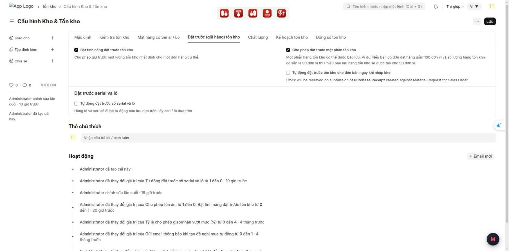
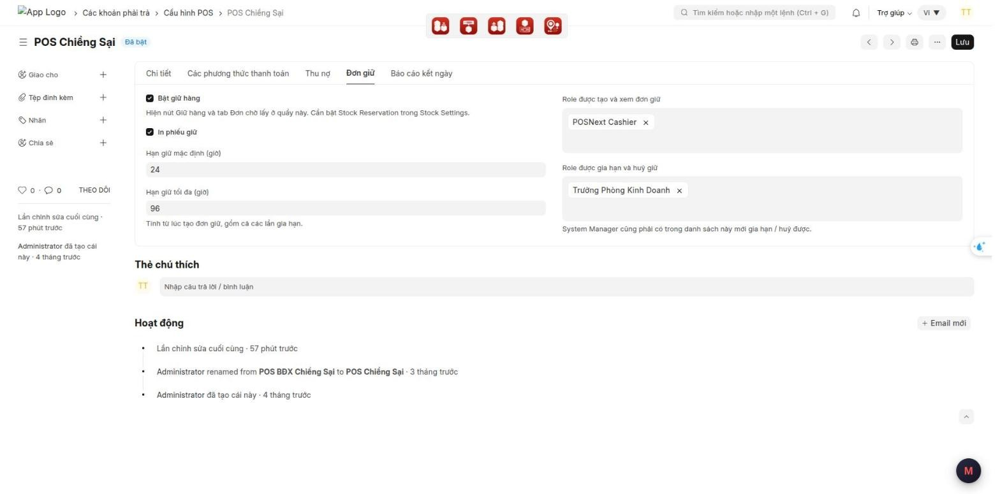

# Hướng dẫn cấu hình: Giữ hàng cho khách đến nhận

> **Phạm vi:** App lõi `pos_next` (POS Next), dùng chung cho mọi khách MBWNext  
> **Đối tượng:** Quản trị hệ thống, tư vấn triển khai  
> **Cập nhật:** 2026-10-03  
> **Mục đích:** Bật giữ hàng cho từng quầy POS, đặt hạn giữ, phân quyền tạo / gia hạn / huỷ, và kiểm lại trước khi giao cho thu ngân.

Cách thu ngân dùng tính năng: xem
[giu-hang-cho-khach-den-nhan-van-hanh.md](giu-hang-cho-khach-den-nhan-van-hanh.md).
Ảnh chụp trên Desk thật (site pos.next), giao diện tiếng Việt.

---

## Mục lục

1. [Tính năng này dùng để làm gì](#1-tính-năng-này-dùng-để-làm-gì)
2. [Chuẩn bị trước khi dùng](#2-chuẩn-bị-trước-khi-dùng)
3. [Các bước cấu hình](#3-các-bước-cấu-hình)
4. [Ai thấy gì](#4-ai-thấy-gì)
5. [Kiểm tra kết quả](#5-kiểm-tra-kết-quả)
6. [Thông báo khi lưu cấu hình](#6-thông-báo-khi-lưu-cấu-hình)
7. [Câu hỏi thường gặp](#7-câu-hỏi-thường-gặp)
8. [Triển khai cho site mới](#8-triển-khai-cho-site-mới)

---

## 1. Tính năng này dùng để làm gì

Thu ngân giữ hàng cho khách đặt trước ngay trên POS. Hàng đang giữ bị trừ khỏi số bán được ở **mọi quầy và cả desk**, cho tới khi khách đến lấy, quản lý huỷ, hoặc hết hạn.

Giữ hàng dùng chức năng **đặt trước tồn kho** (*Stock Reservation*) có sẵn của ERPNext. Mỗi đơn giữ là một **Sales Order** có dấu "đơn giữ hàng POS". Đơn giữ không tạo hoá đơn, không thu tiền, không xuất kho. Khi khách đến lấy, hàng được đưa vào giỏ để bán như thường.

Mỗi quầy (**Cấu hình POS** / POS Profile) cấu hình riêng:

- quầy có bật giữ hàng không;
- hạn giữ mặc định và tối đa;
- có tick sẵn in phiếu giữ không;
- role nào được tạo, role nào được gia hạn / huỷ.

---

## 2. Chuẩn bị trước khi dùng

### 2.1 Bật đặt trước tồn kho cho cả site

Vào **Cấu hình Kho & Tồn kho** (*Stock Settings*) → tab **Đặt trước (giữ hàng) tồn kho**:

| Ô | Giá trị | Ghi chú |
|---|---|---|
| **Bật tính năng đặt trước tồn kho** | Bật | Bắt buộc. Tắt thì nút **Giữ hàng** không hiện ở mọi quầy |
| **Cho phép đặt trước một phần tồn kho** | Bật hoặc tắt đều được | POS luôn kiểm đủ hàng trước khi giữ. Nếu ERPNext chỉ giữ được một phần, POS tự huỷ cả lần giữ và báo thu ngân thử lại |
| **Tự động đặt trước số serial và lô** | Tuỳ cửa hàng | Bật: giữ theo đúng lô (chỉ lô còn hạn). Tắt: giữ theo số lượng |

> ⚠️ Mặt hàng cho phép tồn âm và mặt hàng không quản lý tồn (dịch vụ) không giữ được.

### 2.2 Dữ liệu cần có

- Quầy POS có **Kho** (*Warehouse*). Hàng được giữ ở kho của **cửa hàng nhận**.
- Thu ngân nằm trong bảng user của quầy.
- Role tạo và role quản lý đơn giữ đã gán cho đúng người.

---

## 3. Các bước cấu hình

1. Vào **Cấu hình POS** → mở quầy cần bật.
2. Chọn tab **Đơn giữ**.
3. Điền:

   | Ô | Ý nghĩa | Gợi ý |
   |---|---|---|
   | **Bật giữ hàng** | Hiện nút **Giữ hàng** và tab **Đơn chờ lấy** ở quầy này | Bật |
   | **In phiếu giữ** | Hộp giữ hàng tick sẵn "In phiếu giữ hàng cho khách" | Bật nếu cửa hàng có máy in nhiệt |
   | **Hạn giữ mặc định (giờ)** | Hạn chọn sẵn trong hộp giữ hàng | 24 |
   | **Hạn giữ tối đa (giờ)** | Tổng thời gian giữ tối đa, **tính từ lúc tạo đơn, gồm cả các lần gia hạn** | 72 |
   | **Role được tạo và xem đơn giữ** | Tạo đơn giữ, xem danh sách, giao cho khách (Khách đến lấy), in phiếu | POSNext Cashier |
   | **Role được gia hạn và huỷ giữ** | Gia hạn, huỷ giữ | Role của quản lý cửa hàng |

4. Bấm **Lưu**.

> ⚠️ Quyền theo quầy áp cho **cả System Manager**: muốn gia hạn / huỷ thì System Manager cũng phải nằm trong ô **Role được gia hạn và huỷ giữ**, và nằm trong bảng user của quầy.

> ⚠️ Hạn giữ khi tạo đơn lấy theo cấu hình của **cửa hàng nhận**, không phải quầy tạo đơn.

---

## 4. Ai thấy gì

| Người dùng | Nút Giữ hàng | Tab Đơn chờ lấy, Chi tiết, In phiếu | Khách đến lấy | Gia hạn, Huỷ giữ |
|---|---|---|---|---|
| Có role **tạo và xem** | Có | Có | Có | Không |
| Có role **gia hạn và huỷ** | Không | Có | Không | Có |
| Có cả hai role | Có | Có | Có | Có |
| Không có role nào, hoặc không thuộc quầy | Không | Không | Không | Không |

- Danh sách chỉ có đơn mà quầy đang đứng là **cửa hàng nhận**. Đơn của quầy khác không xem, huỷ hay in được.
- Thu ngân không cần quyền trên **Stock Reservation Entry** hay **Sales Order**: hệ thống kiểm quyền theo quầy rồi tự tạo / huỷ phần giữ.

---

## 5. Kiểm tra kết quả

Sau khi cấu hình, đăng nhập POS bằng một tài khoản thu ngân của quầy:

1. Chân giỏ có nút **Giữ hàng** (xanh ngọc). **Quản lý hoá đơn** có tab **Đơn chờ lấy**.
2. Tab **Đơn chờ lấy** ghi đúng "Hạn giữ quầy này: Mặc định … giờ · tối đa … giờ".
3. Giữ thử 1 món cho một khách, xem thẻ hàng có nhãn **Giữ 1**. Huỷ đơn thử bằng tài khoản quản lý.
4. Tài khoản chỉ có role tạo: không thấy nút **Gia hạn**, **Huỷ giữ**.

---

## 6. Thông báo khi lưu cấu hình

| Thông báo | Nguyên nhân | Cách xử lý |
|---|---|---|
| *Stock Settings chưa bật giữ tồn (Stock Reservation) nên nút Giữ hàng sẽ không hiện trên POS.* | Bật giữ hàng ở quầy nhưng site chưa bật đặt trước tồn kho | Bật **Bật tính năng đặt trước tồn kho** ở **Cấu hình Kho & Tồn kho** (mục 2.1). Cấu hình quầy vẫn được lưu |
| *Quầy này chưa khai role nào được tạo đơn giữ.* | Bật giữ hàng nhưng ô **Role được tạo và xem đơn giữ** trống | Thêm role của thu ngân vào ô đó |
| Cảnh báo khi bật tự sinh hoá đơn từ Sales Order trong **MBWNext System Setting**, kèm *Các quầy đang bật giữ hàng: …* | Đơn giữ cũng là Sales Order, nên sẽ bị tự lập hoá đơn và xuất kho ngay | Không bật tự sinh hoá đơn từ Sales Order ở site có quầy dùng giữ hàng, hoặc tắt giữ hàng ở các quầy được liệt kê |

---

## 7. Câu hỏi thường gặp

**Hỏi:** Đơn giữ có gắn với ca POS không? Đóng ca có mất đơn giữ không?  
**Đáp:** Không gắn với ca. Đóng ca không ảnh hưởng. Đơn giữ sống theo hạn giữ.

**Hỏi:** Hết hạn thì ai nhả hàng?  
**Đáp:** Hệ thống tự nhả mỗi phút. Ngoài ra, ngay trước khi bán hoặc xuất kho món đó, hệ thống cũng nhả các đơn đã quá hạn, nên hàng bán được đúng giờ.

**Hỏi:** Kế toán Huỷ hoặc Đóng Sales Order của đơn giữ trên desk thì sao?  
**Đáp:** Hàng trả về kệ ngay, đơn giữ chuyển **Đã huỷ**, có ghi lý do. Mở lại (Re-open) Sales Order đã đóng **không** giữ hàng lại. Muốn giữ tiếp thì tạo đơn giữ mới trên POS.

**Hỏi:** Lập Delivery Note từ đơn giữ trên desk được không?  
**Đáp:** Được. Đơn giữ chuyển **Đã lấy**. Giao thiếu thì phần chưa giao trả về kệ ngay.

**Hỏi:** Quầy khác không thấy số tồn mới ngay?  
**Đáp:** Trang POS hiện chưa tự cập nhật tồn từ quầy khác theo thời gian thực. Quầy khác tải lại trang POS là thấy, hoặc bật **đồng bộ tồn định kỳ** trong phần cài đặt của POS trên từng máy. Phía máy chủ luôn chặn bán phần đang giữ, nên không bán nhầm được.

**Hỏi:** Đồng bộ đơn hàng sang hệ thống khác (DMS, n8n…) có lẫn đơn giữ không?  
**Đáp:** Đơn giữ là Sales Order có ô **Là đơn giữ hàng POS** được tick. Luồng đồng bộ cần bỏ qua các Sales Order này, vì đó chưa phải đơn bán.

---

## 8. Triển khai cho site mới

1. Cài bản `pos_next` mới, chạy `bench --site <site> migrate` để tạo các trường của đơn giữ (tab **Đơn giữ** trên Cấu hình POS, nhóm **Đơn giữ hàng POS** trên Sales Order).
2. Khởi động lại bench để nạp phần xử lý khi Huỷ / Đóng Sales Order trên desk.
3. Bật đặt trước tồn kho (mục 2.1), rồi cấu hình từng quầy (mục 3).
4. Chạy phần kiểm tra ở mục 5 trên một quầy trước khi bật cho các quầy còn lại.

> ⚠️ Site chưa migrate thì POS vẫn chạy bình thường nhưng không có tính năng giữ hàng.
