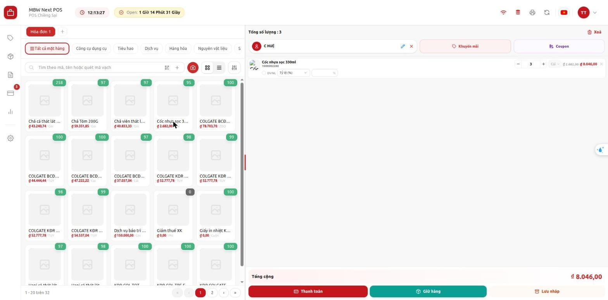
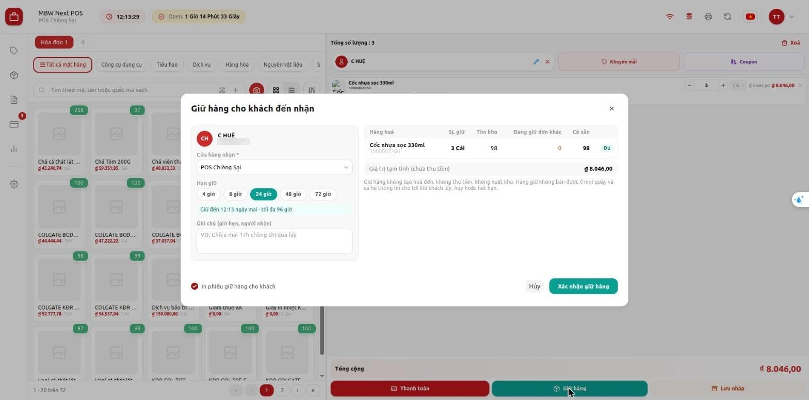
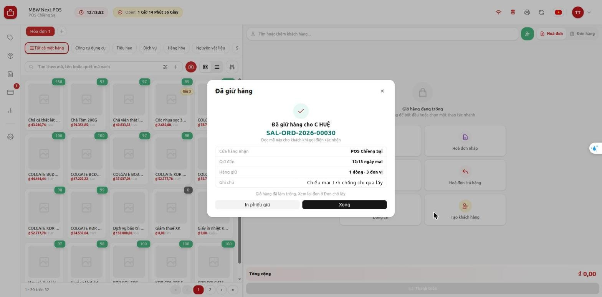
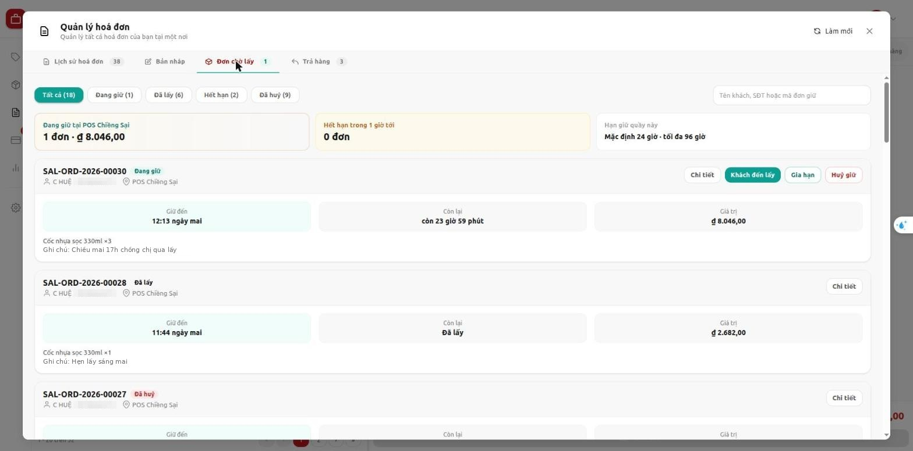
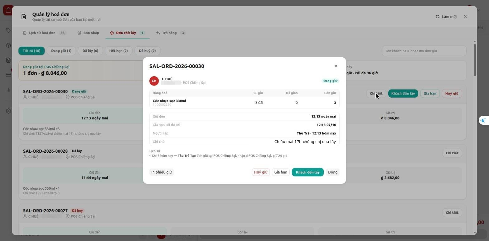
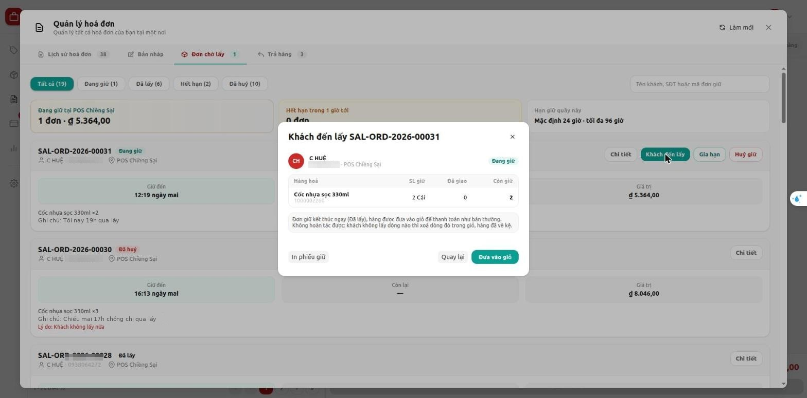
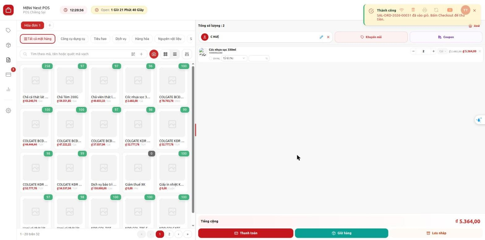
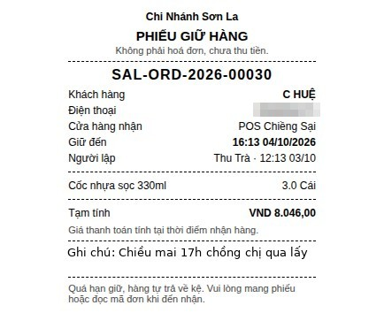
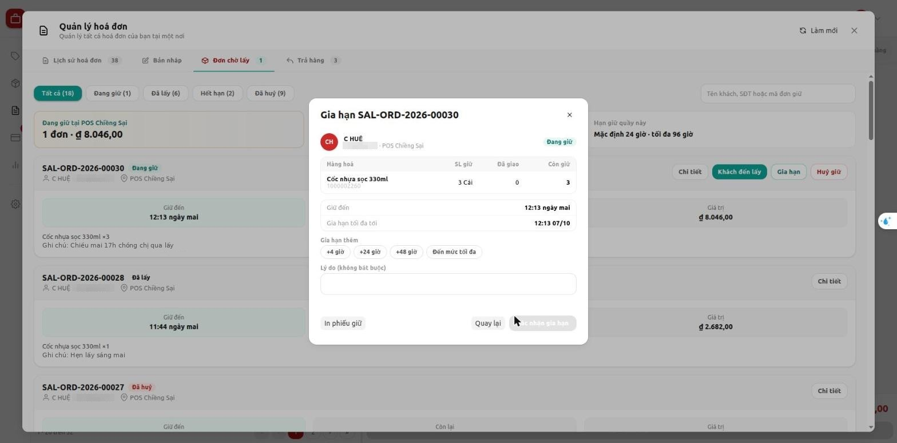
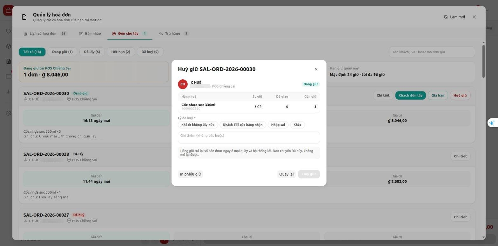

# Hướng dẫn sử dụng: Giữ hàng cho khách đến nhận

> **Phạm vi:** App lõi `pos_next` (POS Next), dùng chung cho mọi khách MBWNext  
> **Đối tượng:** Thu ngân, quản lý cửa hàng  
> **Cập nhật:** 2026-10-03  
> **Mục đích:** Giữ hàng cho khách gọi điện hoặc nhắn đặt trước, rồi giao khi khách đến lấy; gia hạn hoặc huỷ khi khách đổi ý.

Cách bật và phân quyền: xem [giu-hang-cho-khach-den-nhan-cau-hinh.md](giu-hang-cho-khach-den-nhan-cau-hinh.md).
Ảnh chụp trên POS thật (quầy "POS Chiềng Sại"), tài khoản dùng ngôn ngữ tiếng Việt. Tài khoản để tiếng Anh thì tên nút hiện tiếng Anh.

---

## Mục lục

1. [Tính năng này dùng để làm gì](#1-tính-năng-này-dùng-để-làm-gì)
2. [Chuẩn bị trước khi dùng](#2-chuẩn-bị-trước-khi-dùng)
3. [Các bước thực hiện](#3-các-bước-thực-hiện)
4. [Kiểm tra kết quả](#4-kiểm-tra-kết-quả)
5. [Thông báo lỗi thường gặp](#5-thông-báo-lỗi-thường-gặp)
6. [Câu hỏi thường gặp](#6-câu-hỏi-thường-gặp)

---

## 1. Tính năng này dùng để làm gì

Khách gọi điện đặt hàng, hẹn lát nữa hoặc ngày mai qua lấy. Thu ngân giữ hàng cho khách ngay trên POS. Hàng đang giữ không bán được cho người khác, ở mọi quầy.

Giữ hàng **chưa phải bán hàng**: không tạo hoá đơn, không thu tiền, không xuất kho. Khi khách đến, thu ngân đưa hàng vào giỏ rồi thanh toán như bán thường. Quá hạn mà khách không đến, hàng tự trả về kệ.

**Ví dụ tình huống:** Chị Huệ gọi lúc 12 giờ, đặt 3 cốc nhựa, hẹn chiều mai 17 giờ chồng chị qua lấy. Thu ngân giữ 3 cốc trong 24 giờ và ghi chú lại. Chiều mai chồng chị đến, đọc mã đơn. Thu ngân bấm **Khách đến lấy**, hàng vào giỏ, thu tiền như thường.

---

## 2. Chuẩn bị trước khi dùng

- Quầy đã bật giữ hàng: chân giỏ có nút **Giữ hàng** màu xanh ngọc. Không thấy nút thì nhờ quản trị bật (xem file cấu hình).
- Quyền:
  - Tạo đơn giữ, xem danh sách, giao cho khách: thu ngân của quầy.
  - **Gia hạn** và **Huỷ giữ**: quản lý cửa hàng. Thu ngân không thấy hai nút này.
- Khách phải có tên trong hệ thống. Khách lẻ mặc định của quầy không giữ hàng được.
- Cần có mạng. Mất mạng thì không giữ, gia hạn, huỷ hay giao đơn giữ được.

---

## 3. Các bước thực hiện

### Bước 1 — Giữ hàng cho khách

1. Chọn khách ở ô **Tìm hoặc thêm khách hàng**. Khách mới thì bấm nút thêm khách.
2. Thêm hàng vào giỏ như khi bán.
3. Bấm **Giữ hàng** ở chân giỏ.

4. Hộp **Giữ hàng cho khách đến nhận** mở ra:

   | Mục | Làm gì |
   |---|---|
   | **Cửa hàng nhận** | Để nguyên nếu khách lấy ở quầy này. Khách lấy ở cửa hàng khác thì chọn cửa hàng đó |
   | **Hạn giữ** | Chọn 4, 8, 24, 48 hoặc 72 giờ. Dòng xanh bên dưới ghi giờ giữ đến |
   | **Ghi chú** | Ghi giờ hẹn, người đến nhận. Ví dụ: "Chiều mai 17h chồng chị qua lấy" |
   | **In phiếu giữ hàng cho khách** | Tick nếu cần đưa phiếu cho khách |

   Bảng bên phải cho biết **Tồn kho**, **Đang giữ đơn khác**, **Có sẵn** của từng món. Món nào đủ thì ghi **Đủ**.

5. Bấm **Xác nhận giữ hàng**.
6. Hộp **Đã giữ hàng** hiện mã đơn (ví dụ **SAL-ORD-2026-00030**). Đọc mã này cho khách khi gọi điện xác nhận. Bấm **Xong**. Giỏ được làm trống.

> ⚠️ Giữ hàng không thu tiền. Không bấm **Thanh toán** cho đơn giữ cho tới khi khách đến lấy.

### Bước 2 — Xem các đơn đang giữ

1. Mở **Quản lý hoá đơn** ở thanh bên trái.
2. Chọn tab **Đơn chờ lấy**. Số bên cạnh tên tab là số đơn đang giữ.
3. Lọc theo **Đang giữ**, **Đã lấy**, **Hết hạn**, **Đã huỷ**. Tìm theo tên khách, số điện thoại hoặc mã đơn ở ô tìm kiếm.

4. Bấm **Chi tiết** để xem hàng giữ, giờ giữ đến, người lập, ghi chú và lịch sử của đơn.

### Bước 3 — Khách đến lấy

1. Tìm đơn trong tab **Đơn chờ lấy** (theo mã đơn khách đọc hoặc số điện thoại).
2. Bấm **Khách đến lấy**, rồi bấm **Đưa vào giỏ**.

3. Hàng và khách đã có sẵn trong giỏ. Khách không lấy món nào thì xoá món đó khỏi giỏ.
4. Bấm **Thanh toán** và thu tiền như bán thường.

> ⚠️ Bấm **Đưa vào giỏ** là đơn giữ kết thúc ngay (**Đã lấy**), không hoàn tác được. Món khách không lấy sẽ trả về kệ.

### Bước 4 — In lại phiếu giữ

1. Mở **Chi tiết** của đơn.
2. Bấm **In phiếu giữ**.

Phiếu khổ 80mm ghi mã đơn, khách, cửa hàng nhận, giờ giữ đến, hàng giữ, tạm tính và ghi chú.

### Bước 5 — Gia hạn (quản lý cửa hàng)

1. Bấm **Gia hạn** ở đơn đang giữ.
2. Chọn **+4 giờ**, **+24 giờ**, **+48 giờ** hoặc **Đến mức tối đa**. Dòng xanh ghi giờ giữ mới.
3. Ghi lý do nếu cần.
4. Bấm **Xác nhận gia hạn**.

> ⚠️ Không gia hạn quá mức tối đa của quầy, tính từ lúc tạo đơn. Dòng **Gia hạn tối đa tới** ghi mốc này.

### Bước 6 — Huỷ giữ (quản lý cửa hàng)

1. Bấm **Huỷ giữ** ở đơn đang giữ.
2. Chọn lý do: **Khách không lấy nữa**, **Khách đổi cửa hàng nhận**, **Nhập sai** hoặc **Khác**. Ghi thêm nếu cần.
3. Bấm **Huỷ giữ**.

Hàng trả về kệ ngay, bán được ở mọi quầy. Đơn chuyển **Đã huỷ**, không mở lại được.

---

## 4. Kiểm tra kết quả

- Sau khi giữ: thẻ hàng trên POS giảm đúng số đã giữ và có nhãn vàng **Giữ 3**. Đơn hiện trong tab **Đơn chờ lấy** với trạng thái **Đang giữ**.
- Sau khi khách lấy: đơn chuyển **Đã lấy**, hàng có trong giỏ.
- Sau khi huỷ hoặc hết hạn: đơn chuyển **Đã huỷ** / **Hết hạn**, nhãn **Giữ** trên thẻ hàng mất.
- Quầy khác chưa thấy số mới thì tải lại trang POS.

---

## 5. Thông báo lỗi thường gặp

| Thông báo | Nguyên nhân | Cách xử lý |
|---|---|---|
| *Đơn giữ phải có khách có tên. Chọn hoặc tạo khách trước.* | Chưa chọn khách | Chọn khách ở ô tìm khách rồi bấm **Giữ hàng** lại |
| *Đơn giữ phải có khách có tên, không dùng khách lẻ mặc định của quầy* | Đang chọn khách lẻ mặc định | Chọn hoặc tạo khách có tên |
| *Cần kết nối mạng để giữ hàng* | Mất mạng | Chờ có mạng lại (biểu tượng wifi xanh) rồi bấm lại |
| *Mất kết nối mạng — đang hiện danh sách lần tải gần nhất. Gia hạn, huỷ giữ và khách đến lấy cần có mạng.* | Mất mạng khi đang ở tab **Đơn chờ lấy** | Chờ có mạng lại, bấm **Làm mới** |
| *Không đủ hàng để giữ: … cần 4, còn giữ được 3* | Tồn còn lại không đủ, hoặc đơn khác đang giữ | Giảm số lượng giữ, hoặc báo khách số còn lại |
| *Tồn kho vừa thay đổi* | Quầy khác vừa bán hoặc giữ cùng món | Xem lại bảng **Có sẵn** trong hộp giữ, sửa số lượng rồi xác nhận lại |
| *Không giữ được đủ số lượng … Kiểm tra tồn rồi thử lại.* | Hai quầy cùng giữ món cuối gần như cùng lúc; hệ thống đã tự huỷ lần giữ này | Bấm **Giữ hàng** lại để xem số còn giữ được |
| *(… thuộc lô hết hạn / không dùng được)* (đi kèm câu thiếu hàng) | Một phần tồn nằm ở lô hết hạn, không giữ được | Giữ số lượng còn lại, báo thủ kho xử lý lô hết hạn |
| *Không có hàng để giữ* | Giỏ trống hoặc số lượng bằng 0 | Thêm hàng vào giỏ rồi bấm **Giữ hàng** |
| *… không phải cửa hàng nhận đơn giữ* | Cửa hàng nhận đã chọn chưa bật giữ hàng hoặc thuộc công ty khác | Chọn cửa hàng nhận khác trong danh sách |
| *Stock Settings chưa bật giữ tồn (Stock Reservation) nên không giữ hàng được.* | Quản trị đang tắt giữ tồn của cả hệ thống | Báo quản trị (xem file cấu hình, mục 2.1) |
| *Chọn thời gian gia hạn* | Bấm gia hạn khi chưa chọn mức | Chọn **+4 giờ**, **+24 giờ**… rồi bấm **Xác nhận gia hạn** |
| *Nhập lý do huỷ* | Huỷ giữ khi chưa chọn lý do | Chọn một lý do rồi bấm **Huỷ giữ** |
| *Không tìm thấy đơn giữ …* / *Đơn giữ … không thuộc quầy này* | Mã đơn gõ sai, hoặc đơn được giữ cho cửa hàng nhận khác | Kiểm lại mã đơn; đơn của cửa hàng khác thì khách lấy ở cửa hàng đó |
| *… không phải hàng quản lý tồn kho nên không giữ được* | Món là dịch vụ, không theo dõi tồn | Bỏ món đó khỏi giỏ trước khi giữ |
| *… được phép tồn âm nên không giữ được* | Món được bán âm kho | Bỏ món đó khỏi giỏ trước khi giữ |
| *Hạn giữ phải từ 1 đến … giờ* (số giờ tối đa của cửa hàng nhận) | Chọn hạn vượt mức tối đa của cửa hàng nhận | Chọn hạn ngắn hơn |
| *Đơn giữ … không còn giữ hàng. Làm mới danh sách.* | Đơn vừa được người khác huỷ, giao hoặc đã hết hạn | Bấm **Làm mới** ở tab **Đơn chờ lấy** |
| *Đơn này đã giữ tới mức tối đa … giờ* | Đã gia hạn hết mức | Không gia hạn thêm được. Khách cần giữ tiếp thì huỷ đơn cũ rồi tạo đơn mới |
| *… đang bán 97, chỉ bán được 96 — 2 đang giữ cho SAL-ORD-… (C HUỆ, đến …)* | Bán thường lấn vào phần hàng đang giữ cho khách | Bán số lượng còn bán được. Muốn bán phần đang giữ thì quản lý huỷ đơn giữ trước |
| *Bạn không có quyền gia hạn hoặc huỷ đơn giữ tại quầy …* | Tài khoản không có quyền quản lý đơn giữ | Nhờ quản lý cửa hàng gia hạn hoặc huỷ |
| *Bạn không có quyền giữ hàng tại quầy …* / *Bạn không có quyền xem đơn giữ tại quầy …* | Tài khoản chưa được cấp quyền giữ hàng ở quầy này | Nhờ quản trị cấp quyền |

---

## 6. Câu hỏi thường gặp

**Hỏi:** Giữ hàng có tính doanh thu hay thu tiền không?  
**Đáp:** Không. Chỉ khi khách đến lấy và thanh toán mới có hoá đơn.

**Hỏi:** Khách không đến thì sao?  
**Đáp:** Tới giờ giữ đến, hàng tự trả về kệ, đơn chuyển **Hết hạn**. Không cần thao tác gì.

**Hỏi:** Khách lấy thiếu (đặt 3 lấy 2)?  
**Đáp:** Bấm **Khách đến lấy**, xoá bớt số khách không lấy trong giỏ, rồi thanh toán. Phần không lấy trả về kệ ngay.

**Hỏi:** Quầy khác có bán nhầm hàng đang giữ không?  
**Đáp:** Không. POS và desk đều chặn bán phần đang giữ. Nếu quầy khác chưa thấy số mới trên thẻ hàng thì tải lại trang POS.

**Hỏi:** Nút **Lưu nháp** khác gì **Giữ hàng**?  
**Đáp:** **Lưu nháp** chỉ cất tạm giỏ trên máy này, không giữ hàng. Hàng vẫn bán được cho người khác.

**Hỏi:** Có thể huỷ đơn giữ trên desk không?  
**Đáp:** Được. Huỷ (Cancel) hoặc Đóng (Close) Sales Order của đơn giữ trên desk thì hàng trả về kệ, đơn chuyển **Đã huỷ**. Nên huỷ trên POS để ghi lý do.
