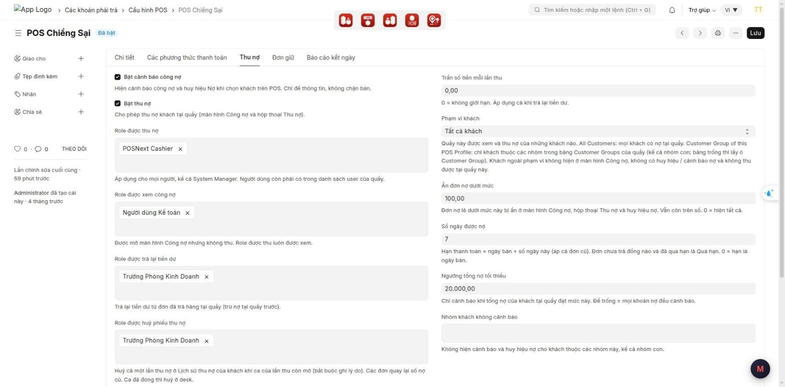
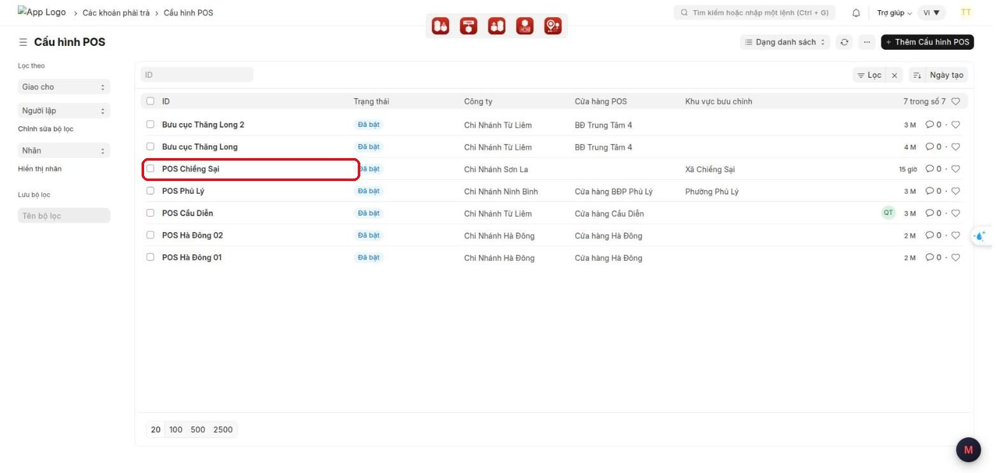
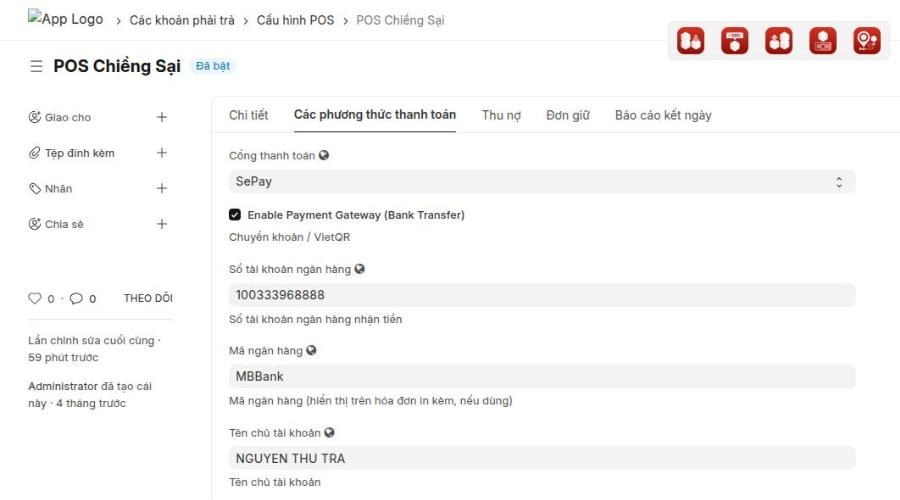
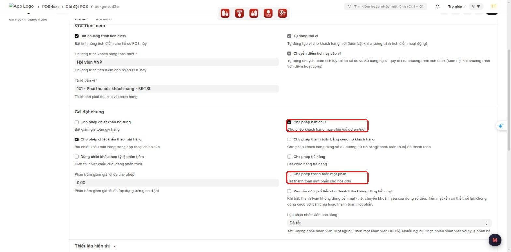
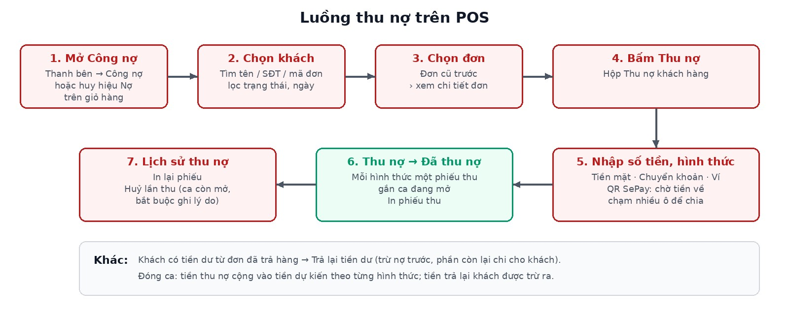

# Hướng dẫn cấu hình: Thu nợ khách hàng trên POS

> **Phạm vi:** App lõi `pos_next` (POS Next), dùng chung cho mọi khách MBWNext
> **Đối tượng:** Quản trị hệ thống, tư vấn triển khai
> **Cập nhật:** 2026-10-03
> **Mục đích:** Bật thu nợ cho từng quầy POS; phân quyền xem / thu / huỷ / trả tiền dư; đặt trần, phạm vi khách, ẩn nợ lẻ, số ngày được nợ; chọn chính sách bán chịu; kiểm lại trước khi giao cho thu ngân.

Cách thu ngân dùng tính năng: xem
[thu-no-khach-hang-tren-pos-van-hanh.md](thu-no-khach-hang-tren-pos-van-hanh.md).
Ảnh chụp trên Desk thật (site pos.next, Cấu hình POS "POS Chiềng Sại"), giao diện tiếng Việt.

---

## Mục lục

1. [Tính năng này dùng để làm gì](#1-tính-năng-này-dùng-để-làm-gì)
2. [Tổng hợp các ô cấu hình](#2-tổng-hợp-các-ô-cấu-hình)
3. [Chuẩn bị trước khi dùng](#3-chuẩn-bị-trước-khi-dùng)
4. [Các bước cấu hình](#4-các-bước-cấu-hình)
5. [Cấu hình mẫu theo kiểu cửa hàng](#5-cấu-hình-mẫu-theo-kiểu-cửa-hàng)
6. [Ai làm được gì](#6-ai-làm-được-gì)
7. [Hạch toán và đóng ca](#7-hạch-toán-và-đóng-ca)
8. [Kiểm tra kết quả](#8-kiểm-tra-kết-quả)
9. [Thông báo lỗi thường gặp](#9-thông-báo-lỗi-thường-gặp)
10. [Câu hỏi thường gặp](#10-câu-hỏi-thường-gặp)
11. [Triển khai cho site mới](#11-triển-khai-cho-site-mới)

---

## 1. Tính năng này dùng để làm gì

Thu ngân xem và thu nợ của khách **ngay trên POS**, thay vì nhờ kế toán tạo phiếu thu ở Desk. Mỗi lần thu tạo
phiếu thu (Payment Entry) gắn vào ca đang mở, nên đóng ca tự cộng tiền thu nợ theo từng hình thức.

Mỗi quầy (mỗi **Cấu hình POS** / POS Profile) cấu hình riêng:

- quầy có thu nợ hay không;
- ai được xem, ai được thu, ai được huỷ lần thu, ai được trả lại tiền dư;
- trần số tiền mỗi lần thu; quầy phục vụ những khách nào;
- ẩn nợ lẻ do làm tròn; số ngày khách được nợ.

Việc quầy có cho bán chịu / trả một phần khi **bán đơn mới** nằm ở **Cài đặt POS** của quầy (Bước 8).

**Ví dụ tình huống:** Cửa hàng cho khách quen ghi sổ 7 ngày. Thu ngân được thu nợ, chỉ trưởng ca được huỷ lần
thu và trả lại tiền dư. Mỗi lần thu tối đa 5.000.000, cao hơn thì nhờ kế toán. Quản trị bật thu nợ, chọn role
tương ứng, đặt trần 5.000.000 và **Số ngày được nợ** 7.

---

## 2. Tổng hợp các ô cấu hình

Các ô nằm trong tab **Thu nợ** của **Cấu hình POS** (cùng tab với các ô của chức năng Cảnh báo công nợ).

| Ô (tiếng Việt) | Tiếng Anh | Kiểu | Mặc định | Tác dụng |
|---|---|---|---|---|
| **Bật thu nợ** | Enable Debt Collection | Tick | Tắt | Bật màn hình **Công nợ** và hộp **Thu nợ** cho quầy |
| **Role được thu nợ** | Roles Allowed to Collect Debt | Chọn nhiều role | Trống | Người có role này được thu (và xem) |
| **Role được xem công nợ** | Roles Allowed to View Debts | Chọn nhiều role | Trống | Chỉ xem màn hình Công nợ, xuất Excel, không thu |
| **Role được trả lại tiền dư** | Roles Allowed to Refund Customer Credit | Chọn nhiều role | Trống | Được dùng **Trả lại tiền dư** |
| **Role được huỷ phiếu thu nợ** | Roles Allowed to Cancel Debt Collections | Chọn nhiều role | Trống | Được **Huỷ lần thu** (chỉ khi ca của lần thu còn mở) |
| **Trần số tiền mỗi lần thu** | Max Amount per Collection | Số tiền | 0 | 0 = không giới hạn. Áp dụng cả khi trả lại tiền dư. Không nhận số âm |
| **Phạm vi khách** | Customer Scope | Chọn | Tất cả khách | **Tất cả khách** hoặc chỉ khách thuộc nhóm khách của quầy (xem Bước 5) |
| **Ẩn đơn nợ dưới mức** | Hide Invoices with Debt Below | Số tiền | 0 | Đơn còn nợ dưới mức này bị ẩn ở POS; vẫn còn trên sổ. 0 = hiện tất cả |
| **Số ngày được nợ** | Credit Days | Số ngày | 0 | Hạn TT = ngày bán + số ngày này (áp cả đơn cũ). 0 = hạn là ngày bán |

Ngoài tab **Thu nợ**:

| Ô | Ở đâu | Tác dụng |
|---|---|---|
| Danh sách người dùng | Cấu hình POS, tab **Chi tiết** | Ai được dùng quầy. Ngoài danh sách thì không xem / thu được, kể cả Administrator |
| Bảng hình thức thanh toán | Cấu hình POS, tab **Chi tiết** | Các hình thức hiện trong hộp Thu nợ (Tiền mặt, Chuyển khoản, ví…) |
| **Cổng thanh toán**, số tài khoản, mã ngân hàng, chủ tài khoản | Cấu hình POS, tab **Các phương thức thanh toán** | Bật **QR SePay** trong hộp Thu nợ |
| **Cho phép bán chịu**, **Cho phép thanh toán một phần** | **Cài đặt POS** của quầy | Đơn mới được ghi nợ hay trả thiếu (Bước 8) |
| Tài khoản của hình thức thanh toán | **Hình thức thanh toán** (Mode of Payment) theo công ty | Tài khoản ghi phiếu thu. Người dùng tự khai (Bước 7) |

---

## 3. Chuẩn bị trước khi dùng

- Quyền cần có: được sửa **Cấu hình POS**, **Cài đặt POS**, **Hình thức thanh toán** (thường là System Manager).
- Đã có các **Role** sẽ gán (vd *POSNext Cashier* cho thu ngân, một role riêng cho trưởng ca).
- Biết chính sách của cửa hàng: cho nợ bao nhiêu ngày, trần mỗi lần thu, ai được huỷ. Hỏi chủ cửa hàng hoặc kế toán trước.
- Mỗi hình thức thanh toán của quầy đã có **tài khoản mặc định** cho công ty của quầy.

---

## 4. Các bước cấu hình

### Bước 1 — Mở Cấu hình POS của quầy

1. Trên Desk, gõ **Cấu hình POS** vào ô tìm kiếm phía trên, mở danh sách **Cấu hình POS**.
2. Bấm vào tên quầy cần cấu hình.

### Bước 2 — Kiểm danh sách người dùng và hình thức thanh toán

1. Ở tab **Chi tiết**, kéo tới bảng người dùng của quầy. Mọi người cần xem hoặc thu nợ ở quầy phải có một dòng.
2. Kéo tới bảng hình thức thanh toán. Hình thức nào có ở đây thì mới hiện trong hộp Thu nợ.
   Hình thức đánh dấu là ví (**Is Wallet Payment**) hiện thành ô ví, chỉ dùng được khi ví khách đủ tiền.

### Bước 3 — Bật thu nợ

1. Bấm tab **Thu nợ**.
2. Tick **Bật thu nợ**.

### Bước 4 — Phân quyền

Chọn role cho 4 ô. Mỗi ô chọn được nhiều role.

| Ô | Gợi ý |
|---|---|
| **Role được thu nợ** | Role của thu ngân (vd *POSNext Cashier*) |
| **Role được xem công nợ** | Kế toán, quản lý chỉ cần xem (vd *Người dùng Kế toán*). Role thu nợ đã tự được xem |
| **Role được trả lại tiền dư** | Trưởng ca / quản lý |
| **Role được huỷ phiếu thu nợ** | Trưởng ca / quản lý |

> ⚠️ Quyền áp cho **mọi người**, kể cả System Manager: không có role trong ô thì không làm được việc đó trên POS.
> Người dùng còn phải nằm trong danh sách người dùng của quầy (Bước 2).

### Bước 5 — Trần, phạm vi khách, nợ lẻ, số ngày được nợ

1. **Trần số tiền mỗi lần thu:** để 0 nếu không giới hạn. Đặt số thì lần thu (hoặc trả tiền dư) lớn hơn sẽ bị chặn.
2. **Phạm vi khách:**
   - **Tất cả khách**: mọi khách có nợ tại quầy.
   - **Customer Group of this POS Profile**: chỉ khách thuộc các nhóm trong bảng **Customer Groups** ở tab
     **Chi tiết** (kể cả nhóm con; bảng trống thì lấy ô **Customer Group**). Khách ngoài phạm vi không hiện ở
     màn Công nợ, không có huy hiệu / cảnh báo nợ, không thu được.
3. **Ẩn đơn nợ dưới mức:** gợi ý 100 – 1.000 để ẩn các đơn chỉ lệch vài đồng do làm tròn.
4. **Số ngày được nợ:** đúng chính sách cửa hàng. Đơn chưa trả đồng nào mà qua hạn sẽ hiện **Quá hạn**.

> Các ô số không nhận giá trị âm; nhập âm thì Desk báo *Giá trị không được âm…* và không lưu.

### Bước 6 — QR SePay (tuỳ chọn)

1. Bấm tab **Các phương thức thanh toán**.
2. Chọn **Cổng thanh toán** = *SePay*, tick **Enable Payment Gateway (Bank Transfer)**.
3. Điền **Số tài khoản ngân hàng**, **Mã ngân hàng**, **Tên chủ tài khoản**.
4. Quầy phải có hình thức **chuyển khoản** trong bảng hình thức thanh toán để ghi nhận tiền QR.

> Webhook SePay phải trỏ về site để tiền về tự tạo phiếu thu. Tiền về sau khi thu ngân đã huỷ mã, hoặc sau khi ca
> đã đóng, sẽ **không** tạo phiếu thu: kế toán đối soát và tạo tay.

### Bước 7 — Kiểm tài khoản của các hình thức thanh toán

Phiếu thu lấy tài khoản từ **Hình thức thanh toán** theo công ty của quầy. Người dùng tự khai cho đúng chế độ kế toán:

- Tiền mặt → tài khoản tiền mặt (111…); chuyển khoản → tài khoản ngân hàng (112…).
- Hình thức **ví** (vd *Đổi điểm*): khai tài khoản theo cách công ty hạch toán điểm ví.
  Không khai tài khoản phải thu (131) cho hình thức ví: ERPNext không cho phiếu thu ghi Nợ 131 / Có 131 cùng khách,
  thu nợ bằng ví sẽ báo lỗi.

### Bước 8 — Bán chịu và thanh toán một phần (trong Cài đặt POS)

Mở **Cài đặt POS** của quầy (POSNext > Cài đặt POS), phần **Cài đặt chung**:

Hai ô độc lập, áp cho **đơn bán mới** (cả đơn bán lúc mất mạng rồi đồng bộ sau):

| Cho phép bán chịu | Cho phép thanh toán một phần | Ghi nợ toàn bộ (khách trả 0) | Khách trả trước một phần |
|---|---|---|---|
| ✓ | ✓ | Được | Được |
| ✓ | ✗ | Được | Được |
| ✗ | ✓ | Không | Được |
| ✗ | ✗ | Không | Không — phải trả đủ |

- Lệch làm tròn ≤ 10 đồng không tính là nợ. Khách trả 1 – 10 đồng coi như chưa trả.
- Quầy **chưa có Cài đặt POS**, hoặc Cài đặt POS đang tắt (**Enabled** bỏ tick): coi như tắt cả hai ô, khách phải trả đủ.

> ⚠️ Hiện thu ngân có quyền sửa Cài đặt POS. Muốn thu ngân không tự bật bán chịu thì bỏ quyền ghi Cài đặt POS
> của role thu ngân.

### Bước 9 — Lưu và cập nhật trên POS

1. Bấm **Lưu** (Ctrl + S).
2. Trên máy POS: bấm biểu tượng đồng bộ trên thanh trên cùng, hoặc tải lại trang. Mục **Công nợ** hiện ở thanh bên.

---

## 5. Cấu hình mẫu theo kiểu cửa hàng

| Kiểu cửa hàng | Bật thu nợ | Trần mỗi lần | Phạm vi | Ẩn nợ dưới | Số ngày được nợ | Bán chịu / Trả một phần |
|---|---|---|---|---|---|---|
| Bán lẻ, ít khi cho nợ | ✓ | 0 | Tất cả | 1.000 | 0–3 | ✗ / ✓ |
| Bán lẻ có khách quen ghi sổ | ✓ | 5.000.000 | Tất cả | 1.000 | 7 | ✓ / ✓ |
| Quầy chỉ phục vụ khách buôn | ✓ | 0 | Theo nhóm | 1.000 | 15–30 | ✓ / ✓ |
| Chỉ bán thu tiền ngay | Không cần | — | — | — | — | ✗ / ✗ |

Đây là gợi ý. Con số thật hỏi chủ cửa hàng hoặc kế toán.

---

## 6. Ai làm được gì

| Người dùng (trong danh sách người dùng của quầy) | Xem Công nợ, Excel | Thu nợ | Huỷ lần thu | Trả lại tiền dư |
|---|---|---|---|---|
| Có role thu nợ | Có | Có (cần ca mở, có mạng) | Chỉ khi có role huỷ | Chỉ khi có role trả tiền dư |
| Chỉ có role xem | Có | Không — POS ghi *Bạn chỉ có quyền xem công nợ…* | Không | Không |
| Không có role nào ở trên | Không thấy mục Công nợ | Không | Không | Không |
| **Không** có trong danh sách người dùng của quầy | Không (kể cả Administrator) | Không | Không | Không |

---

## 7. Hạch toán và đóng ca

| Thao tác trên POS | Chứng từ tạo ra |
|---|---|
| Thu nợ | Mỗi hình thức một **Phiếu thu** (Payment Entry, Nhận tiền) phân bổ vào các hoá đơn, gắn quầy + ca + mã lần thu |
| Huỷ lần thu | Huỷ (cancel) mọi phiếu của lần thu, hoá đơn quay lại số nợ cũ. Không xoá chứng từ |
| Trả lại tiền dư | Một **Bút toán** (Journal Entry) cấn trừ tiền dư vào nợ, và một **Phiếu chi** (Payment Entry, Trả tiền) cho phần trả khách |
| Đóng ca | Tiền dự kiến của từng hình thức cộng tiền thu nợ trong ca, trừ tiền đã trả lại khách |

Phiếu thu ghi diễn giải *Thu nợ tại quầy … (…)*; huỷ trên POS ghi *[POS] Huỷ lần thu nợ tại … bởi … | lý do*.

---

## 8. Kiểm tra kết quả

Sau khi cấu hình, làm thử trên POS theo luồng của thu ngân:

1. Mở POS ở quầy vừa cấu hình, mở ca. Thanh bên có mục **Công nợ**, số đỏ = số khách đang nợ.
2. Mở **Công nợ**, chọn một khách, bấm **Thu nợ**, thu thử một số nhỏ bằng tiền mặt → **Đã thu nợ**, có phiếu thu.
3. Mở **Lịch sử thu nợ** → **Huỷ lần thu** (bằng tài khoản có role huỷ) → nợ quay lại như cũ.
4. Đăng nhập tài khoản chỉ có role xem → thấy Công nợ, không thu được.
5. Nếu dùng phạm vi theo nhóm: chọn khách ngoài nhóm → POS báo *Khách này không thuộc phạm vi khách của quầy*.
6. Bán thử đơn mới trả thiếu → POS cho hay chặn đúng bảng ở Bước 8.

**Checklist giao cho thu ngân:**

- [ ] Đã tick **Bật thu nợ**
- [ ] Đã chọn role cho 4 ô quyền
- [ ] Mọi thu ngân có trong danh sách người dùng của quầy
- [ ] Đã đặt **Số ngày được nợ**, **Ẩn đơn nợ dưới mức**, **Trần** (nếu cần)
- [ ] Hình thức thanh toán của quầy đã có tài khoản đúng; hình thức ví không dùng TK 131
- [ ] Đã kiểm **Cho phép bán chịu / Cho phép thanh toán một phần** trong Cài đặt POS
- [ ] Đã thử đủ 6 bước kiểm tra ở trên

---

## 9. Thông báo lỗi thường gặp

| Thông báo | Nguyên nhân | Cách xử lý |
|---|---|---|
| *Giá trị không được âm đối với Cấu hình POS: Trần số tiền mỗi lần thu* | Nhập số âm | Nhập 0 hoặc số dương rồi lưu lại |
| *Bạn không có quyền xem công nợ tại quầy …* | Người dùng không có role xem / thu, hoặc không có trong danh sách người dùng của quầy | Thêm người dùng vào tab **Chi tiết**, chọn role ở tab **Thu nợ** |
| *Bạn không có quyền thu nợ tại quầy …* | Thiếu role thu nợ | Thêm role vào **Role được thu nợ** |
| *Bạn không có quyền huỷ phiếu thu nợ tại quầy …* | Thiếu role huỷ | Thêm role vào **Role được huỷ phiếu thu nợ** |
| *Bạn không có quyền trả lại tiền dư tại quầy …* | Thiếu role trả tiền dư | Thêm role vào **Role được trả lại tiền dư** |
| *Hình thức … chưa khai cho quầy …* | Hình thức không có trong bảng hình thức thanh toán của quầy | Thêm hình thức vào tab **Chi tiết** |
| *Vui lòng khai tài khoản Tiền mặt/Ngân hàng mặc định cho hình thức thanh toán …, hoặc tài khoản mặc định của công ty …* | Hình thức chưa có tài khoản cho công ty | Mở **Hình thức thanh toán**, thêm dòng tài khoản cho công ty |
| *Customer is required against Receivable account 131…* (khi thu bằng ví) | Hình thức ví khai tài khoản 131 | Đổi tài khoản của hình thức ví theo cách công ty hạch toán điểm ví |
| *Quầy chưa cấu hình SePay* | Chưa bật cổng SePay cho quầy | Làm Bước 6 |
| *Quầy … chưa có hình thức chuyển khoản để ghi nhận tiền QR* | Bảng hình thức của quầy thiếu chuyển khoản | Thêm hình thức chuyển khoản vào quầy |
| *Các đơn dùng tài khoản phải thu khác nhau, hãy thu riêng* | Các đơn chọn cùng lúc ghi nợ vào tài khoản phải thu khác nhau | Thu từng đơn một |
| *Các đơn của khách dùng tài khoản phải thu khác nhau, không trả tiền dư tại quầy được* | Như trên, khi trả tiền dư | Kế toán xử lý ở Desk |
| *Ca … đã đóng. Nhờ kế toán huỷ lần thu này ở desk.* | Huỷ lần thu của ca đã đóng | Kế toán huỷ phiếu thu ở Desk |
| *Quầy … không cho thanh toán một phần hay bán chịu…* / *Quầy … không cho bán chịu…* | Đơn mới trả thiếu so với chính sách ở Bước 8 | Đúng thiết kế. Đổi Cài đặt POS nếu chính sách khác |

---

## 10. Câu hỏi thường gặp

**Hỏi:** Có cần bật Cảnh báo công nợ mới dùng được Thu nợ không?
**Đáp:** Không. Hai chức năng độc lập. Tắt cảnh báo thì bấm huy hiệu **Nợ** trên giỏ là mở thẳng hộp Thu nợ.

**Hỏi:** System Manager có tự được thu nợ không?
**Đáp:** Không. Quyền chỉ theo role chọn trong tab **Thu nợ** và danh sách người dùng của quầy.

**Hỏi:** Đổi **Số ngày được nợ** có ảnh hưởng đơn cũ không?
**Đáp:** Có. Hạn TT tính lúc xem, nên đổi số ngày là các đơn cũ cũng tính lại hạn và trạng thái Quá hạn.

**Hỏi:** Ẩn đơn nợ lẻ có làm mất nợ không?
**Đáp:** Không. Chỉ ẩn trên POS; công nợ trên sổ giữ nguyên, kế toán vẫn xử lý được ở Desk.

**Hỏi:** Huỷ lần thu trên POS có xoá phiếu không?
**Đáp:** Không. Phiếu bị huỷ (cancel), vẫn còn để đối chiếu, kèm người huỷ, giờ và lý do.

**Hỏi:** Khách chỉ có tiền dư, không còn nợ, trả lại tiền ở đâu?
**Đáp:** Màn **Công nợ** → lọc **Có tiền dư** → chọn khách → **Trả lại tiền dư** (cần role trả lại tiền dư).

---

## 11. Triển khai cho site mới

1. Cập nhật app `pos_next` trên site.
2. Chạy `bench --site <site> migrate` để tạo các ô cấu hình và các trường gắn quầy / ca / mã lần thu trên phiếu thu, bút toán.
3. Build lại giao diện POS (`yarn build` trong `apps/pos_next/POS`) và khởi động lại bench.
4. Trên từng máy POS: xoá Service Worker và dữ liệu trang (DevTools → Application → Clear site data), tải lại `/pos`.
5. Cấu hình từng quầy theo mục 4, kiểm theo mục 8.
