# Hướng dẫn sử dụng: Thu nợ khách hàng trên POS

> **Phạm vi:** App lõi `pos_next` (POS Next), dùng chung cho mọi khách MBWNext
> **Đối tượng:** Thu ngân, nhân viên bán hàng, quản lý cửa hàng
> **Cập nhật:** 2026-10-03
> **Mục đích:** Xem khách nào đang nợ tại quầy, thu nợ bằng tiền mặt / chuyển khoản / ví / QR SePay, in phiếu thu, xem lại và huỷ lần thu, trả lại tiền dư cho khách.

Ảnh trong tài liệu chụp trên POS thật (quầy POS Chiềng Sại), giao diện tiếng Việt.
Việc cấu hình quầy (bật thu nợ, phân quyền, trần mỗi lần thu, phạm vi khách, bán chịu) do quản trị làm, xem
[thu-no-khach-hang-tren-pos-cau-hinh.md](thu-no-khach-hang-tren-pos-cau-hinh.md).
Cảnh báo nợ khi chọn khách xem
[canh-bao-cong-no-khi-chon-khach-van-hanh.md](canh-bao-cong-no-khi-chon-khach-van-hanh.md).

---

## Mục lục

1. [Tính năng này dùng để làm gì](#1-tính-năng-này-dùng-để-làm-gì)
2. [Các từ trên màn hình](#2-các-từ-trên-màn-hình)
3. [Thao tác trên POS — nhìn tổng quan](#3-thao-tác-trên-pos--nhìn-tổng-quan)
4. [Chuẩn bị trước khi dùng](#4-chuẩn-bị-trước-khi-dùng)
5. [Các bước thực hiện](#5-các-bước-thực-hiện)
6. [Tình huống mẫu từ đầu đến cuối](#6-tình-huống-mẫu-từ-đầu-đến-cuối)
7. [Kiểm tra kết quả](#7-kiểm-tra-kết-quả)
8. [Thông báo và tình huống thường gặp](#8-thông-báo-và-tình-huống-thường-gặp)
9. [Câu hỏi thường gặp](#9-câu-hỏi-thường-gặp)
10. [Tóm tắt thao tác nhanh](#10-tóm-tắt-thao-tác-nhanh)

---

## 1. Tính năng này dùng để làm gì

Khi khách mua chịu hoặc trả thiếu, hoá đơn còn nợ. Màn hình **Công nợ** trên POS cho thu ngân thấy ngay
khách nào đang nợ tại quầy, nợ ở đơn nào, đơn nào đã quá hạn. Khách quay lại trả tiền thì thu ngay tại
quầy, không cần nhờ kế toán vào Desk.

- Thu một lần cho nhiều đơn; số tiền tự chia vào **đơn cũ trước**.
- Trả bằng **Tiền mặt, Chuyển khoản, Ví (Đổi điểm), QR SePay**, chia được nhiều hình thức trong một lần thu.
- Mỗi lần thu có **phiếu thu** để in, gắn vào **ca** đang mở. Đóng ca tự cộng tiền thu nợ theo từng hình thức.
- Thu nhầm thì **huỷ lần thu** ngay trên POS khi ca còn mở.
- Khách có **tiền dư** từ đơn đã trả hàng thì **trả lại tiền dư**: trừ vào nợ trước, phần còn lại chi cho khách.

**Ví dụ tình huống:** Chị Huế mua hàng hôm 19/05, tổng 117.700, trả trước 100.000, còn nợ 17.700. Hôm nay chị
ghé quầy trả nốt. Thu ngân mở **Công nợ**, chọn Chị Huế, bấm **Thu nợ**, chọn **Tiền mặt**, thu 17.700, in phiếu
thu đưa chị ký.

---

## 2. Các từ trên màn hình

| Từ trên màn hình | Nghĩa |
|---|---|
| **Công nợ** | Màn hình liệt kê khách đang nợ **tại chính quầy này**, cùng công ty. Nợ ở quầy khác không hiện |
| **Còn nợ** | Mọi đơn còn tiền chưa trả (gồm cả quá hạn và đã trả một phần) |
| **Quá hạn** | Đơn **chưa trả đồng nào** và hôm nay đã qua **Hạn TT** |
| **Đã trả một phần** | Đơn khách đã trả một ít, còn nợ phần còn lại |
| **Hạn TT** (hạn thanh toán) | Ngày bán + số ngày được nợ của quầy |
| **Thu lần này** | Số tiền thu cho từng đơn trong lần thu đang làm |
| **Nợ còn lại** | Số nợ của các đơn đã chọn sau khi thu xong |
| **Lần thu** | Một lần bấm **Thu nợ**. Một lần thu có thể gồm nhiều đơn và nhiều phiếu thu (mỗi hình thức một phiếu) |
| **Tiền dư** | Tiền khách đã trả nhưng hàng đã trả lại, quầy còn giữ của khách |
| **Ẩn N đơn nợ lẻ dưới …** | Đơn chỉ còn nợ vài đồng do làm tròn, quầy cài để ẩn. Vẫn còn trên sổ |

---

## 3. Thao tác trên POS — nhìn tổng quan

### Màn hình Công nợ

Màn hình **Công nợ** khi đã chọn một khách. Các số trong ảnh ứng với bảng bên dưới.

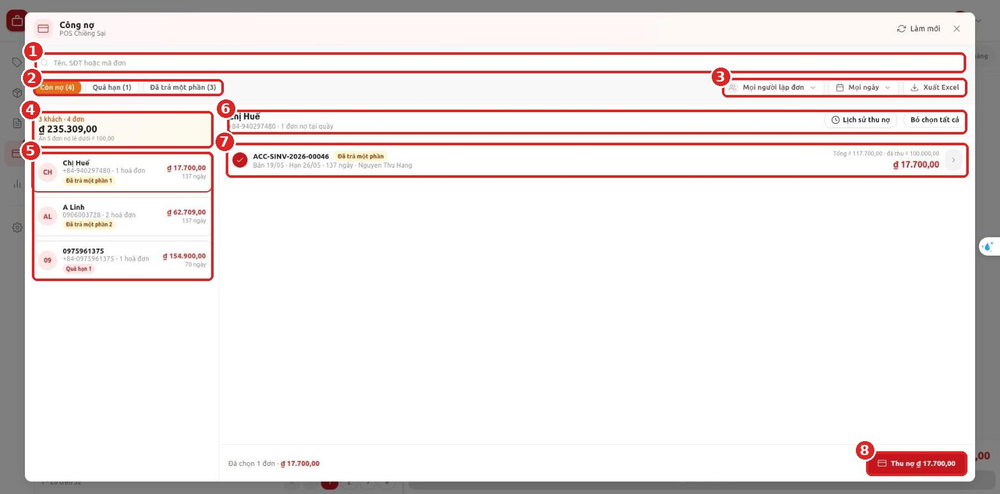

| Số | Vùng | Dùng để làm gì |
|---|---|---|
| 1 | **Ô tìm kiếm** | Gõ tên, số điện thoại hoặc mã đơn |
| 2 | **Lọc trạng thái** | **Còn nợ** / **Quá hạn** / **Đã trả một phần**, số trong ngoặc là số đơn; **Có tiền dư**: khách quầy đang giữ tiền (số trong ngoặc là số khách) |
| 3 | **Người lập đơn**, **Ngày**, **Xuất Excel** | Lọc theo người bán và ngày bán; xuất danh sách nợ đang lọc ra Excel. Ở nhãn **Có tiền dư** ba nút này ẩn |
| 4 | **Ô tổng** | Số khách, số đơn, tổng nợ theo bộ lọc; số đơn nợ lẻ đang ẩn |
| 5 | **Danh sách khách** | Mỗi khách: số đơn, tổng nợ, số ngày nợ của đơn cũ nhất, nhãn trạng thái |
| 6 | **Khách đang chọn** | Tên, SĐT, số đơn nợ; nút **Lịch sử thu nợ**, **Bỏ chọn tất cả** |
| 7 | **Đơn nợ** | Mỗi dòng một đơn: ngày bán, hạn TT, người bán, tổng / đã thu / còn nợ. Bấm vào dòng để chọn hoặc bỏ chọn, bấm **›** để xem chi tiết |
| 8 | Nút **Thu nợ** | Mở hộp thoại thu cho các đơn đang chọn |

### Luồng thao tác

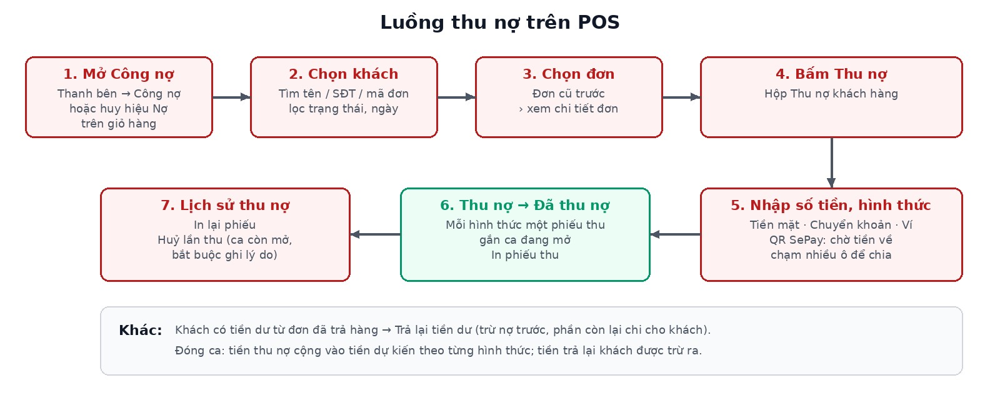

| Bước | Thu ngân làm | POS hiện |
|---|---|---|
| 1 | Bấm **Công nợ** ở thanh bên trái | Màn hình **Công nợ** |
| 2 | Tìm và bấm chọn khách | Các đơn nợ của khách, đã chọn sẵn tất cả |
| 3 | Bỏ chọn đơn khách chưa trả (nếu có) | Tổng ở nút **Thu nợ** đổi theo |
| 4 | Bấm **Thu nợ** | Hộp **Thu nợ khách hàng** |
| 5 | Chọn hình thức, nhập số tiền, bấm **Thu nợ** | Hộp **Đã thu nợ** |
| 6 | Bấm **In phiếu thu** hoặc **Đóng** | Danh sách nợ cập nhật số mới |

---

## 4. Chuẩn bị trước khi dùng

Trước ca bán, kiểm đủ các điểm sau:

- [ ] Đã đăng nhập POS và **mở ca** ở quầy đã được bật thu nợ. Chưa mở ca thì chỉ xem, không thu được.
- [ ] Thanh bên trái có mục **Công nợ** (số đỏ là số khách đang nợ). Không thấy thì tài khoản chưa có quyền xem công nợ.
- [ ] Muốn thu thì tài khoản phải có quyền **thu nợ**. Huỷ lần thu và trả lại tiền dư cần quyền riêng — hỏi quản lý.
- [ ] Máy **có mạng**. Thu nợ, huỷ, trả tiền dư đều cần mạng vì số nợ phải lấy đúng lúc thu.

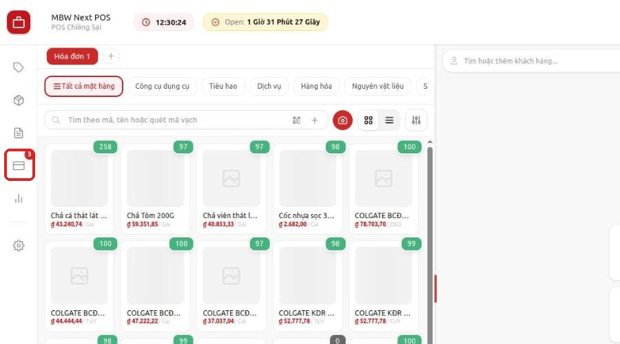

---

## 5. Các bước thực hiện

### Bước 1 — Mở màn hình Công nợ

1. Ở màn hình bán hàng, bấm biểu tượng **Công nợ** ở thanh bên trái (có số đỏ).
2. Màn hình **Công nợ** mở ra, mặc định lọc **Còn nợ**.

Cách khác: khi khách đang nợ được chọn vào giỏ, bấm huy hiệu **Nợ …** cạnh tên khách (xem Bước 10).

### Bước 2 — Tìm khách

1. Gõ tên, số điện thoại hoặc mã đơn vào ô **Tên, SĐT hoặc mã đơn**.
2. Muốn thu hẹp thêm: bấm **Quá hạn** hoặc **Đã trả một phần**, chọn **Người lập đơn** hoặc **Ngày**.

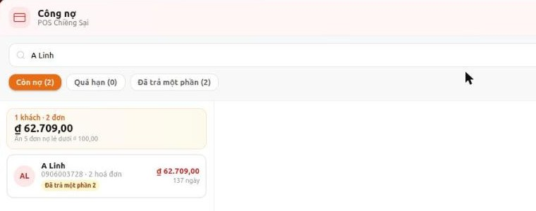

> Khách không hiện trong danh sách: khách không nợ ở quầy này, chỉ nợ ở quầy khác, hoặc không thuộc phạm vi khách của quầy.

### Bước 3 — Chọn khách và kiểm đơn nợ

1. Bấm vào khách ở cột trái. Cột phải hiện các đơn nợ, **đã chọn sẵn tất cả**.
2. Bấm vào dòng đơn để bỏ chọn đơn khách chưa trả lần này. Bấm **Bỏ chọn tất cả** / **Chọn tất cả** để đổi nhanh.
3. Muốn xem trong đơn có hàng gì, đã trả bao nhiêu: bấm **›** cuối dòng.

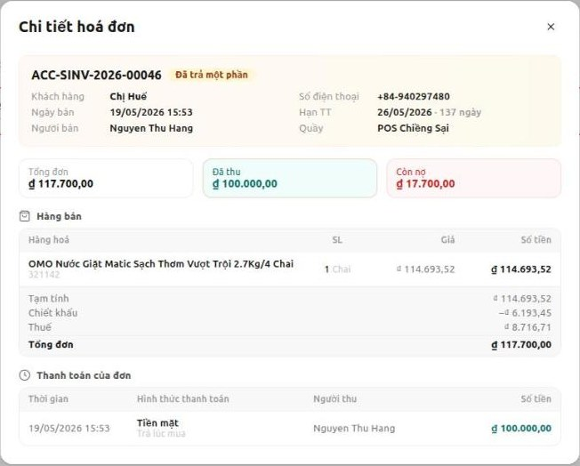

### Bước 4 — Mở hộp Thu nợ

1. Bấm nút đỏ **Thu nợ ₫ …** ở góc dưới bên phải.
2. Hộp **Thu nợ khách hàng** mở ra, số thu mặc định bằng toàn bộ nợ các đơn đã chọn.

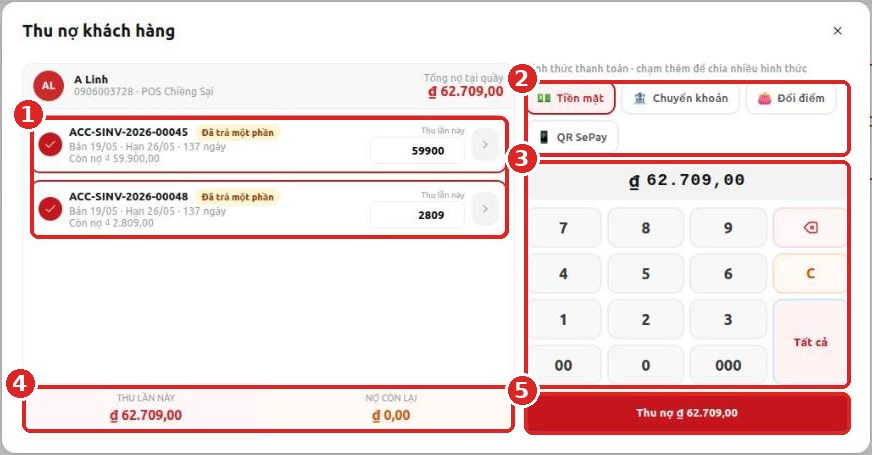

| Số | Vùng | Ghi chú |
|---|---|---|
| 1 | Các đơn đã chọn | Ô **Thu lần này** của từng đơn; sửa tay được |
| 2 | Hình thức thanh toán | **Tiền mặt**, **Chuyển khoản**, **Đổi điểm** (ví), **QR SePay** |
| 3 | Bàn phím số | **Tất cả** = thu đủ toàn bộ nợ; **C** = xoá về 0 |
| 4 | **Thu lần này** / **Nợ còn lại** | Kiểm trước khi bấm thu |
| 5 | Nút **Thu nợ ₫ …** | Ghi nhận lần thu |

### Bước 5 — Nhập số tiền

- **Khách trả hết:** để nguyên số mặc định (hoặc bấm **Tất cả**).
- **Khách trả một phần:** bấm **C**, gõ số khách trả. POS tự chia vào **đơn cũ nhất trước**, đơn sau nhận phần còn lại.

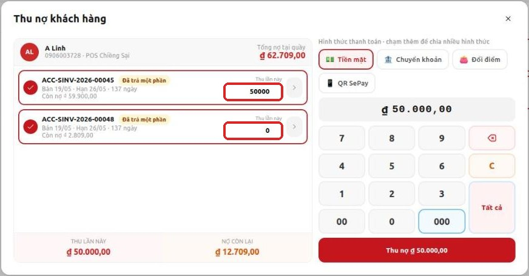

> Muốn thu cho đơn cụ thể thay vì đơn cũ trước: sửa trực tiếp ô **Thu lần này** của từng đơn.

Khách đưa nhiều hơn số nợ thì nút **Thu nợ** bị mờ và POS báo phần thừa trả lại khách. Nhập đúng số nợ cần thu.

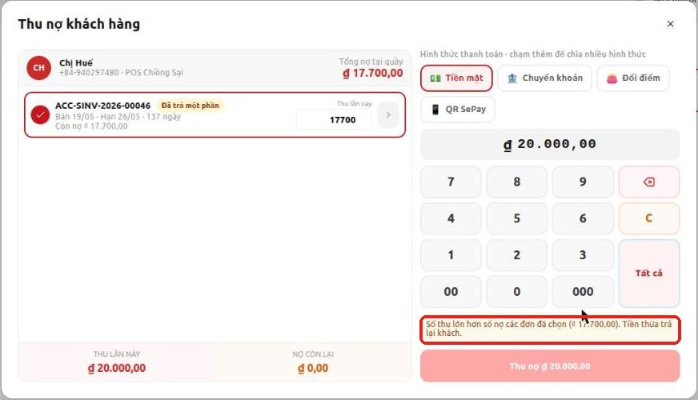

### Bước 6 — Chọn hình thức thanh toán

1. Bấm hình thức khách trả. Mặc định là **Tiền mặt**.
2. **Khách trả bằng nhiều hình thức:** bấm thêm hình thức thứ hai. POS hiện từng dòng hình thức, nhập số cho dòng đầu, **dòng cuối tự nhận phần còn lại**.
3. **Đổi điểm** (ví): chỉ chọn được khi ví của khách đủ tiền.

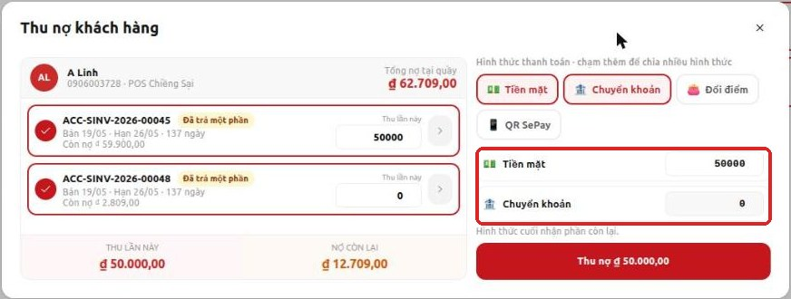

### Bước 7 — Thu bằng QR SePay (khách chuyển khoản qua mã QR)

1. Bấm **QR SePay** (bỏ chọn **Tiền mặt** nếu khách chỉ chuyển khoản).
2. Bấm **Hiện QR ₫ …**. Cho khách quét mã. Nội dung chuyển khoản đã có sẵn trong mã, khách **không sửa nội dung**.
3. Chờ dòng **Đang chờ tiền về...**. Tiền về đúng số và đúng nội dung thì POS tự tạo phiếu thu và hiện **Đã thu nợ**.
4. Khách đổi ý: bấm **Đổi hình thức thanh toán** hoặc **Hủy**. Đang chờ QR thì không đóng hộp được, phải huỷ mã trước.

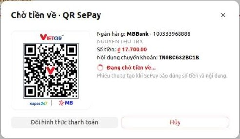

> ⚠️ Đã huỷ mã hoặc đã đóng ca mà khách vẫn chuyển tiền: POS **không** tạo phiếu thu. Báo kế toán đối soát.

### Bước 8 — Bấm Thu nợ và in phiếu thu

1. Bấm **Thu nợ ₫ …**.
2. Hộp **Đã thu nợ** hiện số đã thu, từng phiếu thu theo hình thức, số **Khách còn nợ tại quầy**.
3. Bấm **In phiếu thu** để in phiếu 80mm cho khách ký, hoặc **Đóng**.

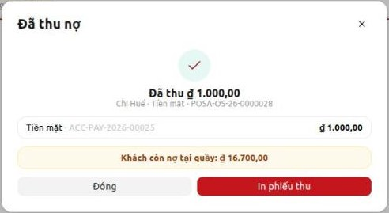

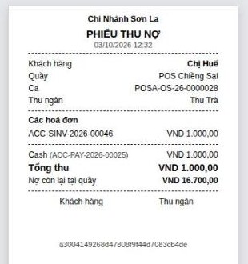

### Bước 9 — Xem lịch sử, in lại hoặc huỷ lần thu

1. Chọn khách, bấm **Lịch sử thu nợ**. Mỗi lần thu hiện ngày giờ, người thu, ca, các đơn đã thu và các phiếu.
2. **In lại:** bấm **In lại** ở lần thu cần in.
3. **Huỷ** (thu nhầm số, nhầm khách): bấm **Huỷ lần thu**, nhập **Lý do (bắt buộc)**, bấm **Huỷ lần thu**.
   Mọi phiếu của lần thu bị huỷ, các đơn quay lại số nợ cũ.

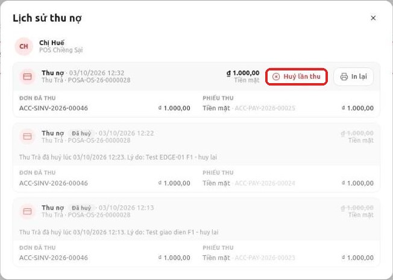

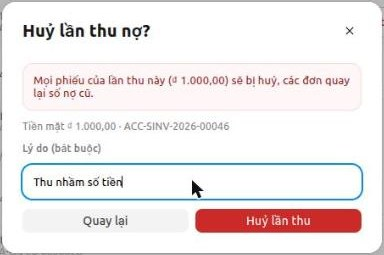

> ⚠️ Chỉ huỷ được lần thu thuộc **ca còn mở**. Ca đã đóng, POS ghi *Ca đã đóng — muốn huỷ thì nhờ kế toán huỷ ở desk*.
> Không có nút **Huỷ lần thu** thì tài khoản không có quyền huỷ — nhờ quản lý.

### Bước 10 — Thu nợ ngay từ giỏ hàng

Khi chọn khách đang nợ vào đơn bán, POS hiện cảnh báo **Khách hàng đang còn nợ** (nếu quầy bật cảnh báo).

1. Bấm **Thu nợ ngay**. Hộp **Thu nợ khách hàng** mở ra với các đơn đã chọn sẵn, làm tiếp như Bước 5 – 8.
2. Bấm **Tiếp tục bán hàng** thì vẫn xem lại được: bấm huy hiệu **Nợ …** cạnh tên khách.
3. Quầy tắt cảnh báo: bấm huy hiệu **Nợ …** là mở thẳng hộp **Thu nợ**.

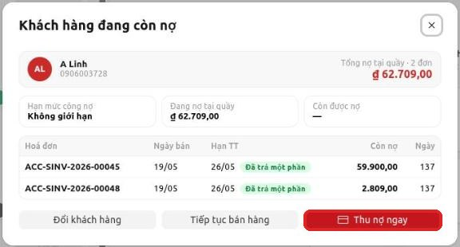

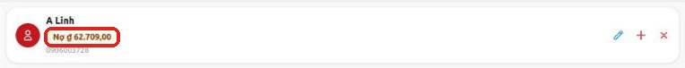

### Bước 11 — Trả lại tiền dư cho khách

Dùng khi khách đã trả hàng và quầy còn giữ tiền của khách.

1. Trên màn hình **Công nợ**, bấm **Có tiền dư** để xem các khách quầy đang giữ tiền (kể cả khách không còn nợ), rồi bấm chọn khách.
   Khách đang nợ cũng có thể chọn ngay ở **Còn nợ**. Có tiền dư thì hiện dòng *Khách có tiền dư … từ … đơn đã trả hàng tại quầy* và nút **Trả lại tiền dư**.
2. Bấm **Trả lại tiền dư**. POS tính: tiền dư **trừ vào nợ của khách tại quầy trước**, phần còn lại trả khách.
3. Chọn hình thức trả (**Tiền mặt** / **Chuyển khoản**), nhập **ghi chú**, bấm xác nhận.

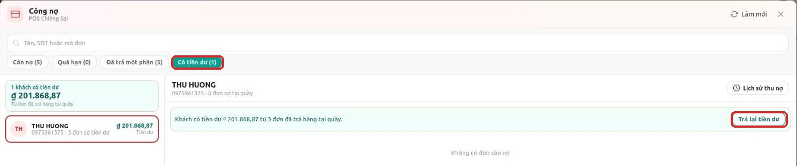

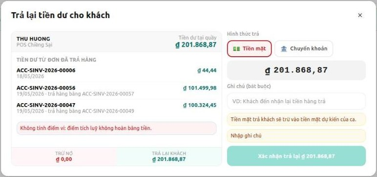

> Điểm tích luỹ trong ví **không** hoàn bằng tiền. Tiền mặt trả khách sẽ trừ vào tiền mặt dự kiến của ca.

### Bước 12 — Khi mất mạng

Mất mạng thì màn hình **Công nợ** hiện dải vàng *Đang mất mạng…*, hộp **Thu nợ** khoá nút và ghi
*Cần kết nối mạng để thu nợ*. Có mạng lại thì nút tự mở, thu bình thường.

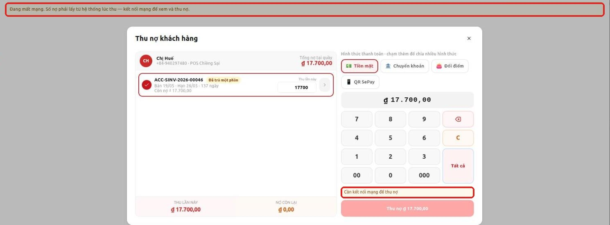

### Bước 13 — Bán đơn mới: trả một phần hoặc ghi nợ

Trong hộp **Hoàn tất thanh toán** của đơn mới:

| Cách khách trả | Nút | Điều kiện của quầy |
|---|---|---|
| Không trả đồng nào, ghi nợ toàn bộ | **Ghi nợ** | Quầy bật **Cho phép bán chịu** |
| Trả trước một phần | **Thanh toán một phần** (sau khi nhập khoản trả) | Quầy bật **Cho phép thanh toán một phần** hoặc **Cho phép bán chịu** |
| Trả đủ | **Hoàn tất thanh toán** | Luôn được |

Khoản trả trước phải lớn hơn 10 đồng; trả 1 – 10 đồng thì nút **Thanh toán một phần** bị mờ.

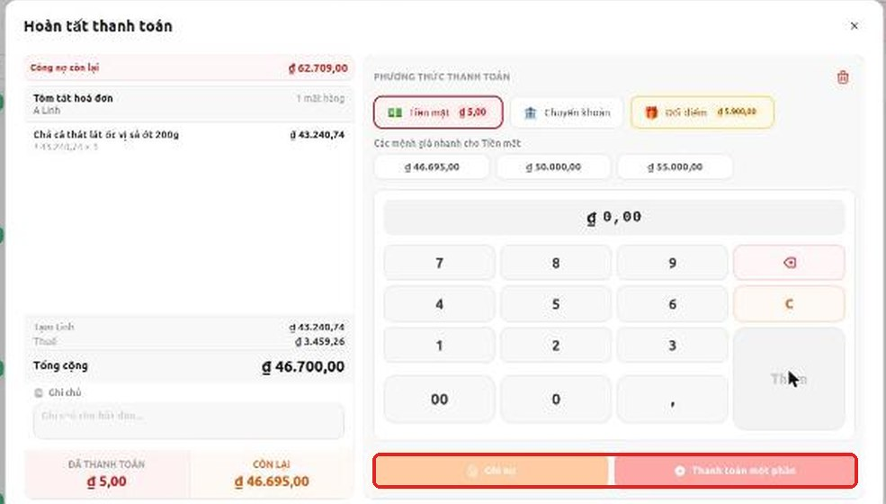

---

## 6. Tình huống mẫu từ đầu đến cuối

### Tình huống A — Khách trả hết nợ bằng tiền mặt

1. **Công nợ** → gõ tên khách → bấm chọn khách.
2. Để nguyên các đơn đã chọn, bấm **Thu nợ**.
3. Để **Tiền mặt**, số mặc định = toàn bộ nợ → bấm **Thu nợ**.
4. **In phiếu thu**, đưa khách ký. Khách biến mất khỏi danh sách nợ.

### Tình huống B — Khách trả một phần, nửa tiền mặt nửa chuyển khoản

1. Chọn khách → **Thu nợ** → bấm **C**, gõ số khách trả (vd 50.000).
2. Bấm thêm **Chuyển khoản**. Dòng **Tiền mặt** nhập 30.000, dòng **Chuyển khoản** tự nhận 20.000.
3. **Thu nợ** → POS tạo 2 phiếu thu (1 tiền mặt, 1 chuyển khoản) trong cùng một lần thu.

### Tình huống C — Khách chuyển khoản qua QR

1. Chọn khách → **Thu nợ** → **QR SePay** → **Hiện QR**.
2. Khách quét, chuyển khoản. Chờ **Đã thu nợ** hiện ra rồi mới cho khách đi.

### Tình huống D — Thu nhầm số tiền

1. Chọn khách → **Lịch sử thu nợ** → **Huỷ lần thu** → nhập lý do *Thu nhầm số tiền* → **Huỷ lần thu**.
2. Thu lại đúng số (Bước 4 – 8).

### Tình huống E — Khách đang mua hàng thì nhớ ra còn nợ

1. Chọn khách vào giỏ → cảnh báo **Khách hàng đang còn nợ** → **Thu nợ ngay**.
2. Thu xong bấm **Đóng**, bán tiếp đơn mới.

### Tình huống F — Hai quầy cùng thu một đơn

Quầy kia vừa thu trước thì POS báo *Đơn … nay chỉ còn nợ …, ít hơn …. Có thể quầy khác vừa thu* và tự tải lại số mới.
Kiểm lại với khách rồi thu phần còn thiếu (nếu có).

---

## 7. Kiểm tra kết quả

| Việc vừa làm | Thấy gì là đúng |
|---|---|
| Thu hết nợ của khách | Khách biến mất khỏi danh sách **Còn nợ**, số đỏ trên thanh bên giảm 1 |
| Thu một phần | Dòng đơn hiện số **còn nợ** mới, nhãn **Đã trả một phần** |
| Thu nhiều hình thức | **Đã thu nợ** liệt kê từng phiếu theo hình thức |
| Huỷ lần thu | **Lịch sử thu nợ** ghi **Đã huỷ** kèm người huỷ, giờ, lý do; đơn quay lại số nợ cũ |
| Cuối ca | **Đóng ca**: tiền thu nợ đã cộng vào tiền dự kiến của từng hình thức |

---

## 8. Thông báo và tình huống thường gặp

| Thông báo / hiện tượng | Nguyên nhân | Cách xử lý |
|---|---|---|
| Không thấy mục **Công nợ** trên thanh bên | Tài khoản không có quyền xem công nợ, hoặc quầy chưa bật thu nợ | Nhờ quản lý cấp quyền |
| *Bạn chỉ có quyền xem công nợ tại quầy này — không thu được.* | Tài khoản chỉ có quyền xem | Nhờ người có quyền thu nợ thu cho khách |
| *Mở ca trước khi thu nợ* / *Cần mở ca tại quầy … để thu nợ* | Chưa mở ca | Mở ca rồi thu lại |
| *Cần kết nối mạng để thu nợ* | Mất mạng | Chờ có mạng, nút tự mở |
| *Chọn ít nhất một đơn* | Đã bỏ chọn hết đơn | Bấm chọn ít nhất một đơn |
| *Số thu lớn hơn số nợ các đơn đã chọn (…). Tiền thừa trả lại khách.* | Nhập số lớn hơn tổng nợ | Bấm **Tất cả** hoặc nhập đúng số nợ, trả lại tiền thừa cho khách |
| *Vượt trần … mỗi lần thu của quầy* / *Số thu … vượt trần … mỗi lần thu của quầy* | Quầy giới hạn số tiền mỗi lần thu | Chia thành nhiều lần thu, hoặc nhờ quản lý |
| *Số dư ví không đủ* / *Số dư ví … không đủ trả …* | Ví của khách không đủ tiền | Giảm số trả bằng ví, phần còn lại trả hình thức khác |
| *Khách này không thuộc phạm vi khách của quầy* | Khách thuộc nhóm khách mà quầy không phục vụ | Không thu tại quầy này; báo quản lý nếu cần |
| *Đơn … nay chỉ còn nợ …, ít hơn …. Có thể quầy khác vừa thu - tải lại rồi thử lại.* | Quầy khác vừa thu đơn này | POS đã tải lại số mới; kiểm lại với khách rồi thu |
| *Mã QR đã hết hạn. Huỷ và tạo mã mới.* | Mã QR quá 30 phút | Bấm **Hủy** rồi **Hiện QR** lại |
| *Huỷ mã QR trước khi đóng* | Đang chờ tiền QR mà bấm đóng | Bấm **Hủy** trên hộp QR trước |
| *Mã lần thu … đã được dùng. Vui lòng tải lại rồi thử lại.* | Lần thu bị gửi trùng từ màn hình cũ | Đóng hộp, bấm **Làm mới**, thu lại |
| *Lần thu này đã lưu trước đó, không tạo phiếu mới.* | Bấm thu hai lần hoặc mạng chập chờn lúc gửi | Không sao: chỉ có một phiếu. Kiểm **Lịch sử thu nợ** |
| *Nhập lý do huỷ* | Huỷ lần thu mà để trống lý do | Nhập lý do rồi bấm lại |
| *Ca đã đóng — muốn huỷ thì nhờ kế toán huỷ ở desk.* | Lần thu thuộc ca đã đóng | Báo kế toán huỷ phiếu thu ở Desk |
| *Nhập ghi chú cho lần trả tiền* | Trả lại tiền dư mà chưa ghi chú | Nhập ghi chú rồi xác nhận |
| *Tiền dư của khách vừa thay đổi (nay trả …). Tải lại rồi thử lại.* | Có thay đổi trong lúc đang mở hộp | Đóng hộp, mở lại **Trả lại tiền dư** |
| *Quầy … không cho thanh toán một phần hay bán chịu. Hoá đơn phải thanh toán đủ (còn thiếu …).* | Bán đơn mới ở quầy không cho nợ | Thu đủ tiền rồi thanh toán lại |
| *Quầy … không cho bán chịu. Khách phải trả trước ít nhất một phần hoá đơn (còn thiếu …).* | Khách trả 0 đồng ở quầy chỉ cho trả một phần | Thu trước ít nhất một phần |
| Khách nợ vài đồng không hiện trong danh sách | Quầy ẩn đơn nợ lẻ dưới mức cài đặt | Không cần xử lý; cần xem thì nhờ quản lý |

---

## 9. Câu hỏi thường gặp

**Hỏi:** Thu một lần cho nhiều đơn thì tiền vào đơn nào trước?
**Đáp:** Đơn cũ nhất trước. Muốn khác thì sửa ô **Thu lần này** của từng đơn.

**Hỏi:** Khách trả bằng hai hình thức thì có mấy phiếu thu?
**Đáp:** Mỗi hình thức một phiếu, cùng nằm trong một lần thu và in chung một tờ.

**Hỏi:** Khách nợ ở cửa hàng khác có thu tại đây được không?
**Đáp:** Không. Mỗi quầy chỉ thấy và thu nợ của đơn bán tại chính quầy đó.

**Hỏi:** Đóng ca rồi mới phát hiện thu nhầm?
**Đáp:** POS không huỷ được nữa. Báo kế toán huỷ phiếu thu ở Desk.

**Hỏi:** Khách chuyển khoản QR nhưng màn hình vẫn "Đang chờ tiền về"?
**Đáp:** Đợi thêm vài giây. Quá lâu thì nhờ khách kiểm nội dung chuyển khoản có đúng mã trên QR không, rồi báo kế toán đối soát.

**Hỏi:** Tiền thu nợ có vào đóng ca không?
**Đáp:** Có. Khi đóng ca, tiền dự kiến của từng hình thức đã gồm tiền thu nợ trong ca; tiền mặt trả lại tiền dư thì bị trừ ra.

**Hỏi:** Có xuất danh sách nợ ra Excel được không?
**Đáp:** Có. Lọc như mong muốn rồi bấm **Xuất Excel**, file gồm đúng các đơn nợ đang lọc. Danh sách khách có tiền dư hiện chưa xuất Excel.

---

## 10. Tóm tắt thao tác nhanh

| Muốn | Làm |
|---|---|
| Xem ai đang nợ | Thanh bên → **Công nợ** |
| Thu nợ | Chọn khách → **Thu nợ** → chọn hình thức → **Thu nợ** |
| Thu một phần | Trong hộp Thu nợ: **C** → gõ số |
| Chia hình thức | Bấm thêm hình thức thứ hai, dòng cuối nhận phần còn lại |
| Thu qua QR | **QR SePay** → **Hiện QR** → chờ **Đã thu nợ** |
| In / in lại phiếu | **In phiếu thu**, hoặc **Lịch sử thu nợ** → **In lại** |
| Huỷ lần thu | **Lịch sử thu nợ** → **Huỷ lần thu** → nhập lý do |
| Thu khi đang bán | Huy hiệu **Nợ …** / **Thu nợ ngay** |
| Trả tiền dư | **Có tiền dư** → chọn khách → **Trả lại tiền dư** |
