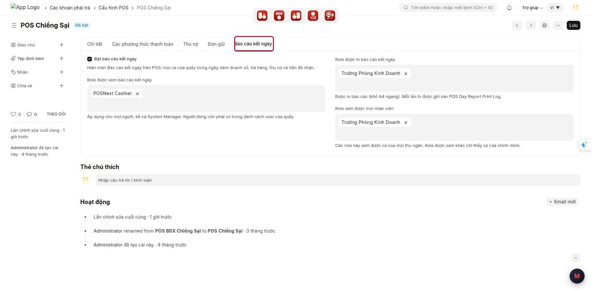
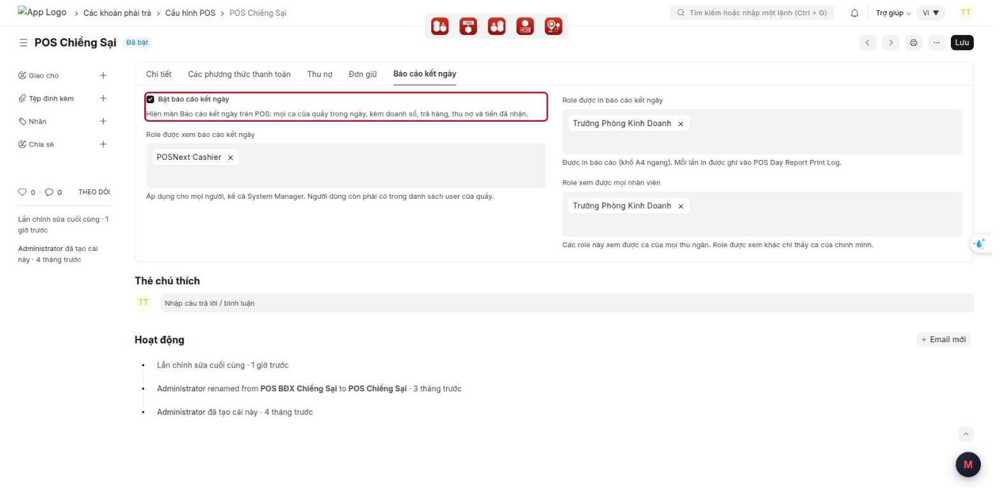
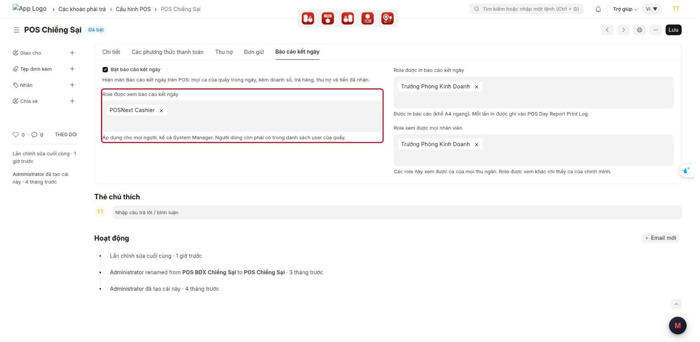
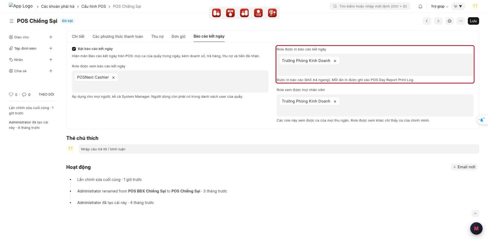
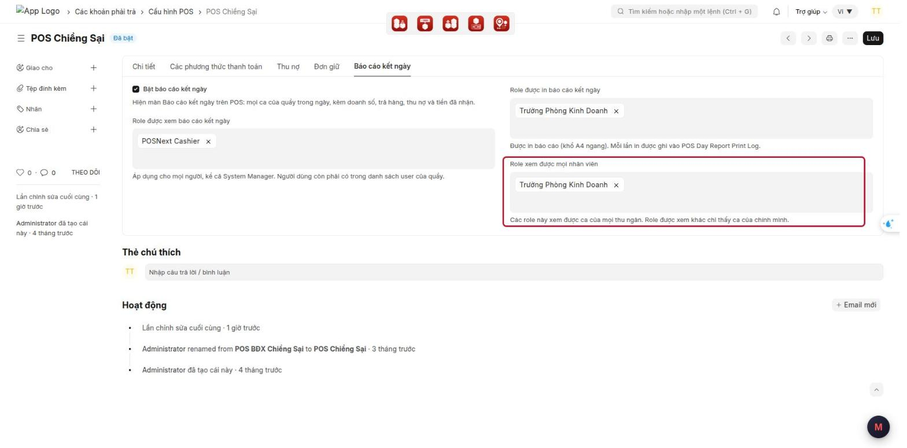
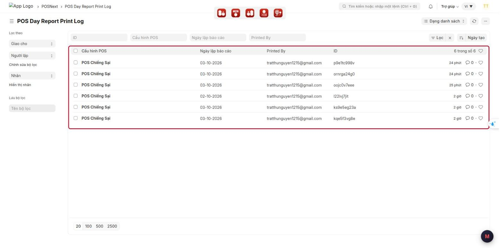

# Hướng dẫn cấu hình: Báo cáo kết ngày theo ca trên POS

> **Phạm vi:** App lõi `pos_next` (POS Next), dùng chung cho mọi khách MBWNext
> **Đối tượng:** Quản trị hệ thống, tư vấn triển khai
> **Cập nhật:** 2026-10-03
> **Mục đích:** Bật Báo cáo kết ngày cho từng quầy POS, phân quyền xem / in / xem mọi nhân viên, và tra lại nhật ký in.

Cách quản lý / thu ngân dùng báo cáo: xem
[xem-bao-cao-ket-ngay-theo-ca-van-hanh.md](xem-bao-cao-ket-ngay-theo-ca-van-hanh.md).
Ảnh chụp trên Desk thật (site pos.next, Cấu hình POS "POS Chiềng Sại"), giao diện tiếng Việt.

---

## Mục lục

1. [Tính năng này dùng để làm gì](#1-tính-năng-này-dùng-để-làm-gì)
2. [Tổng hợp các ô cấu hình](#2-tổng-hợp-các-ô-cấu-hình)
3. [Chuẩn bị trước khi dùng](#3-chuẩn-bị-trước-khi-dùng)
4. [Các bước cấu hình](#4-các-bước-cấu-hình)
5. [Cấu hình mẫu](#5-cấu-hình-mẫu)
6. [Ai thấy gì](#6-ai-thấy-gì)
7. [Nhật ký in](#7-nhật-ký-in)
8. [Kiểm tra kết quả](#8-kiểm-tra-kết-quả)
9. [Thông báo lỗi thường gặp](#9-thông-báo-lỗi-thường-gặp)
10. [Câu hỏi thường gặp](#10-câu-hỏi-thường-gặp)
11. [Triển khai cho site mới](#11-triển-khai-cho-site-mới)

---

## 1. Tính năng này dùng để làm gì

Thêm màn hình **Báo cáo kết ngày** vào POS: mọi ca của một quầy trong một ngày, kèm doanh thu, VAT, tiền hoàn
trả hàng, tổng bán, tiền thu nợ và tiền thật đã nhận (theo hình thức), có dòng tổng và in A4. Số liệu tính lại
từ hoá đơn và phiếu đóng ca của từng ca, khớp với phiếu đóng ca.

Mỗi quầy (mỗi **Cấu hình POS**) bật riêng và phân quyền riêng: ai được xem, ai được in, ai thấy ca của mọi thu
ngân. Báo cáo chỉ đọc, không ghi gì vào dữ liệu bán hàng (ngoài nhật ký in).

**Ví dụ tình huống:** Cửa hàng muốn cửa hàng trưởng xem và in báo cáo của mọi thu ngân, còn thu ngân chỉ tự
xem ca của mình, không in. Quản trị đặt: Role xem = thu ngân; Role in và Role xem mọi nhân viên = cửa hàng trưởng.

---

## 2. Tổng hợp các ô cấu hình

Tất cả nằm trong tab **Báo cáo kết ngày** của **Cấu hình POS**.

| Ô (tiếng Việt) | Tiếng Anh | Kiểu | Mặc định | Tác dụng |
|---|---|---|---|---|
| **Bật báo cáo kết ngày** | Enable Day Report | Tick | Tắt | Hiện biểu tượng Báo cáo kết ngày trên POS của quầy |
| **Role được xem báo cáo kết ngày** | Roles Allowed to View Day Report | Chọn nhiều role | Trống | Được mở báo cáo. Không có role xem mọi nhân viên thì chỉ thấy ca của mình |
| **Role được in báo cáo kết ngày** | Roles Allowed to Print Day Report | Chọn nhiều role | Trống | Có nút **In báo cáo** (A4 ngang). Role in cũng được xem |
| **Role xem được mọi nhân viên** | Roles That See All Cashiers | Chọn nhiều role | Trống | Thấy ca của mọi thu ngân và có bộ lọc thu ngân. Role này cũng được xem |

Ba bảng role chỉ hiện khi đã tick **Bật báo cáo kết ngày**.

Ngoài tab này, người dùng còn phải nằm trong **danh sách người dùng của quầy** (tab **Chi tiết** của Cấu hình POS).

---

## 3. Chuẩn bị trước khi dùng

- Quyền cần có: được sửa **Cấu hình POS** (thường là System Manager / quản trị).
- Biết cửa hàng dùng role nào cho thu ngân, cửa hàng trưởng, kế toán (ví dụ **POSNext Cashier**, **Trưởng Phòng Kinh Doanh**).
- Người cần xem báo cáo đã có trong danh sách người dùng của quầy.

---

## 4. Các bước cấu hình

### Bước 1 — Mở tab "Báo cáo kết ngày" của quầy

1. Trên Desk, gõ **Cấu hình POS** vào ô tìm kiếm, mở danh sách, bấm vào tên quầy.
2. Bấm tab **Báo cáo kết ngày** (tab cuối, sau **Đơn giữ**).

### Bước 2 — Bật báo cáo

Tick **Bật báo cáo kết ngày**.

- Tick: hiện 3 bảng role bên dưới; POS của quầy có biểu tượng **Báo cáo kết ngày** (với người có quyền).
- Bỏ tick: biểu tượng biến mất trên POS (sau khi tải lại trang), mọi người đều không xem được.

### Bước 3 — Chọn role được xem

1. Bấm vào ô **Role được xem báo cáo kết ngày**.
2. Gõ tên role, **bấm chọn** trong danh sách gợi ý. Chọn được nhiều role.

> Áp dụng cho **mọi người, kể cả System Manager**: không có role trong bảng thì không xem được. Người dùng còn
> phải có trong danh sách user của quầy.

### Bước 4 — Chọn role được in

Chọn role vào ô **Role được in báo cáo kết ngày**.

- Người có role này thấy nút **In báo cáo**, in khổ **A4 ngang**.
- Mỗi lần in được ghi vào **POS Day Report Print Log** (mục 7).
- Không cần chọn lại role này ở ô xem — role in tự được xem.

### Bước 5 — Chọn role xem được mọi nhân viên

Chọn role vào ô **Role xem được mọi nhân viên**.

- Role này thấy ca của **mọi thu ngân** trong quầy, có bộ lọc thu ngân / người kết ca.
- Role chỉ có quyền xem (không có role này) chỉ thấy **ca của chính mình**; ô lọc hiện "Chỉ ca của bạn".

### Bước 6 — Lưu và cập nhật trên POS

1. Bấm **Lưu** (Ctrl+S).
2. Trên máy POS đang mở: tải lại trang (hoặc bấm đồng bộ) để biểu tượng mới hiện ra.

---

## 5. Cấu hình mẫu

| Kiểu cửa hàng | Role xem | Role in | Role xem mọi nhân viên |
|---|---|---|---|
| Cửa hàng có cửa hàng trưởng, thu ngân tự xem ca mình | Thu ngân (POSNext Cashier) | Cửa hàng trưởng | Cửa hàng trưởng |
| Chỉ quản lý / kế toán xem, thu ngân không xem | (trống) | Cửa hàng trưởng, Kế toán | Cửa hàng trưởng, Kế toán |
| Cửa hàng 1 người | (trống) | Role của người đó | Role của người đó |

---

## 6. Ai thấy gì

| Người dùng (có trong danh sách user của quầy) | Mở được báo cáo | Thấy ca của | Nút In |
|---|---|---|---|
| Có role xem mọi nhân viên + role in | Có | Mọi thu ngân | Có |
| Có role xem mọi nhân viên | Có | Mọi thu ngân | Không |
| Chỉ có role xem | Có | Chỉ ca của mình | Không |
| Có role in, không có role xem mọi nhân viên | Có | Chỉ ca của mình | Có |
| Không có role nào trong 3 bảng | Không | — | — |
| **Không** nằm trong danh sách user của quầy (kể cả Administrator) | Không | — | — |

---

## 7. Nhật ký in

Mỗi lần bấm **In báo cáo**, hệ thống ghi một dòng **POS Day Report Print Log**: quầy, ngày báo cáo, người in,
giờ in, bộ lọc, số ca.

Xem: trên Desk gõ **POS Day Report Print Log** vào ô tìm kiếm.

Chỉ System Manager / kế toán xem được nhật ký này. Dùng để biết ai đã in báo cáo ngày nào, lúc nào.

---

## 8. Kiểm tra kết quả

1. Đăng nhập POS bằng tài khoản có role xem mọi nhân viên + role in → có biểu tượng **Báo cáo kết ngày**, thấy
   mọi ca, có bộ lọc thu ngân, có nút **In báo cáo**.
2. Đăng nhập bằng thu ngân chỉ có role xem → chỉ thấy ca của mình, ô lọc ghi "Chỉ ca của bạn", không có nút In.
3. Chọn một ngày đã đóng ca, so **Tổng bán** từng ca với **Tổng doanh số thuần** trên phiếu đóng ca → bằng nhau.
4. Bấm **In báo cáo** → trang A4 ngang; mở **POS Day Report Print Log** thấy thêm 1 dòng.

**Checklist giao cho cửa hàng:**

- [ ] Đã tick **Bật báo cáo kết ngày**
- [ ] Đã chọn role xem / in / xem mọi nhân viên theo mục 5
- [ ] Người dùng cần xem đã có trong danh sách user của quầy
- [ ] Đã thử đủ 4 bước kiểm tra ở trên

---

## 9. Thông báo lỗi thường gặp

| Thông báo / hiện tượng | Nguyên nhân | Cách xử lý |
|---|---|---|
| Người dùng không thấy biểu tượng **Báo cáo kết ngày** | Quầy chưa tick **Bật báo cáo kết ngày**; người đó không có role trong 3 bảng; không có trong danh sách user của quầy; hoặc POS chưa tải lại | Kiểm bước 2–5 và tab **Chi tiết**, **Lưu**; trên POS tải lại trang |
| *Bạn không có quyền xem báo cáo kết ngày tại quầy …* | Như trên | Như trên |
| *Bạn không có quyền in báo cáo kết ngày tại quầy …* | Người dùng không có role trong **Role được in báo cáo kết ngày** | Thêm role vào bảng in (bước 4), **Lưu** |
| Quản lý chỉ thấy ca của chính mình | Thiếu role trong **Role xem được mọi nhân viên** | Thêm role (bước 5), **Lưu**, tải lại POS |
| System Manager / Administrator không xem được | Quyền báo cáo theo quầy, áp dụng cả System Manager | Thêm tài khoản vào danh sách user của quầy và thêm role vào bảng |
| Sau khi cập nhật bản mới, POS chưa có biểu tượng | Trình duyệt còn bản cũ (Service Worker) | Tải lại trang; vẫn chưa có thì xoá dữ liệu trang (DevTools → Application → Clear site data) |

---

## 10. Câu hỏi thường gặp

**Hỏi:** Có cần chọn role in vào cả ô xem không?
**Đáp:** Không. Role in và role xem mọi nhân viên tự được xem.

**Hỏi:** Báo cáo có xem được của quầy khác không?
**Đáp:** Không. Mỗi quầy chỉ xem ca của chính quầy đó, cùng công ty.

**Hỏi:** Báo cáo có làm thay đổi phiếu đóng ca, hoá đơn không?
**Đáp:** Không. Báo cáo chỉ đọc; thứ duy nhất được ghi là nhật ký in.

**Hỏi:** Có in khổ giấy nhiệt 80mm được không?
**Đáp:** Không. Báo cáo chỉ in khổ A4 ngang.

**Hỏi:** Số trên báo cáo có khớp phiếu đóng ca không?
**Đáp:** Có. Tổng bán của ca bằng Tổng doanh số thuần trên phiếu đóng ca; tiền theo hình thức bằng phần kỳ
vọng tăng thêm trong ca (không lấy số đếm thực tế).

---

## 11. Triển khai cho site mới

1. Cập nhật app `pos_next`, chạy `bench --site <site> migrate` (tạo tab và các ô cấu hình, DocType nhật ký in).
2. Build giao diện POS (`yarn build` trong `apps/pos_next/POS`), khởi động lại bench.
3. Trên từng máy POS: tải lại trang, nếu chưa thấy biểu tượng thì xoá dữ liệu trang.
4. Cấu hình từng quầy theo mục 4, kiểm theo mục 8.
