# Hướng dẫn sử dụng: Báo cáo kết ngày theo ca trên POS

> **Phạm vi:** App lõi `pos_next` (POS Next), dùng chung cho mọi khách MBWNext
> **Đối tượng:** Quản lý cửa hàng, kế toán, thu ngân được cấp quyền xem
> **Cập nhật:** 2026-10-09
> **Mục đích:** Xem lại tổng kết mọi ca bán hàng trong một ngày của cửa hàng (bán, trả hàng, thu nợ, tiền đã nhận), lọc theo người, đối chiếu với phiếu đóng ca và in báo cáo A4.

Ảnh trong tài liệu chụp trên POS thật (quầy POS Chiềng Sại, ngày 03/10/2026), giao diện tiếng Việt.
Việc bật báo cáo và phân quyền do quản trị làm, xem
[xem-bao-cao-ket-ngay-theo-ca-cau-hinh.md](xem-bao-cao-ket-ngay-theo-ca-cau-hinh.md).

---

## Mục lục

1. [Tính năng này dùng để làm gì](#1-tính-năng-này-dùng-để-làm-gì)
2. [Các từ trên màn hình](#2-các-từ-trên-màn-hình)
3. [Chuẩn bị trước khi dùng](#3-chuẩn-bị-trước-khi-dùng)
4. [Các bước thực hiện](#4-các-bước-thực-hiện)
5. [Tình huống mẫu](#5-tình-huống-mẫu)
6. [Kiểm tra kết quả](#6-kiểm-tra-kết-quả)
7. [Thông báo và tình huống thường gặp](#7-thông-báo-và-tình-huống-thường-gặp)
8. [Câu hỏi thường gặp](#8-câu-hỏi-thường-gặp)
9. [Tóm tắt thao tác nhanh](#9-tóm-tắt-thao-tác-nhanh)

---

## 1. Tính năng này dùng để làm gì

Màn hình **Báo cáo kết ngày** trong POS liệt kê **mọi ca** của cửa hàng trong một ngày. Mỗi ca là một dòng:
giờ mở → giờ kết ca, thu ngân, số lượng bán, doanh thu, VAT, tiền hoàn trả hàng, tổng bán, tiền thu nợ và
**tiền thật đã nhận**. Cuối bảng có dòng tổng. Quản lý không phải vào Desk mở từng phiếu đóng ca nữa.

Báo cáo **chỉ để xem và in**, không sửa được số liệu nào.

**Ví dụ tình huống:** Cuối ngày 03/10, quản lý cửa hàng mở Báo cáo kết ngày, thấy 2 ca: ca sáng đã kết
(Tổng bán 14.894,28, Thực thu 70.397,27) và ca chiều đang mở. Quản lý bấm vào ca sáng để xem tiền mặt và
chuyển khoản, đối chiếu với tiền trong két, rồi in báo cáo để ký.

---

## 2. Các từ trên màn hình

| Từ trên màn hình | Nghĩa | Cách tính |
|---|---|---|
| **Doanh thu** | Giá trị hàng bán **trước VAT**, đã trừ chiết khấu | Cộng các đơn bán của ca (không tính phiếu trả) |
| **VAT** | Thuế GTGT trên hàng bán | Cộng thuế các đơn bán |
| **Phí trả hàng** | Tiền hoàn cho khách khi trả hàng trong ca (gồm VAT) | Cộng giá trị các phiếu trả lập **trong ca này** |
| **Tổng bán** | Doanh số thuần của ca | Doanh thu + VAT − Phí trả hàng |
| **Thu nợ** | Tiền khách trả nợ cũ trong ca | Cộng các phiếu thu nợ của ca (phiếu đã huỷ không tính) |
| **Thực thu** | Tiền thật đã vào két / tài khoản trong ca | Tiền mặt + chuyển khoản/QR, gồm cả thu nợ; **không** gồm phần bán chịu và thanh toán bằng ví (điểm) |
| **Số lượng** | Số sản phẩm bán ra và số đơn bán | Chưa trừ hàng trả |
| **Tạm tính đến HH:mm** | Ca chưa kết, số liệu tính tới lúc xem | — |
| **Kết ca: <tên>** | Người lập phiếu đóng ca | — |

**Vì sao Tổng bán + Thu nợ thường khác Thực thu?** Vì có đơn bán chịu (chưa thu tiền), thanh toán bằng ví
(điểm, không phải tiền) và làm tròn tiền. Báo cáo ghi rõ phần chênh này khi bấm vào ca (Bước 5).

---

## 3. Chuẩn bị trước khi dùng

- [ ] Đã đăng nhập POS và mở ca ở quầy đã được quản trị bật Báo cáo kết ngày.
- [ ] Tài khoản có role được xem báo cáo. Muốn **in** cần thêm role được in; muốn thấy **mọi thu ngân** cần role xem mọi nhân viên.
- [ ] Máy **có mạng**: báo cáo tính trên máy chủ, mất mạng thì không xem được.

---

## 4. Các bước thực hiện

### Bước 1 — Mở Báo cáo kết ngày

1. Ở màn hình bán hàng, nhìn thanh biểu tượng bên trái.
2. Bấm biểu tượng **cột** (**Báo cáo kết ngày**), nằm dưới biểu tượng Công nợ.

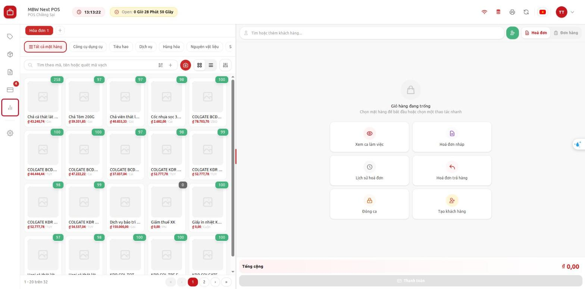

**Kết quả:** màn hình **Báo cáo kết ngày** mở ra, dưới tiêu đề là tên quầy · công ty. Ngày mặc định là
**Hôm nay**.

> Không thấy biểu tượng này: quầy chưa bật báo cáo hoặc tài khoản chưa có quyền xem — báo quản trị.

### Bước 2 — Chọn ngày và bộ lọc

Thanh dưới tiêu đề có 3 ô: **ngày**, **thu ngân**, **người kết ca**. Góc phải ghi "Ca tính theo ngày mở ca ·
số liệu lấy lúc HH:mm".

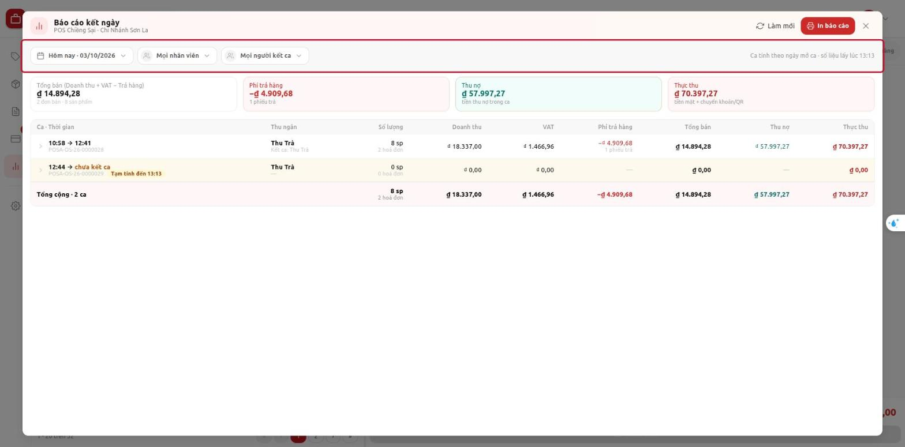

**Chọn ngày:**

1. Bấm ô ngày (**Hôm nay · dd/mm/yyyy**).
2. Bấm **Hôm nay**, **Hôm qua**, hoặc chọn ngày trên lịch (dùng mũi tên ‹ › để đổi tháng).

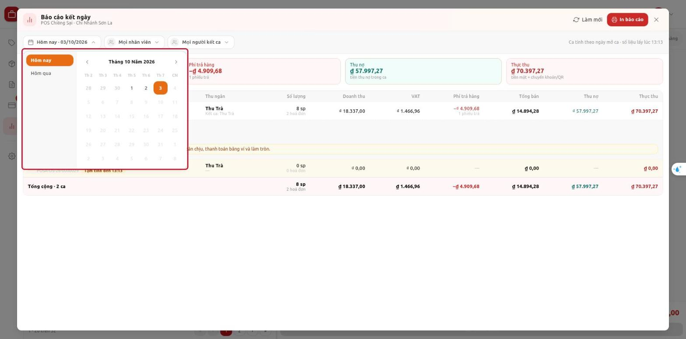

- Ngày tương lai bị mờ, không chọn được.
- Ca mở trước nửa đêm và kết ca sang ngày sau vẫn tính vào **ngày mở ca**.

**Lọc theo thu ngân:**

1. Bấm ô **Mọi nhân viên**.
2. Chọn tên thu ngân (gõ vào ô **Tìm kiếm...** nếu danh sách dài). Chọn **Mọi nhân viên** để bỏ lọc.

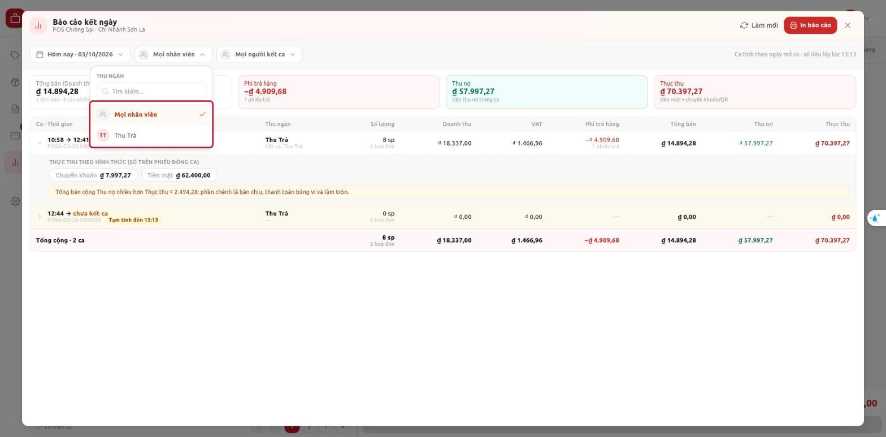

- Danh sách chỉ gồm những người **có ca trong ngày** đã chọn.
- Ô **Mọi người kết ca** lọc theo người lập phiếu đóng ca, dùng giống hệt.
- Lọc xong, bảng, dòng tổng và 4 thẻ số đều tính lại theo bộ lọc.

> Tài khoản chỉ được xem ca của chính mình thì ô lọc thu ngân hiện **Chỉ ca của bạn**, không đổi được.

### Bước 3 — Đọc 4 thẻ tổng

Bốn thẻ ngay dưới thanh bộ lọc là tổng của **mọi ca đang hiển thị**:

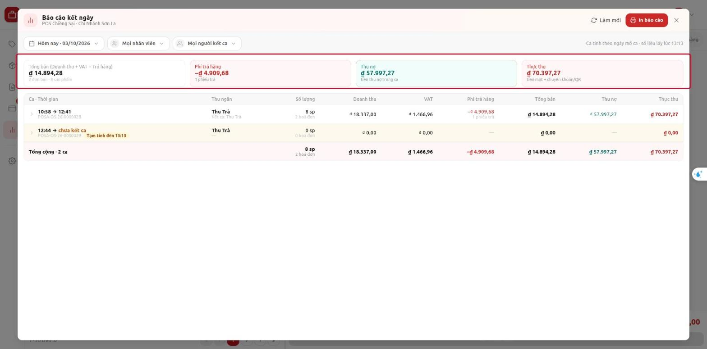

| Thẻ | Ý nghĩa | Dòng nhỏ bên dưới |
|---|---|---|
| **Tổng bán (Doanh thu + VAT − Trả hàng)** | Doanh số thuần cả ngày | số đơn bán · số sản phẩm |
| **Phí trả hàng** (đỏ, số âm) | Tiền đã hoàn cho khách | số phiếu trả |
| **Thu nợ** (xanh) | Tiền thu nợ cũ | tiền thu nợ trong ca |
| **Thực thu** | Tiền thật đã nhận | tiền mặt + chuyển khoản/QR |

### Bước 4 — Đọc bảng các ca

Mỗi dòng là một ca, xếp theo giờ mở ca. Dòng cuối **Tổng cộng · N ca** là tổng của các dòng trên.

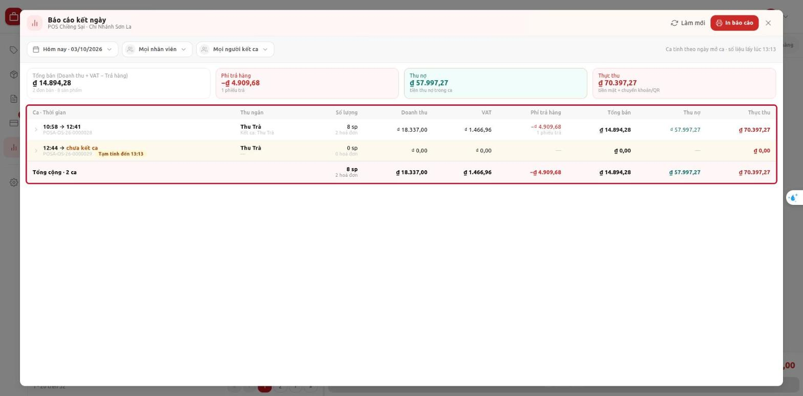

| Cột | Ví dụ ca 28 | Ghi chú |
|---|---|---|
| **Ca · Thời gian** | 10:58 → 12:41, POSA-OS-26-0000028 | Giờ mở → giờ kết ca, dưới là mã ca |
| **Thu ngân** | Thu Trà, "Kết ca: Thu Trà" | Người bán ca này, dưới là người lập phiếu đóng ca |
| **Số lượng** | 8 sp, 2 hoá đơn | Chưa trừ hàng trả |
| **Doanh thu** | 18.337,00 | Trước VAT |
| **VAT** | 1.466,96 | |
| **Phí trả hàng** | −4.909,68, 1 phiếu trả | |
| **Tổng bán** | 14.894,28 | = 18.337 + 1.466,96 − 4.909,68 |
| **Thu nợ** | 57.997,27 | |
| **Thực thu** | 70.397,27 | |

**Ca chưa kết** có nền vàng, ghi **chưa kết ca** và nhãn **Tạm tính đến HH:mm**: số liệu là tạm tính tới
lúc xem, sẽ còn thay đổi khi thu ngân bán tiếp.

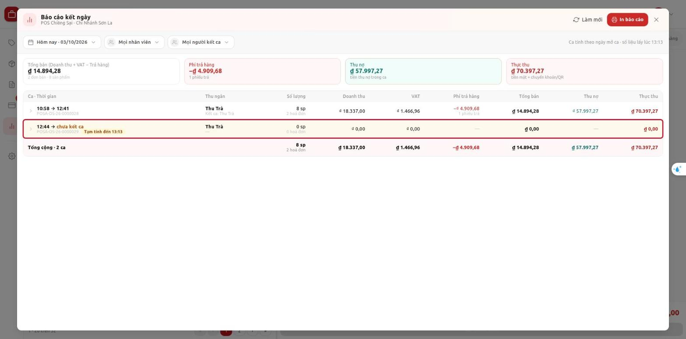

### Bước 5 — Xem tiền thu theo từng hình thức

1. Bấm vào một dòng ca (hoặc mũi tên › đầu dòng).
2. Dòng phụ mở ra: **Thực thu theo hình thức** — tiền mặt, chuyển khoản… của ca đó.
3. Bấm lại để thu gọn.

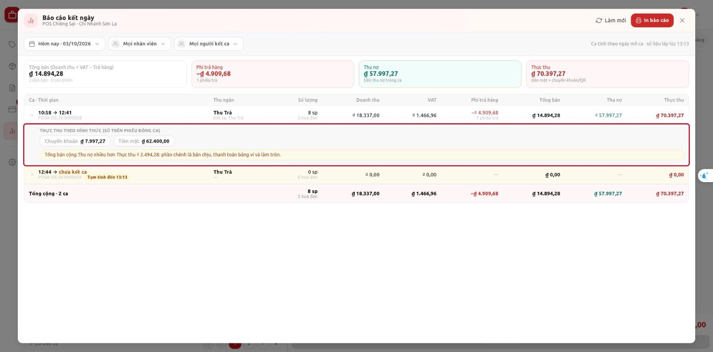

| Ca | Tiêu đề dòng phụ | Số liệu |
|---|---|---|
| Đã kết ca | **Thực thu theo hình thức (số trên phiếu đóng ca)** | Đúng số **kỳ vọng** đã đối soát trên phiếu đóng ca (không lấy số đếm thực tế) |
| Chưa kết ca | **Thực thu theo hình thức (tạm tính)** | Tính tới lúc xem |

- Dòng vàng **Tổng bán cộng Thu nợ nhiều hơn Thực thu …: phần chênh là bán chịu, thanh toán bằng ví và làm
  tròn** giải thích phần chênh. Ví dụ ca 28: 14.894,28 + 57.997,27 − 70.397,27 = 2.494,28 (khách nợ lại 2.500,
  trừ lệch làm tròn).
- Thanh toán bằng **ví / điểm** (ví dụ **Đổi điểm**) hiện gạch ngang, ghi **ví — không tính**: không cộng vào Thực thu.

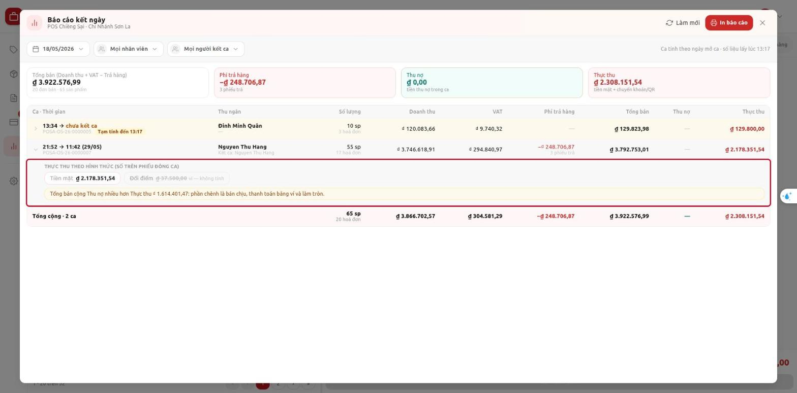

Ảnh trên cũng là ví dụ ca **qua đêm**: mở 21:52 ngày 18/05, kết ca 11:42 ngày 29/05, vẫn nằm ở báo cáo ngày
18/05.

### Bước 6 — Làm mới số liệu

Bấm **Làm mới** ở góc trên để tải lại số liệu (ví dụ ca đang mở vừa bán thêm). Giờ "số liệu lấy lúc …" cập
nhật theo.

### Bước 7 — In báo cáo

1. Chọn ngày và bộ lọc muốn in (bản in theo đúng bộ lọc đang chọn).
2. Bấm **In báo cáo** (nút đỏ góc trên bên phải).

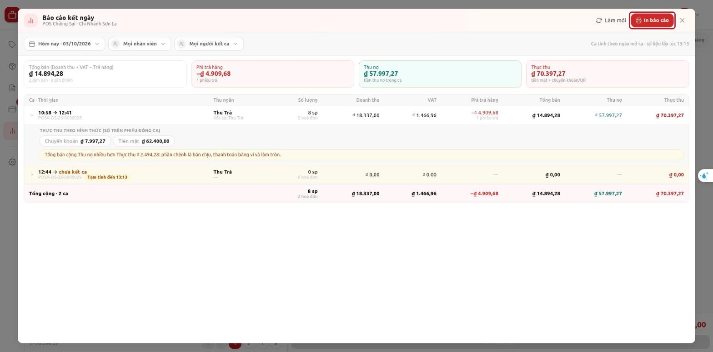

3. Một tab mới mở trang in **khổ A4 ngang** và hộp in của trình duyệt tự bật. Chọn máy in, bấm **In**.

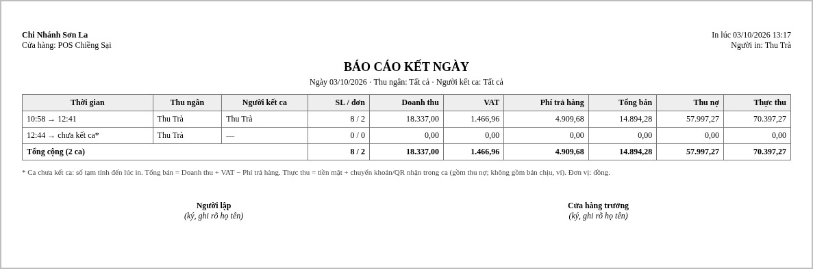

Trang in gồm: công ty, cửa hàng, giờ in, người in; ngày và bộ lọc; bảng các ca (10 cột) và dòng tổng; chú thích
công thức; chỗ ký **Người lập** và **Cửa hàng trưởng**. Ca chưa kết ghi "chưa kết ca*" (số tạm tính lúc in).

- Không có nút **In báo cáo**: tài khoản không có role được in.
- Mỗi lần bấm In, hệ thống ghi lại ai in, in lúc nào, ngày và bộ lọc nào.

---

## 5. Tình huống mẫu

### Tình huống A — Cuối ngày, quản lý chốt số của cả cửa hàng

1. Mở **Báo cáo kết ngày** (ngày mặc định Hôm nay).
2. Kiểm mọi ca đã **kết ca** (không còn dòng nền vàng). Còn ca chưa kết thì nhắc thu ngân đóng ca.
3. Bấm từng ca xem **Thực thu theo hình thức**, đối chiếu tiền mặt trong két và sao kê chuyển khoản.
4. Bấm **In báo cáo**, ký **Cửa hàng trưởng**.

### Tình huống B — Kế toán xem lại một ngày cũ

1. Bấm ô ngày → dùng mũi tên ‹ để lùi tháng → chọn ngày.
2. Đối chiếu dòng **Tổng bán** từng ca với phiếu đóng ca trên Desk (hai số phải bằng nhau).

### Tình huống C — Xem riêng ca của một thu ngân

1. Bấm **Mọi nhân viên** → chọn tên thu ngân.
2. Bảng và 4 thẻ chỉ còn ca của người đó. In nếu cần (bản in ghi rõ "Thu ngân: <tên>").

### Tình huống D — Thu ngân tự xem ca của mình

1. Thu ngân có role xem mở **Báo cáo kết ngày**.
2. Chỉ thấy ca của chính mình (ô lọc ghi **Chỉ ca của bạn**). Không có nút In nếu không có role in.

---

## 6. Kiểm tra kết quả

| Việc | Thấy gì là đúng |
|---|---|
| Mở báo cáo hôm nay | Có đủ các ca mở trong ngày, ca đang mở có nền vàng "chưa kết ca" |
| So một ca đã kết với phiếu đóng ca | **Tổng bán** bằng Tổng doanh số thuần trên phiếu đóng ca; tiền mặt / chuyển khoản bằng phần kỳ vọng tăng thêm |
| Đổi bộ lọc | Bảng, dòng tổng và 4 thẻ tính lại |
| Bấm In báo cáo | Trang A4 ngang có đúng ngày, bộ lọc, các ca và dòng tổng như trên màn hình |

---

## 7. Thông báo và tình huống thường gặp

Ví dụ chọn một ngày cửa hàng không mở ca nào:

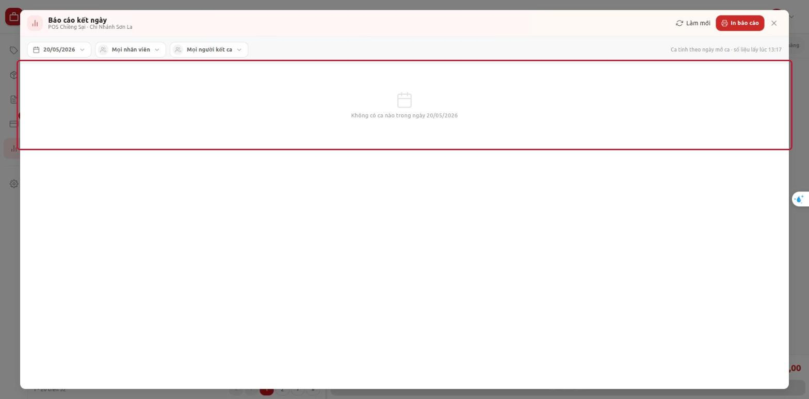

| Thông báo / hiện tượng | Nguyên nhân | Cách xử lý |
|---|---|---|
| Không thấy biểu tượng **Báo cáo kết ngày** | Quầy chưa bật báo cáo, hoặc tài khoản không có role xem, hoặc POS còn bản cũ | Báo quản trị; nếu vừa cập nhật thì tải lại trang POS |
| *Không có ca nào trong ngày dd/mm/yyyy* | Ngày đó cửa hàng không mở ca nào | Chọn ngày khác |
| *Không có ca nào khớp bộ lọc trong ngày …* | Người được chọn không có ca / không kết ca nào trong ngày | Chọn **Mọi nhân viên** / **Mọi người kết ca** |
| *Bạn đang ngoại tuyến. Báo cáo kết ngày được tính trên máy chủ — hãy kết nối mạng để xem.* | Mất mạng (hoặc máy chủ trả lời chậm lúc mở) | Kiểm mạng rồi bấm **Thử lại** trên dải vàng (hoặc **Làm mới**). Có mạng lại thì báo cáo tự hiện |
| Không có nút **In báo cáo** | Tài khoản không có role được in | Nhờ người có quyền in, hoặc báo quản trị |
| *Bạn không có quyền in báo cáo kết ngày tại quầy …* | Mở trang in khi không có role in | Như trên |
| *Bạn không có quyền xem báo cáo kết ngày tại quầy …* | Không có role xem, hoặc không nằm trong danh sách người dùng của quầy | Báo quản trị |
| Bấm In nhưng không thấy hộp in | Trình duyệt chặn cửa sổ mới | Cho phép cửa sổ bật lên (pop-up) với trang POS rồi bấm In lại |
| Ca đang mở thay đổi số mỗi lần xem | Số tạm tính, ca vẫn đang bán | Bình thường; số chốt khi thu ngân đóng ca |
| Tổng bán + Thu nợ khác Thực thu | Có bán chịu, trả bằng ví, làm tròn | Bình thường; xem dòng vàng giải thích ở Bước 5 |

---

## 8. Câu hỏi thường gặp

**Hỏi:** Ca mở tối hôm trước, sáng hôm sau mới kết ca thì nằm ở ngày nào?
**Đáp:** Ngày **mở ca**. Ví dụ ca mở 21:52 ngày 18/05 thuộc báo cáo 18/05.

**Hỏi:** Khách trả hàng hôm nay cho đơn mua hôm qua thì tính vào đâu?
**Đáp:** Vào **Phí trả hàng** của ca lập phiếu trả (hôm nay). Báo cáo hôm qua không đổi.

**Hỏi:** Thực thu có tính tiền thu nợ không?
**Đáp:** Có, vì tiền thu nợ cũng vào két. Cột **Thu nợ** tách riêng để biết bao nhiêu là tiền nợ cũ.

**Hỏi:** Thanh toán bằng điểm / ví có vào Thực thu không?
**Đáp:** Không. Ví là điểm của khách, không phải tiền; báo cáo hiện riêng và ghi "ví — không tính".

**Hỏi:** Phiếu thu nợ đã huỷ có bị cộng không?
**Đáp:** Không.

**Hỏi:** Thu ngân đếm két dư / thiếu lúc đóng ca thì Thực thu lấy số nào?
**Đáp:** Lấy số **kỳ vọng** (theo chứng từ). Phần dư / thiếu vẫn nằm trên phiếu đóng ca để quản lý xử lý.

**Hỏi:** Sửa số trên báo cáo được không?
**Đáp:** Không. Báo cáo chỉ xem và in; muốn sửa phải sửa chứng từ gốc (hoá đơn, phiếu thu…).

**Hỏi:** Giờ kết ca trên báo cáo sớm hơn lúc bấm Đóng ca vài phút?
**Đáp:** Giờ kết ca là giờ thu ngân **mở hộp Đóng ca**, theo phiếu đóng ca.

---

## 9. Tóm tắt thao tác nhanh

| Muốn | Làm |
|---|---|
| Mở báo cáo | Thanh bên trái → biểu tượng cột **Báo cáo kết ngày** |
| Xem ngày khác | Ô ngày → **Hôm qua** hoặc chọn trên lịch |
| Xem một thu ngân | **Mọi nhân viên** → chọn tên |
| Xem tiền mặt / chuyển khoản của ca | Bấm vào dòng ca |
| Cập nhật số mới | **Làm mới** |
| In | **In báo cáo** → chọn máy in → **In** |
